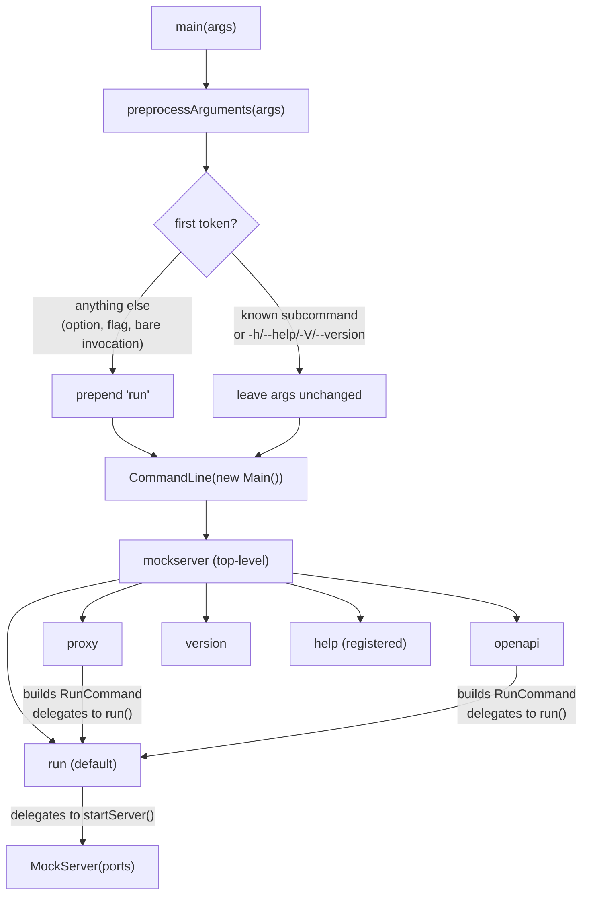
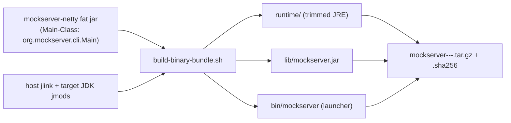

# CLI Architecture

MockServer's command-line interface is built with [picocli](https://picocli.info/) and lives entirely in `org.mockserver.cli.Main`. The entry point is unchanged from earlier releases — Docker's `ENTRYPOINT` and all existing shell scripts still invoke `Main.main()`. The visible change is that the old monolithic argument parser has been replaced by a proper picocli command tree with four named subcommands, while full backward compatibility with pre-existing single-dash legacy flags is preserved.

## Command tree



## Subcommands

| Subcommand | Class | Purpose |
|---|---|---|
| `run` (default) | `Main.RunCommand` | Start MockServer in mock/proxy mode |
| `ui` | `Main.UiCommand` | Start MockServer (default port 1080) and open the dashboard UI in a browser; delegates to `RunCommand.run()` then calls `openDashboard()` |
| `proxy` | `Main.ProxyCommand` | Syntactic sugar — starts MockServer with `--proxy-to` set, delegates to `RunCommand.run()` |
| `openapi` | `Main.OpenApiCommand` | Start MockServer, pre-load expectations from an OpenAPI spec; delegates to `RunCommand.run()` |
| `import` | `Main.ImportCommand` | Load expectations from a JSON file into an **already-running** MockServer (connects as a `MockServerClient`; does not start a server) |
| `lint` | `Main.LintCommand` | Check expectation JSON files offline (no server) for expectations that can never match or will not match as written, using `ExpectationLinter` from core; advisory, it changes nothing (see [`lint` subcommand](#lint-subcommand)) |
| `demo` | `Main.DemoCommand` | Start MockServer (default port 1080), seed a small set of example expectations (`GET /hello`, `GET /users/{id}`) via `MockServerClient`, then print a getting-started URL, the dashboard URL, and a sample `curl`; delegates to `RunCommand.run()` then `seedDemoExpectations()` / `printDemoInstructions()` (only when the server actually started) |
| `version` | `Main.VersionCommand` | Print `Version.getVersion()` and exit |
| `help` | `CommandLine.HelpCommand` (picocli built-in, registered in `@Command(subcommands = {...})`) | Print usage for the top command or any subcommand — `mockserver help` or `mockserver help <subcommand>` |

`ui`, `proxy`, `openapi` and `demo` are thin wrappers: they construct a `RunCommand` instance, populate the relevant fields (including any `-D` system properties), and call `runCmd.run()`. All actual wiring of `ConfigurationProperties` and server startup lives in `RunCommand`. `ui` additionally opens `http://localhost:<firstPort>/mockserver/dashboard` after startup (only when the server actually started); `demo` additionally seeds example expectations and prints getting-started instructions (also gated on `runCmd.started`, so a no-port/validation/bind failure does not print misleading guidance). `demo` registers its expectations with a plain `MockServerClient` and deliberately does **not** use try-with-resources — `MockServerClient.close()` sends a stop request, which would shut the demo server down immediately.

### `--print-config` (top-level diagnostic)

`Main.main()` scans the raw arguments for `--print-config` **before** picocli parsing (the same place the legacy `-help`/`-version` single-dash forms are normalised) and, if present, prints the effective configuration and exits without starting a server. The output comes from `ConfigurationProperties.effectiveConfigurationAsText()`: one `name = value   [source]` line per recognised `mockserver.*` property, where `source` is the winning tier (`system-property`, `properties-file`, `environment-variable`, `default`, or `runtime-set` for a value applied at runtime via a programmatic setter). Properties at their built-in default show that default's value, read from the property's own getter, and any other property ends its line `(default: ...)` with the built-in default it replaced (see [configuration-reference.md](configuration-reference.md#effective-configuration-view)); every value, default or not, is redacted by `redactSensitiveValue(...)`. The reporting is purely observational and **cache-first**, matching `readPropertyHierarchically(...)`: `effectiveConfiguration()` reads the in-memory property cache first (the value the server actually uses) and falls back to `resolveEffectiveSource(...)` / `resolveExplicitValue(...)`, which inspect the same tiers in the same precedence order. It leaves the cache as it found it (a getter that memoises a default while it is read is undone) and never changes resolution. After the properties it lists, under `Unrecognised configuration, ignored (names only)`, each `mockserver.*` / `MOCKSERVER_*` key that is not a recognised property, with the recognised key it was most likely meant to be (`did you mean ...?`); only the key's name is shown, never its value. The same report is exposed as JSON (`effectiveConfigurationAsJson(boolean nonDefaultOnly)`) by the authenticated `GET /mockserver/config` control-plane endpoint in `HttpState.handle()`, where `?nonDefault=true` leaves out the properties at their default — see [configuration-reference.md](configuration-reference.md#effective-configuration-view).

## Options reference

### `run` subcommand

| Flag | Short | Config property set | Notes |
|---|---|---|---|
| `--port` | `-p` | `mockserver.serverPort` (via `startServer`) | Comma-separated list, e.g. `1080,1081`. **Required unless** resolvable from `MOCKSERVER_SERVER_PORT`, the `mockserver.serverPort` system property, or a properties file (see [No-port behaviour](#no-port-behaviour)) |
| `-D<key>=<value>` | — | any `mockserver.*` system property | Repeatable. Sets a JVM system property before startup, e.g. `-Dmockserver.metricsEnabled=true`. Applied first in `RunCommand.run()` so every downstream `ConfigurationProperties` read sees it. Lets you set arbitrary config from the launcher/jar without a JVM `-D` before `-jar` |
| `--proxy-to` | — | `mockserver.proxyRemoteHost` + `mockserver.proxyRemotePort` (parsed) | `host:port`, `https://host[:port]`, or `http://host[:port]`; `https://` infers port 443, `http://` infers port 80; a bare hostname with no port and no scheme is rejected with a clear error message |
| `--openapi` | — | `mockserver.initializationOpenAPIPath` | URL or file path |
| `--init` | — | `mockserver.initializationJsonPath` | File path or glob |
| `--watch` | — | `mockserver.watchInitializationJson` = `true` | Live-reload expectations when the initializer/expectations file(s) (from `--init` / `--openapi`) change, without a restart (~5s poll). Thin surface over the existing property; also `MOCKSERVER_WATCH_INITIALIZATION_JSON=true` / `-Dmockserver.watchInitializationJson=true`. Set before startup so the `ExpectationFileWatcher` is created. |
| `--persist` | — | `mockserver.persistExpectations` = `true` + `mockserver.persistedExpectationsPath` | |
| `--log-level` | `-l` | `mockserver.logLevel` | |
| `--dev` | — | `mockserver.devMode` | Developer-friendly defaults: `maxLogEntries=1000`, `maxExpectations=1000`. Explicit config overrides dev defaults. Also available as `MOCKSERVER_DEV_MODE=true` or `-Dmockserver.devMode=true`. |
| `--proxy-setup` | — | `mockserver.proxySetup` | Generate a unique, local CA on first startup (forces `dynamicallyCreateCertificateAuthorityCertificate=true`). Recommended for shared or persistent setups. Without this flag, MockServer uses the built-in default CA whose private key is published in the git repository. The standalone launcher auto-enables `mockserver.proxySetupLogging`, which writes `mockserver-ca.pem` to the dynamic-SSL directory at startup and prints the copy-paste "Proxy Setup" block; set `mockserver.proxySetupLogging=false` to suppress both. When `proxySetupLogging` is off (e.g. embedded usage), the CA file is written on the first `GET /mockserver/proxyConfiguration` call instead. |
| `--validate-openapi` | — | `mockserver.validateProxyOpenAPISpec` | Validate forwarded/proxied requests and responses against the given OpenAPI spec (URL, file path, or inline payload). Violations are logged; combine with `--validate-enforce` to block non-conformant traffic. |
| `--validate-enforce` | — | `mockserver.validateProxyEnforce` | When combined with `--validate-openapi`, reject requests that violate the spec (400) and replace non-conformant upstream responses (502). Without this flag, violations are report-only. |
| `--extensions` | `-extensions` | `mockserver.extensions` | Comma-separated extension class names, loaded and started before anything else; their JARs must be on the classpath, so launch with `java -cp ... org.mockserver.cli.Main` (`java -jar` ignores `-cp`). See [extensions.md](extensions.md) |
| `-serverPort` | — | same as `--port` | Hidden legacy flag |
| `-proxyRemotePort` | — | same as `--proxy-to` port part | Hidden legacy flag |
| `-proxyRemoteHost` | — | same as `--proxy-to` host part | Hidden legacy flag |
| `-logLevel` | — | same as `--log-level` | Hidden legacy flag |

### `proxy` subcommand

| Flag | Short | Notes |
|---|---|---|
| `--to` | — | Required; `host:port`, `https://host[:port]`, or `http://host[:port]`; scheme infers default port (443/80); bare hostname with no port and no scheme is rejected |
| `--port` | `-p` | |
| `--log-level` | `-l` | |
| `--validate-openapi` | — | Validate forwarded/proxied traffic against the given OpenAPI spec |
| `--validate-enforce` | — | Block non-conformant traffic (400 for requests, 502 for responses) |

### `ui` subcommand

| Flag | Short | Notes |
|---|---|---|
| `--port` | `-p` | Defaults to `1080` if not specified |
| `-D<key>=<value>` | — | Repeatable; same as `run` |
| `--log-level` | `-l` | |
| `--dev` | — | |

After the server binds, `ui` opens `http://localhost:<firstPort>/mockserver/dashboard` via `openDashboard()` — AWT `Desktop.browse` first, then the platform opener (`open` / `rundll32` / `xdg-open`). The URL is **always printed**. On a headless host (no display — server, CI, SSH) no browser launch is attempted; the printed URL is the user's hook. There is deliberately **no** `--no-open` flag: "start without opening a browser" is simply `mockserver run`.

### `openapi` subcommand

| Argument | Notes |
|---|---|
| `<specUrlOrPath>` | Positional, required |
| `--port` / `-p` | |
| `-D<key>=<value>` | Repeatable; same as `run` |
| `--log-level` / `-l` | |

### `import` subcommand

Unlike every other subcommand, `import` does **not** start a server — it loads expectations into one that is already running. It constructs a `MockServerClient` for `--host`/`--port` and calls `importExpectationsFromFile(...)`, which reads the file via `FileReader.readFileFromClassPathOrPath`, deserialises a single-object-or-array of expectations, and upserts them (`PUT /mockserver/expectation`).

| Argument / Option | Short | Required | Notes |
|---|---|---|---|
| `<file>` | — | Yes (positional) | Path to a JSON file containing a single expectation or an array of expectations |
| `--port` | `-p` | Yes | Port of the running MockServer to load into |
| `--host` | `-H` | No | Host of the running MockServer (default `localhost`) |

It deliberately never calls `MockServerClient.stop()`/`close()`: that method sends a shutdown request to the **remote** server (and, for an in-JVM client, publishes a `STOP` event on the per-port `MockServerEventBus`), which must never happen when only loading expectations. The client's event-loop threads are daemon threads, so the short-lived CLI process exits cleanly without an explicit close. On any failure (missing/invalid file, unreachable server) it prints a clean `ERROR:` line and reports exit code `1` via `CommandLine.IExitCodeGenerator`, so it does not fall into the top-level execution-exception handler that prints the legacy `run` usage blob.

### `lint` subcommand

`lint` does not start or contact a server. It reads each file with `FileReader.readFileFromClassPathOrPath`, takes the entries of every file (an object or an array) in the order given, and passes them, with each entry's file, to `ExpectationLinter.lintInitializationFileEntries`, the code `PUT /mockserver/lint` runs on a body. As an initialisation-file load does, it keeps the last entry for an id, within a file and across files, served from the first entry's place; the file of each entry only changes the `DUPLICATE_ID` message. Expectations spread across files are checked for shadowing together, as `--init` would load them. Each issue then gets its `file` and its `index` within that file (and `relatedFile` / `relatedIndex`). The serializer's own logger is silenced, because an invalid entry is already reported as `INVALID_EXPECTATION`.

| Argument / Option | Notes |
|---|---|
| `<file>...` | One or more JSON files, each a single expectation or an array |
| `--json` | Print the `PUT /mockserver/lint` report, with `file` on each issue, instead of text |
| `--strict` | Exit `1` on any warning too |

Exit code: `1` when a file cannot be read or parsed (reported as `ERROR:` on stderr, with no usage blob) or when an entry is invalid; with `--strict`, also on a warning; otherwise `0`, because lint is advisory.

### `version` subcommand

No options. Prints `Version.getVersion()` and exits.

## The `preprocessArguments` heuristic

The heuristic exists to satisfy two constraints simultaneously:

1. **Bare invocation** — existing scripts and Docker images invoke MockServer as `mockserver -serverPort 1080` or `mockserver -p 1080` with no subcommand. Without preprocessing, picocli would see an unknown option on the top-level `Main` command and fail.
2. **Top-level flags** — `mockserver --help` and `mockserver --version` must still work without being swallowed into the `run` subcommand.

The logic (in `Main.preprocessArguments`):

```
if args is empty                                        → return ["run"]
if args[0] == "-help"                                   → rewrite args[0] to "--help"
if args[0] == "-version"                                → rewrite args[0] to "--version"
if args[0] ∈ {run, ui, proxy, openapi, import, lint, demo, version, help} → return args unchanged
if args[0] ∈ {--help, -h, --version, -V}                → return args unchanged
otherwise                                                → return ["run"] + args
```

This means every token sequence that would have worked with the old flat parser is transparently routed to `RunCommand`.

**Legacy single-dash help/version normalisation.** Without the rewrite, `mockserver -help` is not a known subcommand or top-level flag, so it would be prepended with `run`; picocli then POSIX-clusters `-help` into `-h -e -l -p`, matches the `run` command's `-h`, and prints the **run** usage — inconsistent with `mockserver --help`, which prints the **top-level** overview. Rewriting `-help`/`-version` to their double-dash forms makes both single- and double-dash variants show the same top-level output.

## Legacy flag compatibility

The four legacy flags (`-serverPort`, `-proxyRemotePort`, `-proxyRemoteHost`, `-logLevel`) are declared as `hidden = true` options on `RunCommand` with **exact single-token names** (not as clustered POSIX shorts). picocli matches them as long options, so `-serverPort 1080` is parsed as `legacyServerPort = "1080"`.

`RunCommand.run()` merges them with the new flags. New flags always win:

```java
String resolvedPort = isNotBlank(port) ? port : legacyServerPort;
String resolvedLogLevel = isNotBlank(logLevel) ? logLevel : legacyLogLevel;
```

`--proxy-to` and the legacy `-proxyRemotePort`/`-proxyRemoteHost` pair are also merged: if `--proxy-to` is set, its parsed host/port overwrite the legacy values.

## Configuration precedence in `startServer`

`RunCommand.run()` calls `startServer(resolvedPort, resolvedProxyRemotePort, resolvedProxyRemoteHost, resolvedLogLevel)`. This method preserves the original four-level precedence chain:

```
CLI arg  >  JVM system property (mockserver.*)  >  env var (MOCKSERVER_*)  >  mockserver.properties file
```

The env var check is two-pass: `MOCKSERVER_SERVER_PORT` (long form) is checked before `SERVER_PORT` (short form). The short-form check has a special guard: if `SERVER_PORT=1080` (the Docker default) is present **and** `mockserver.serverPort` is already in the properties file, the env var is ignored (prevents Docker's ambient `SERVER_PORT` from overriding a deliberate properties-file setting).

The `Arguments` enum is the canonical source of truth for the three property name forms:

| `Arguments` member | System property | Long env var | Short env var |
|---|---|---|---|
| `serverPort` | `mockserver.serverPort` | `MOCKSERVER_SERVER_PORT` | `SERVER_PORT` |
| `proxyRemoteHost` | `mockserver.proxyRemoteHost` | `MOCKSERVER_PROXY_REMOTE_HOST` | `PROXY_REMOTE_HOST` |
| `proxyRemotePort` | `mockserver.proxyRemotePort` | `MOCKSERVER_PROXY_REMOTE_PORT` | `PROXY_REMOTE_PORT` |
| `logLevel` | `mockserver.logLevel` | `MOCKSERVER_LOG_LEVEL` | `LOG_LEVEL` |

## New flags and `ConfigurationProperties`

`--openapi`, `--init`, and `--persist` are wired directly in `RunCommand.run()` before calling `startServer()`:

```java
if (isNotBlank(openapi))          ConfigurationProperties.initializationOpenAPIPath(openapi);
if (isNotBlank(init))             ConfigurationProperties.initializationJsonPath(init);
if (isNotBlank(persist)) {
    ConfigurationProperties.persistExpectations(true);
    ConfigurationProperties.persistedExpectationsPath(persist);
}
if (isNotBlank(validateOpenapi))  ConfigurationProperties.validateProxyOpenAPISpec(validateOpenapi);
if (validateEnforce)              ConfigurationProperties.validateProxyEnforce(true);
if (isNotBlank(extensions))       ConfigurationProperties.extensions(extensions);
```

These calls write into the same `ConfigurationProperties` property store that env vars and `.properties` files write into, so the precedence rule still applies — a `-Dmockserver.initializationJsonPath=...` JVM flag will be overwritten if `--init` is also supplied on the command line (CLI wins).

`--dev` sets `ConfigurationProperties.devMode(true)`, which applies laptop-friendly defaults for any property the user has not explicitly set (via system property, environment variable, or properties file). Currently this lowers `maxLogEntries` and `maxExpectations` to 1,000 each — enough for local development without consuming the full heap-based default (which can reach 250,000 / 15,000). The same effect is available as `MOCKSERVER_DEV_MODE=true` or `-Dmockserver.devMode=true` for Docker / Compose workloads.

## Proxy target parsing (`parseProxyTarget`)

`--proxy-to` (on `run`) and `--to` (on `proxy`) are both routed through `Main.parseProxyTarget(String value)`. The method returns a `String[]{host, port}` pair or throws `IllegalArgumentException`.

Accepted forms:

| Input | Resolved host | Resolved port |
|---|---|---|
| `host:port` | `host` | `port` |
| `https://host` | `host` | `443` (inferred from scheme) |
| `http://host` | `host` | `80` (inferred from scheme) |
| `https://host:port` | `host` | `port` (explicit overrides scheme default) |
| `http://host/path` | `host` | `80` (path is stripped) |
| `[::1]:port` | `::1` | `port` (IPv6 brackets handled) |

**Rejected form:** a bare hostname with no port and no scheme — e.g. `api.example.com` — causes an immediate `IllegalArgumentException` with an error message that suggests the explicit `host:port` or `https://` form. There is no silent fall-through to mock mode.

## Validation

`validateArguments()` runs after flag merging inside `RunCommand.run()` and produces the same error messages as the old flat parser. Validation rules:

- `serverPort` must match `^\d+(,\d+)*$`
- `proxyRemotePort` must be a single integer
- `proxyRemoteHost` must match either a valid IPv4 or hostname regex
- `logLevel` must be one of: `TRACE DEBUG INFO WARN ERROR OFF FINEST FINE WARNING SEVERE`

If validation fails, the errors are printed and `showUsage()` is called. The `showUsage()` method prints the legacy `USAGE` string (retained for backward compatibility with legacy flag paths) and is guarded by a `usageShown` flag to prevent double-printing. For picocli-era error paths (parse errors, `--proxy-to` validation), picocli's concise subcommand usage is shown instead of the legacy blob.

## Error handling

Two picocli exception handlers are registered in `main()`:

- `setExecutionExceptionHandler` — catches exceptions thrown by `Runnable.run()`, logs them via `MockServerLogger`, calls `showUsage()`, and returns exit code `1`.
- `setParameterExceptionHandler` — catches picocli parse errors (unknown option, missing required arg), prints the error to stderr and the offending subcommand's picocli concise usage to stdout, and returns exit code `2`.

## No-port behaviour

`-p`/`--port` is **not** a picocli `required` option, because a port can equally come from `MOCKSERVER_SERVER_PORT`, the `mockserver.serverPort` system property, or a properties file — and the official Docker images start that way (they set `SERVER_PORT`). Making it picocli-required would regress all of those. Instead the port is resolved from every source inside `startServer`, and only if **none** yields a port does the CLI report an error.

That error is rendered like a normal CLI usage error rather than the legacy `java -jar` blob:

- the picocli concise usage for the `run` command (the same path `--proxy-to` validation and unknown-flag errors already use), and
- a one-line actionable message naming all three sources, e.g.
  `ERROR:  no port specified — set a port with -p/--port (e.g. mockserver -serverPort 1080), the MOCKSERVER_SERVER_PORT environment variable, or the mockserver.serverPort property`.

The startup configuration dump (`using environment variables:[…] and system properties:[…] and command line options:[…]`) is logged **only on the successful-start branch**, so it never precedes the no-port error.

## Invocation-aware usage text

Usage/help text and the no-port error refer to the command the user actually typed:

- `Main.launchCommand()` / `launchExample()` return the launcher name when `mockserver.launcherName` (system property, used by tests) or `MOCKSERVER_LAUNCHER` (environment variable) is set, otherwise they fall back to the `java -jar <jar>` form.
- The binary-bundle launchers (`bin/mockserver`, `bin/mockserver.bat`) export `MOCKSERVER_LAUNCHER` with their own basename before exec'ing the JVM, so a bundle user sees `mockserver -serverPort 1080`, while a raw `java -jar` user sees the jar form.
- `MOCKSERVER_LAUNCHER` / `mockserver.launcherName` are internal hints, so they are filtered out of the configuration dump.

## How to add a new subcommand

1. Create a `static class MyCommand implements Runnable` annotated with `@Command(name = "mycommand", ...)` inside `Main`.
2. Add `@Option` fields for the subcommand's flags.
3. Register it in the top-level `@Command(subcommands = {..., MyCommand.class})`.
4. Add `"mycommand"` to the `subcommands` set inside `preprocessArguments` so that `mockserver mycommand ...` is not incorrectly prepended with `"run"`.
5. If the subcommand starts MockServer, delegate to `RunCommand.run()` by populating a `RunCommand` instance (as `ProxyCommand` and `OpenApiCommand` do) rather than calling `startServer()` directly — this keeps validation and new-flag wiring in one place.
6. Update this document and the consumer-facing CLI page.

## JVM-less binary distribution (jlink bundle)

The CLI can be shipped as a self-contained, cross-platform bundle that runs with **no
pre-installed JVM and no Docker**, built by `scripts/build-binary-bundle.sh`.



**Why jlink, not GraalVM native-image:** MockServer loads user-supplied classes at runtime
(`initializationClass`, `RESPONSE_CLASS_CALLBACK`, `FORWARD_CLASS_CALLBACK`), generates TLS
certificates dynamically via BouncyCastle, and embeds scripting engines — all of which violate
native-image's closed-world assumption. A jlink-trimmed runtime is the real HotSpot JVM, so
feature parity is 100% with zero reachability-metadata maintenance.

**Runtime module set** (validated end-to-end — HTTP, HTTPS/BouncyCastle dynamic certs, and DNS
all confirmed): `java.se` (runtime aggregator) plus `jdk.unsupported` (Netty `sun.misc.Unsafe`),
`jdk.crypto.ec` + `jdk.crypto.cryptoki` (TLS), `jdk.naming.dns`, `jdk.zipfs`, and `jdk.management`
(`com.sun.management.ThreadMXBean` for the `jvm_memory_allocated_bytes` Prometheus gauge — `java.se`
aggregates only `java.*` modules, so this is added explicitly). Trimmed runtime is ~54 MB.

**Launcher** (`bin/mockserver`) execs the bundled `runtime/bin/java -jar lib/mockserver.jar "$@"`,
so every CLI subcommand and flag documented above works identically; `MOCKSERVER_JAVA_OPTS`
overrides JVM options. The launcher also exports `MOCKSERVER_LAUNCHER` with its own basename so
usage/help text reads `mockserver …` rather than `java -jar …` (see [Invocation-aware usage
text](#invocation-aware-usage-text)). To set MockServer config from the launcher use either a
`-D` flag (`mockserver -p 1080 -Dmockserver.metricsEnabled=true`) or `MOCKSERVER_JAVA_OPTS`
(`MOCKSERVER_JAVA_OPTS=-Dmockserver.metricsEnabled=true mockserver -p 1080`).
The Node launcher (`mockserver-node`'s `runBinary` and `mockserver` command) runs the bundled
`java` itself rather than this script, applying the same baked options, `MOCKSERVER_JAVA_OPTS`
(split on whitespace, with quoted text kept together) and `MOCKSERVER_LAUNCHER`.

**Cross-build from one host:** jlink targets another OS/arch by using the host `jlink` with the
target JDK's `--jmods` (host and target JDK must share the major version). `--os`/`--arch` name the
archive; Windows produces a `.zip` with `bin/mockserver.bat`. `scripts/build-all-bundles.sh`
orchestrates this for every platform — it downloads a same-version Temurin JDK per target (cached
under `--cache`), then invokes the builder for each `{os}/{arch}`
(`linux/x86_64 linux/aarch64 darwin/x86_64 darwin/aarch64 windows/x86_64`). Validated: a macOS host
produces genuine Linux (ELF) and Windows (PE32+) runtimes.

**Convenience wrapper for local builds:** `scripts/build-standalone-binary.sh` resolves the version,
locates or builds the shaded jar, pins jlink to JDK 21, builds the host bundle (or `--all`), and
verifies it runs with a stripped environment. It builds the shaded jar in two steps — `mvn -am
install` then a no-`-am` `clean package` of `mockserver-netty-no-dependencies` — because the
no-dependencies `maven-shade-plugin` resolves the `mockserver-netty` dependency from the **local
repository, not the reactor**. A single `-am package` after local source changes silently shades a
**stale `~/.m2` netty jar**; the install-then-reshade sequence guarantees the bundle matches the
working tree. (The release pipeline is unaffected — it shades the artifact published to Maven
Central, or builds fresh in a clean container.)

## Readiness vs liveness for orchestrators

Operators wiring health checks (Kubernetes, Compose, load balancers) have two distinct endpoints:

- **Liveness** — `PUT /mockserver/status` or the configurable `GET` `mockserver.livenessHttpGetPath`. Both answer `200` the instant the server port binds, so they confirm the process is alive but say nothing about whether expectations have been seeded.
- **Readiness** — `GET /mockserver/ready` (alias `GET /ready`). Returns `503 {"status":"NOT_READY"}` until the synchronous startup work (expectation initializers from `--init` / `initializationClass`, OpenAPI seeding from `--openapi`, gRPC descriptor loading) has completed, then `200 {"status":"READY"}`. Point a readiness probe here so traffic is not routed before the seeded mocks exist.

To make a *broken* initializer (malformed JSON/OpenAPI or a failing initializer class) abort startup instead of starting with zero seeded expectations, set `-Dmockserver.failOnInitializationError=true` (or `MOCKSERVER_FAIL_ON_INITIALIZATION_ERROR=true`). Default is `false` (log a WARN and continue). The readiness probe handles the *slow* case; this flag handles the *broken* case.

## Source files

| File | Role |
|---|---|
| `mockserver/mockserver-netty/src/main/java/org/mockserver/cli/Main.java` | Entire CLI: top command, all subcommands, preprocessing, validation |
| `mockserver/mockserver-netty/src/main/java/org/mockserver/netty/HttpRequestHandler.java` | Routes `GET /mockserver/ready` to the readiness signal (`HttpState.isInitializationComplete()`) |
| `mockserver/mockserver-core/src/main/java/org/mockserver/configuration/ConfigurationProperties.java` | Property store; the CLI writes here for `--openapi`, `--init`, `--persist` |
| `mockserver/mockserver-core/src/main/java/org/mockserver/version/Version.java` | Version string used by `VersionCommand` and `MockServerVersionProvider` |
