# Dashboard UI

## Architecture Overview

The MockServer dashboard is a React single-page application (SPA) that receives real-time updates via WebSocket. The frontend is built with Vite and served as static resources from the Java classpath. During the Maven build, the `build-ui` profile in `mockserver-netty` uses `frontend-maven-plugin` to install Node, run `npm ci` and `npm run build`, then copies the output to the classpath.

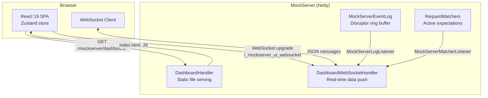

## How the Dashboard Is Served, and How to Run a Local Build

**The dashboard is bundled into the netty jar at build time.** It is not fetched, not served
separately, and not carried by any editor plugin — `mockserver-ui` is built and its output packaged
into the jar, which then serves it at `/mockserver/dashboard`. So the dashboard anyone sees is
whatever was built into the server they are talking to.

Two consequences that repeatedly cost time:

**Rebuild the right module.** The runnable jar is produced by `mockserver-netty-no-dependencies`,
not `mockserver-netty`. Building the latter alone leaves the runnable jar untouched, so a UI change
silently does not appear and the natural conclusion — that the change did not work — is wrong.

```bash
cd mockserver && ./mvnw -q -pl mockserver-netty-no-dependencies -am -DskipTests -DskipITs package
java -jar mockserver-netty-no-dependencies/target/mockserver-netty-no-dependencies-*-SNAPSHOT.jar -serverPort 1080
```

Confirm the jar really carries the change rather than assuming the build did what you meant:

```bash
unzip -p <jar> 'org/mockserver/dashboard/assets/*.js' | grep -c "<some string from your change>"
```

**For iterating on the UI, do not rebuild the jar at all.** Run the Vite dev server, which proxies
the control plane and the WebSocket to a MockServer already running, and gives hot reload:

```bash
cd mockserver-ui && npx vite --port 3010   # MOCKSERVER_URL overrides the default http://localhost:1080
```

Rebuild the jar only when something must be verified against the *served* artefact — the e2e suite
does exactly this (`e2e/start-mockserver.mjs` boots the real jar).

**The end-to-end suite** (`mockserver-ui/e2e/*.spec.ts`, `npm run test:e2e`) has one spec per
dashboard area (`mock`, `observe`, `verify`, `resilience`, `library`, `shell`) plus the dashboard,
follow and live-scroll specs. Its config boots two servers from the newest
`mockserver-netty-no-dependencies` jar: the main one on 1084 (INFO, load generation and SLO tracking
on, metrics off) and a secondary on 1114 (the proxied upstream, metrics on); `observe.spec.ts` boots a
third for its log-pressure test. Set `E2E_JAVA` to choose the java executable; each server's output
goes to `test-reports/mockserver-<role>.log`. Tests run serially against that shared state. A test
for a known open defect is a `test.fixme` naming the defect id; any other skip fails the run in CI
(see [ci-cd.md](../infrastructure/ci-cd.md#ui-end-to-end-playwright-step)).

**Editors embed this dashboard, they do not ship it.** The JetBrains plugin's tool window is a
`JBCefBrowser` and the VS Code docked view is a `WebviewView` iframe, both pointed at
`http://localhost:<port>/mockserver/dashboard` (see
[editor-extensions.md](editor-extensions.md)). So testing an unreleased dashboard change in either
editor needs a server on the new jar, not a new plugin build — and conversely, their dashboard
screenshots go stale when the UI changes, with no plugin change involved.

## Request Flow

### 1. Initial Page Load

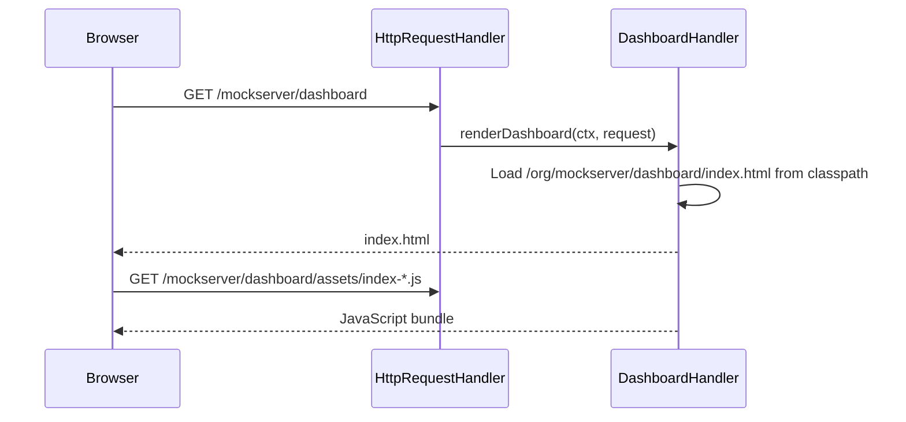

### 2. WebSocket Connection

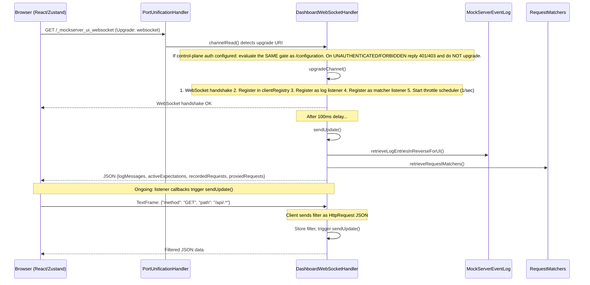

### Authentication

The dashboard exposes all captured traffic (request/response bodies included), so both the dashboard HTTP surface (`GET /mockserver/dashboard*`, served in `HttpRequestHandler`) and the UI WebSocket upgrade (`/_mockserver_ui_websocket`, handled in `DashboardWebSocketHandler`) go through the **same control-plane authentication/authorization gate** as `PUT /mockserver/configuration` — `HttpState.controlPlaneRequestAuthenticated(...)` for the HTTP path and its non-writing sibling `HttpState.evaluateControlPlaneAuthentication(...)` for the WebSocket path (the WebSocket must render a raw HTTP handshake rejection, not a MockServer `HttpResponse`).

- **Default (no control-plane authentication configured):** the gate returns `ALLOWED`, so the dashboard stays open exactly as before — this is non-breaking.
- **Control-plane auth enabled (mTLS / JWT / OIDC):** an unauthenticated caller gets `401`; an authenticated caller whose scopes map to no role gets `403`. The dashboard is a **read** (`GET`), so a read-only control-plane role (`controlPlaneScopeMapping`) can view it.
- **Health/lifecycle unaffected:** `/status` and `/ready` remain reachable without credentials (and `/bind` / `/stop` keep their own gate).
- **Browser limitation:** a browser cannot attach a bearer token to a WebSocket, so a token/OIDC-authenticated dashboard must be served through an authenticating reverse proxy (or use mutual TLS). The SPA's `useWebSocket` hook probes `GET /mockserver/dashboard` on a failed upgrade and, on `401`/`403`, shows an actionable "dashboard requires authentication" message instead of the generic "server unreachable" banner.

### 3. Real-Time Updates

The `DashboardWebSocketHandler` implements both `MockServerLogListener` and `MockServerMatcherListener`. When either fires, `sendUpdate()` assembles and pushes the current state to all connected clients.

**Throttling — be precise about what it bounds.** The `Semaphore(1)` with a scheduled release every second is a **per-connection permit**, not a JVM-global one: although `DashboardWebSocketHandler` is `@ChannelHandler.Sharable`, `PortUnificationHandler` builds a **new** instance per HTTP/1.1 channel (see the `clientRegistry` note below), so in production each dashboard connection holds its own permit. `sendUpdate` acquires it before walking the event log, so a missed permit defers the walk as well as the write to the next refill (a trailing update), which then sends the latest state. That walk runs on coalesced log updates at up to ~4/second (`MockServerEventLogNotifier.COALESCE_WINDOW_MILLIS` is 250 ms) per registry entry; the inbound `TextWebSocketFrame` pull path, whose rate the client controls, is now coalesced per connection by a leading-plus-trailing debounce (`PULL_COALESCE_WINDOW_MILLIS`) rather than walking on every frame. Read "1/second" as a bound per connection, never across connections: N dashboards walk and write N times.

**Backpressure — a client that is not keeping up.** An update frame is not bounded in bytes (see the item count below): with large captured bodies one frame can be tens or hundreds of megabytes, and each frame queued on the connection holds its full size in direct memory until the client takes it. `sendUpdate` and the trailing refill therefore skip a connection that is not writable (its outbound bytes are above the connection's write-buffer high water mark) and leave it pending; the refill tick sends the latest state once it drains. So at most about one frame waits for a client, instead of one more per second. A client that stops reading entirely is still closed by `WriteStallTimeoutHandler` after `responseWriteStallTimeoutMillis`.

**Bodies are capped, and an update has a size ceiling.** Measured in process (performance programme item 206): a log row carries its exchange's bodies about eight times (the request and response of the recorded row, plus the request, response and expectation arguments of its log messages), and building an update allocates about six times the update's size, so 100 rows of 1 MiB bodies could not be built in a 4 GB heap, and on a 1 GiB container one retained 10 MiB exchange was enough to run out of heap. So:

- `DashboardLogEntryDTO` cuts every request and response body it shows (the entry's own messages and its log message arguments, including the request and response inside an expectation argument) to `DashboardBodyCap.MAX_BODY_CHARACTERS` (64 KiB of text) **after** redaction, so a cut never exposes what redaction hid. A JSON body is measured and cut by its serialised text without holding the whole text (`PrefixWriter`). A long string argument (a rendered curl command, a `because`) is cut with a "(N more characters not shown)" suffix. A binary message (a `BinaryRequestDefinition`, which the dashboard shows as base64) is cut to the bytes whose base64 fills the cap (`MAX_BINARY_BYTES`, 48 KiB), measured and marked in base64 characters, so its row is charged and loadable like an HTTP body.
- Each cut message is marked so the UI can say so and load it whole: a recorded or proxied row gets `truncatedBodies.{httpRequest,httpResponse}` and a log message part gets `truncatedBody`, each `{logEntryId, part, originalLength, shownLength, loadable}`. A log message argument is `loadable` only when it is the entry's own request or response object (`LogEntry.argumentOwnMessagePart`), because the endpoint returns the entry's own message; an equal copy, an action or an expectation is shown cut without a load button. Request/response arguments inside a list or a `LogEventRequestAndResponse` are not cut. A row's response marker names the response entry (`EXPECTATION_RESPONSE`/`NO_MATCH_RESPONSE`), not the request entry. `GET /mockserver/logEntryBody?id=&part=request|response` (core `HttpState`, behind control-plane authentication like every control-plane read) returns that entry's message whole, through the same `getHttpUpdatedRequests/Response(configuration)` view, so it is redacted exactly as the dashboard is. The full body travels over that HTTP response, never in a WebSocket frame, and is bounded by the server's own body limits. An expectation in a log message is marked (`part: expectation`) but cannot be loaded.
- `populateLogSections` keeps a `FrameBudget` of `MAX_UPDATE_CHARACTERS` (16 MiB of estimated text). Each body is charged the length measured when it was capped (`DashboardBodyCap.Sizes.shownLength`), so a small JSON body costs its own size, not the cap. Log messages and request rows reach the ceiling separately: log messages may use at most three quarters of it, and request rows (recorded and proxied together) whatever the update has left, so the rows always keep at least a quarter. Without that split an unmatched request, which logs one `EXPECTATION_NOT_MATCHED` message per expectation it was compared with, starved the rows: with about 150 expectations the log messages filled the update at about 33 requests, and Traffic showed only those. Items arrive newest first; the first log message that would pass its share, and every older one, is left out (`logMessagesLimitReached: true`), and likewise the first request row that would pass the whole budget, and every older row (`frameLimitReached: true`). The first item of each kind is always admitted, so an update can exceed the ceiling by at most one log message and one row. The walk stops once both kinds are full or cut. The UI's `FrameLimitBanner` names what was left out: older requests when `frameLimitReached` is set, older log messages when `logMessagesLimitReached` is set (on the Dashboard only, since Traffic shows no log messages), or both. With capped bodies a row is at most about 0.5 MiB, so the row ceiling binds only when dozens of recent exchanges have bodies near the cap.
- **The expectations section is cut the same way, and the UI loads an expectation whole before editing it.** Each expectation's serialised tree is cut once, when `activeExpectationValue` builds it (the cache then holds the cut tree), by `DashboardBodyCap.capExpectationTree`: any `body` field whose serialised text is longer than `MAX_BODY_CHARACTERS` (64K characters; a JSON or binary body included) becomes the first 64K characters of that text, and **any other string** longer than the cap (an LLM completion or tool-call arguments, a template, an inline OpenAPI spec, an SSE event) is cut to it. The item then carries `truncatedExpectation: {expectationId, part: "expectation", originalLength, shownLength}`, `originalLength` being the longest value cut. Measured with 100 expectations of 1 MiB response bodies (`DashboardActiveExpectationBodyCapTest`), an update fell from about 105 million characters to about 6.6 million. In the UI, `lib/fullExpectation.ts` remembers the values of shortened items as each update arrives; Edit, Duplicate and Test in Active Expectations, Edit in Scenario Details, picking a mock in the Composer's existing-mocks list, and `LlmConversationForm` (which re-registers every turn of a conversation, so it loads each shortened turn before building its draft and shows an error instead of the editor if one cannot be loaded) load the whole expectation first with `fetchExpectation` (`PUT /mockserver/retrieve?type=active_expectations&format=json` with `{"id": ...}`), through `useWithWholeExpectation`, and do nothing, with a notification, when it cannot be loaded. Two guards stop a shortened value being saved if a future path skips that: the store's `editExpectation` refuses a remembered shortened value, and the Composer's register refuses an edit original that is one. The Composer's edit hand-off loads the handed-off value, not the (possibly shortened) listed one, and its before-and-after diff compares against the loaded original. A shortened row's `JsonViewer` offers no Copy button, since a copy would be pasted or saved shortened. Other readers of `activeExpectations` (session grouping, the LLM filter, Scripted Turns, onboarding counts) only display or group, so they read the shortened values as they are.
- **A large body is decoded once, not at every quote in every update.** The cut needs the whole rendered body (decoded and, for JSON, parsed and re-serialised), and one exchange quotes its request about six times and its response twice across its log entries. `DashboardLogEntryDTO` renders bodies through `LogEntry.redactedView(configuration, DashboardBodyCap.Rendering)`: the first time a retained body is cut, its cut text and full length are kept in `DashboardBodyCap.CUT_BODIES`, and every later quote of that body object, in that update or a later one, is shown from it without decoding. The keys are the retained bodies, held weakly and compared by identity, so an entry leaves the cache with the log entry; values are soft and the cache holds at most 16M characters of cut text, so under heap pressure it gives way and the dashboard decodes again. A body that fits is not kept (its rendering is the whole tree).
  - **With `redactSecretsInLog` on, what is kept is the redacted cut.** The rendering hook is handed the body *after* redaction (the standard redacted rendering is run on a miss, unchanged), so a kept cut never holds text redaction would hide. Each cut is stored with the *variant* it was rendered under — `null` when unredacted, else the redaction key (`fixtureBodyRedactFields` as configured) and the message's `Content-Type` (which decides whether a binary body is read as text or as base64) — and is served only when the variant of the current render is equal. Turning redaction on or off, or changing the masked fields, therefore misses and renders again rather than show a cut made under other settings; a cut made with redaction off is never served with it on. On a hit, the rest of the message (headers, cookies, query string) is still redacted as the standard rendering does, with only the body taken from the kept cut.
  - **The credential values found in a large body are kept too.** Redaction scrubs free text (a message, a matcher's "because") of the credential values the entry's own messages carry, which for `fixtureBodyRedactFields` means decoding and parsing every body of the entry on every render. `FixtureRedactor` keeps the values it found in a string, JSON, XML or binary body of 64K characters or more (`KEPT_BODY_VALUES`: weak identity keys, soft values, at most 4M characters), keyed by the field names and `Content-Type` they were found under; any other names or type searches again, so a kept list can never scrub less than a fresh search. Smaller bodies are searched as before.
  - Measured with `DashboardLogEntryBodyBenchmark` (one exchange's three rows per op): 10 MiB JSON bodies took, before the cache, about 500 ms and 1 GB of allocation per update with redaction off, and with redaction on 490 ms and 1.04 GB (no body fields) or 1.3 s and 3 GB (masking a field); once cut, about 2 to 4 us and 11 to 23 KB in every case. Bodies under the cap are unchanged. `DashboardCutBodyMemoTest` checks a kept cut produces the update a fresh decode produces, over JSON that re-serialises differently from its source, surrogate pairs across the cut, binary, XML and lengths either side of the cap; `DashboardRedactedCutBodyMemoTest` does the same under redaction, with bodies whose secrets redaction masks or replaces whole, and checks that toggling redaction, changing the masked fields and quoting one body under two `Content-Type`s never shows a cut or scrubs with values found under other settings.

In the UI, `src/lib/fullBody.ts` fetches a message and `useLoadFullRow` stores it in `fullMessages` by row key; `applyMessage` re-applies loaded messages to later updates until the row leaves the window, so every panel and action sees the whole body once loaded. Every action that sends, matches, copies, compares or builds a mock from a row loads it whole first and, if that fails, does nothing and shows why (a notification, or the error in the Replay dialog): Replay, Repeat, bulk Clear, Capture as Mock, Copy as curl, Compare, Add to Diff Pool (the pool keeps the whole request, since the row may leave the log before it is diffed), the Create Mock launchpad, Why Didn't This Match? and Generate Stub. On a log row the same actions fetch the row's request argument through its `truncatedBody` marker with `fetchFullMessage`; a cut argument that is not loadable makes them do nothing and say so.

Two consumers read every row rather than one, so they are handled differently:

- **LLM views** (Traffic, Trace, LLM Optimise, MCP Health) mount `useAutoLoadLlmRows`, which loads each shortened row that `cachedParseTraffic` recognises as LLM or MCP traffic from what is shown (host, path, headers or the start of the body), two at a time, skipping any message over `AUTO_LOAD_MAX_CHARACTERS` (4 Mi characters), which keeps its Load Full Body button. Trace shows that notice on the request's detail and in its lane's conversation, and keeps a shortened request out of the conversation threads until it is loaded, since a conversation parsed from the shown prefix would read as complete with messages missing. A module-level set of attempted markers means each message is fetched at most once per page, a failure is not retried and raises no notification (the row keeps its Load Full Body button), and a row the shown part does not identify stays shortened.
- **Search** matches only what is shown. Loading every shortened row automatically could hold hundreds of megabytes in the browser, so while a search is active Traffic says how many rows are shortened and offers **Search Full Bodies**, which loads them (four at a time) and reports how many could not be loaded.

**How many items an update carries.** By default each update carries up to 100 log messages, 100 recorded requests and 100 proxied requests, plus up to 100 expectations. A client may request a different **log-row** limit on the upgrade URI:

```
/_mockserver_ui_websocket?logLimit=250
```

`resolveLogItemLimit` is the single choke point that both validates the value and applies the ceiling. It fails toward the **default**, never the maximum — absent, blank, zero, negative, non-numeric and non-integer values all resolve to 100, so a malformed request can never be read as "send everything". Values above `MAX_LOG_UPDATE_ITEM_LIMIT` (500) are clamped down. The chosen value is pinned to the channel in an `AttributeKey` (the handler is `@Sharable`, so it cannot live in an instance field) and read on each update.

The **expectation** count is deliberately not client-tunable and stays at `EXPECTATION_UPDATE_ITEM_LIMIT`. Expectations are expensive per item and change rarely — and the one genuinely costly per-item operation, `DescriptionProcessor`'s OpenAPI parse, is reachable only from that path. Keeping it off the client-controlled knob means this parameter cannot amplify it.

This matters because **the dashboard WebSocket is unauthenticated by default**, so the requested limit is attacker-controlled on a default deployment. The protection is the maximum itself together with the per-connection rate bound on both update paths — not the per-request validation, which bounds only the per-client cost.

**Do not mistake `clientRegistry`'s `CircularHashMap(100)` for a cap on dashboards.** The registry is an instance field and `PortUnificationHandler` builds a **new** `DashboardWebSocketHandler` per HTTP/1.1 channel, so in production each registry holds exactly one connection — its own. (`@Sharable` is real, but the only pipeline sharing one instance is the HTTP/2 child initialiser, and HTTP/2 dashboard upgrades are refused with 501.) Each upgraded dashboard registers its own instance as a log and matcher listener and runs two threads of its own, so N open dashboards means N independent walks per notification. The aggregate cost scales with N, which nothing in this class bounds.

## Error Resilience

The entire view-switching region in `App.tsx` is wrapped in a single `ErrorBoundary` (`src/components/ErrorBoundary.tsx`) keyed on the active `view`:

```tsx
<ErrorBoundary label="this view" resetKeys={[view]}>
  {view === 'dashboard' && <DashboardGrid />}
  {/* ... */}
</ErrorBoundary>
```

When any view throws during render — including a failed `lazy()` chunk import (e.g. `MetricsView`) — the boundary catches it and shows an inline alert instead of blanking the whole app. The AppBar sits **outside** the boundary so navigation always works. Two recovery paths:

- **Chunk-load failure** (stale JS hashed URL after a redeploy): the fallback offers a hard "Reload page" button (`window.location.reload()`). These are detected by matching the browser's `Failed to fetch dynamically imported module` / `Importing a module script failed` error messages.
- **Any other render error**: the fallback offers a "Try again" button that calls `boundary.reset()` in place.

When `resetKeys` changes (the user navigates to another tab), the boundary clears its error state automatically — a crashed subtree recovers without a manual retry.

`ErrorBoundary` accepts an optional `label` prop (shown in the fallback text and in `console.error`) and an `onReset` callback.

## Auto-Refresh

`src/hooks/useAutoRefresh.ts` is a thin wrapper over `usePolling` that drives periodic background refresh in panels that do not receive WebSocket push. It inherits `usePolling`'s self-rescheduling loop (next tick scheduled only after the previous run completes, preventing overlapping fetches), tab-visibility gating, and abort-on-unmount cleanup. The `AbortSignal` is forwarded to the callback so in-flight fetches are cancelled when the component unmounts or polling restarts.

**Data-fetch model by panel:**

| Panel | Refresh mechanism |
|-------|------------------|
| Dashboard, Traffic, Trace | WebSocket push (`_mockserver_ui_websocket`) |
| Breakpoints — live exchanges / frames | Callback WebSocket push (`_mockserver_callback_websocket`) |
| Breakpoints — matcher list | `useAutoRefresh` (interval, default 3 s) |
| Drift | `useAutoRefresh` (interval) |
| AsyncAPI | `useAutoRefresh` (interval, 5 s) |
| gRPC Services | `useAutoRefresh` (interval, 5 s) |
| MCP tools panel | `useAutoRefresh` (interval, 3 s) |
| MCP Server Health | WebSocket push (reads `proxiedRequests` + `recordedRequests` from store; no independent polling) |
| Chaos | `setInterval` poll every 4 s (predates `useAutoRefresh`) |
| Performance — registry, live status, chart | `setTimeout` poll of `GET /mockserver/loadScenario` (1 s while a scenario runs, 5 s idle) |
| Performance — load generation enabled | `setTimeout` poll of `GET /mockserver/configuration` (5 s) |
| Metrics | `usePolling` directly in `useMetricsPolling` (3 s) |

## Shared Error Helpers

`src/lib/errorMessage.ts` exports two functions used across control-plane calls:

- **`humanizeError(e)`** — catches any thrown value; recognises the `MockServer returned <status>: <body>` shape (thrown by most lib helpers) and the `Replay failed (<status>): <body>` shape, then delegates to `humanizeServerError`. Falls back to a network-error message for `TypeError` / `Failed to fetch`. Returns `{ message, details? }`.
- **`humanizeServerError(status, rawBody)`** — maps HTTP status + raw body to a short actionable `message`, keeping the raw body in `details`. Handles 400 (invalid, extracts `{ "error": "…" }` envelope or JSON-schema `N errors:` summary), 401/403 (not authorised), 404 (feature unavailable), 409 (conflict), 5xx (internal error).

`src/components/HumanErrorAlert.tsx` (`HumanErrorAlert`) is the shared rendering component. It accepts a `HumanError` object (or discrete `message`/`details` props), shows the short message in an MUI `Alert`, and puts the raw `details` text behind an inline "Details" / "Hide details" toggle rendered in a monospace scrollable block. It replaces near-identical inline implementations that previously lived in `ComposerView`, `CaptureAsMockDialog`, and `ImportForm`. All panels added in subsequent rounds (`GrpcServicesPanel`, `BaselineCompareDialog`, `AsyncApiPanel`, etc.) use `HumanErrorAlert` and `humanizeError` consistently — there are no longer any inline error string concatenations in control-plane call sites.

`monospaceFontFamily` exported from `src/theme.ts` is the canonical monospace font stack. All code, JSON, log, and identifier surfaces across the dashboard use it via `sx={{ fontFamily: monospaceFontFamily }}` or the MUI theme's `typography` overrides rather than hardcoded `'monospace'` strings, giving a consistent typeface across panels.

`src/lib/replay.ts` wraps `PUT /mockserver/replay`: `replayRequests(params, httpRequest)` returns the upstream response parsed as JSON (wraps non-JSON bodies as `{ body: text }`), throwing `ReplayError(status, body)` on non-2xx so `humanizeError` can parse it.

`src/lib/expectations.ts` exposes `deleteExpectation(params, id)`, which issues `PUT /mockserver/clear?type=expectations` with body `{ "id": "<expectationId>" }` to remove a single expectation without disturbing logs or recorded requests.

`src/lib/traffic.ts` exposes `clearLoggedRequest(params, requestDefinition)` (issues `PUT /mockserver/clear?type=log` with the request definition as the matcher body, removing the matching log entries / captured requests) and `requestDefinitionOf(value)` (returns the row's `httpRequest`, or the whole value when absent). Used by the Traffic inspector's bulk-clear.

## Top-Level Views

The dashboard has **twenty-one top-level views** controlled by the AppBar. The view state is stored in Zustand as `view: ViewMode` where:

```
ViewMode = 'dashboard' | 'traffic' | 'sessions' | 'composer' | 'library'
         | 'chaos' | 'performance' | 'metrics' | 'drift' | 'verification'
         | 'slo' | 'async' | 'grpc' | 'breakpoints'
         | 'contract' | 'cluster' | 'optimise' | 'mcp-health' | 'get-started'
         | 'scenarios' | 'audit'
```

`'composer'` is surfaced in the UI under the button label **Mocks**; `'async'` is the **AsyncAPI** broker view; `'performance'` is the **Performance** load-scenario panel; `'sessions'` is labelled **Trace** in the nav; `'get-started'` is the initial onboarding view shown to new users before any data arrives; `'scenarios'` is a standalone view over the same `ScenarioPanel` that the Mocks composer embeds as a tab; `'audit'` renders the control-plane audit trail from `GET /mockserver/audit` (see [Audit View](#audit-view)). The audit trail is a record of **control-plane mutations** — who changed what (`PUT /expectation`, `/clear`, `/reset`, configuration changes, etc.) with principal, source, and authorization outcome. It is a **separate, additional trail from the data-plane event log** (received requests, responses, and expectation matches) — the two never overlap. The audit trail is **opt-in and off by default** — the server records an `AuditEntry` for a control-plane operation only when `controlPlaneAuditEnabled=true` (recording is gated purely on that flag in `HttpState.recordAudit`; it is independent of whether control-plane authentication is configured, and an unauthenticated mutation is recorded with principal `anonymous`/source `none`). Reads are skipped unless `controlPlaneAuditReads=true` (a `FORBIDDEN` outcome is always recorded, even for a read). Request headers and bodies are never stored — only the mutation metadata.

The active view and per-panel search terms persist across page reloads: the view is mirrored in the URL hash (`#/<view>`) and in `localStorage`, resolved at startup by `coerceView`/`persistView` in `store/index.ts`; per-panel search terms are stored under a separate `localStorage` key. Unknown or stale values are silently ignored and fall back to `'get-started'`.

### Workspaces

A **workspace** bundles a view, the five panel search terms and, optionally, its own **MockServer target**, so one browser tab can hold several independent investigations, including against different MockServer instances. The WebSocket subscription filter and the theme are **global**. The captured data (log messages, expectations, received and proxied requests) always belongs to the **active** workspace's target: there is one live connection at a time, and switching to a workspace on another server replaces the data rather than mixing it.

The active workspace's state *is* the existing top-level store state (`view`, `logSearch`, …); `workspaces` holds a **snapshot** per workspace, refreshed only when the active workspace changes. Every panel keeps its existing selector and every setter is unchanged, which is what makes a view switch structurally unable to reset filter state. With a single workspace no snapshot is ever read or written, so the behaviour is exactly what it was before workspaces existed.

Persistence keeps `mockserver-view` and `mockserver-search` as the **authoritative** record of the *active* workspace's view and searches (unchanged keys and formats); the `mockserver-workspaces` key holds the workspace list, including each workspace's target, and the active snapshot's view and searches are overwritten from the two legacy keys on load. An upgrading user with no `mockserver-workspaces` entry therefore lands in a single workspace carrying exactly their previous view and searches, and nothing is written to the new key until they create a second workspace. Malformed blobs — bad JSON, wrong shape, duplicate or missing ids, unknown views, non-string searches, a target that fails validation — degrade field by field to safe defaults (an invalid target becomes "follow the URL").

**Two browser tabs** share one `localStorage`. Once the workspaces key is in use, a store subscription writes every live change of view, searches or target through to it, under the writing tab's active id, so the legacy keys and the blob always describe the same workspace. Each tab also listens for the `storage` event and adopts the other tab's list (`adoptWorkspacesFromOtherTab`) for every workspace **except its own active one**, whose live state and target never change from another tab. A tab therefore never writes back a stale copy of a workspace it is not using; a workspace live in two tabs at once is last-writer-wins, and a workspace closed in one tab stays open in a tab that is using it.

`WorkspaceTabBar.tsx` renders a switcher row below the app bar, and only once a second workspace exists or the only workspace has its own target (so a target is never in force without being shown and editable) — the app bar itself gains a single icon button. That placement is deliberate: an earlier tab bar of pinned/recent *views* was reverted in `d55d7077d` because labelled tabs in the flexible nav region stopped the bar fitting at typical widths.

#### Per-workspace MockServer target

Each tab in the workspace bar has a **Set MockServer** button that opens `WorkspaceTargetDialog` (host, port, https, base path). Once any workspace has its own target, every tab shows its `host:port`, so where a tab's actions go is never a guess; closing down to a single workspace that has a target keeps the bar (without a close button) for that reason. A workspace without a target follows the dashboard URL (`?host=`/`?port=`/`?secure=`/`?basePath=`, else the page origin); a new workspace starts that way.

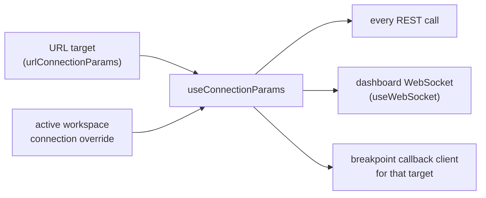

How the target change stays safe:

| Concern | Mechanism |
|---------|-----------|
| One consumer still calling the old server | `useConnectionParams` merges the store's `connection` over the URL target; it is the only source every component and hook reads, including the ones that call it directly. |
| Old server's data shown under the new target | Any change of the *effective* target (switch, close, add, or retargeting the active workspace) drops the four data arrays and their reconcile caches, loaded full bodies, the configuration, selection, hand-offs and the debug/stub dialogs in the same store update, and increments `connectionEpoch`. |
| Component state from the old server (lists, open dialogs, held rows) | `App` keys the app bar, the log-pressure banner, the view region and the App-level dialogs on the target, so they remount. |
| A push or a reply from the old server arriving after the switch | The dashboard socket ignores messages once `connectionEpoch` has moved on; `useWithWholeExpectation`, `useLoadFullRow` and the auth probe drop late results the same way; the auto-load markers reset per epoch. |
| Two live sockets | A target change re-creates `useWebSocket`'s `start`, and `connect()` closes the previous socket first, reconnecting with the last filter. |
| Breakpoints | `getBreakpointCallbackClient(params)` keeps **one callback client per target**. Matchers are owned on the server by that socket's `clientId`, so switching workspace leaves another server's matchers armed (exactly as navigating to another view does). When no workspace targets a server any more (closed or retargeted), `releaseBreakpointCallbackClientsExcept` closes its socket and the server removes those matchers and continues anything they paused. |
| Cross-origin calls | Saving a target first sends `PUT /mockserver/status` (`probeTarget`); a failure is explained (unreachable or CORS refused, `controlPlaneCorsAllowOrigin` excluding this origin, control-plane auth, a wrong base path, mixed content, an untrusted certificate) and the user may still choose **Save anyway**. A lost connection to a cross-origin target names CORS too. |

Validation (`validateConnection`) refuses a host typed as a URL or with a path, credentials or `#`, one longer than 253 characters, a bracketed value that is not an IPv6 address, a port outside 1-65535, and a base path that does not start with `/` or that contains `?`, `#`, `%`, `\`, whitespace, an empty segment (`//`) or a `.`/`..` segment; it lower-cases the host (underscores are allowed, as in Docker service names), and the breakpoint client compares targets by `connectionKey`, so a different spelling of one host never reconnects and drops matchers. Analytics is decided only by the dashboard URL's server, never by a workspace's other target.

#### URL target validation

**The dashboard's own address is untrusted input.** Anyone can send a user a dashboard link, so `?host=`, `?port=` and `?basePath=` (and the base path derived from the page path) pass the same checks as a typed target before any URL is built from them. Without that, `?basePath=/mockserver/reset%23` (or a `host` such as `127.0.0.1:1080/mockserver/stop%23`) turned the rest of every control-plane URL into a fragment, so the dashboard's next routine call went to `/mockserver/reset` on its own origin, where CORS does not apply.

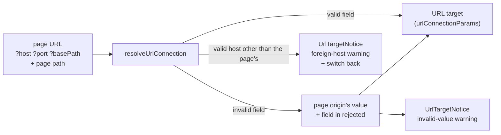

| Piece | Behaviour |
|-------|-----------|
| `resolveUrlConnection()` (`lib/connectionTarget.ts`) | Returns `{ params, rejected, page, foreignHost }`; `page` is the page origin's own target and `foreignHost` is true when a valid `?host=` differs from the page's host. Each field is checked by the same `hostProblem`/`portProblem`/`basePathProblem` helpers `validateConnection` uses; an invalid one falls back, field by field, to the page origin's host, port or base path (or `''` when the page path itself is invalid). `?secure=` is a boolean and cannot inject. |
| `urlConnectionParams()` | `resolveUrlConnection().params`; every consumer (store, `useConnectionParams`, `App`, `WorkspaceTabBar`, `WorkspaceTargetDialog`) reads the URL target through it, so none sees an unchecked value. |
| `UrlTargetNotice` | Two warnings under the workspace bar. A dismissible one names ignored fields (`url-target-notice`). A persistent one, shown only when `foreignHost`, names the server the link points at and links to `pageOriginDashboardUrl()`, the same address without `host`/`port`/`secure`/`basePath` (`url-target-foreign-host`). |
| Analytics | Decided only by the URL target's server, or by the page origin's server (`page`) when `foreignHost` is true, so a server a link names on another host cannot switch analytics on or choose its endpoint. |

**A link to another host gets a notice, not a confirmation.** Validated, a link chooses only *which* server the dashboard talks to, never which endpoint, so it cannot turn a read into a destructive call. Two directions remain:

- *Towards the user's own MockServer* — nothing new: every destructive action is a click (the clear-menu reset/clear actions confirm), and MockServer answers control-plane CORS for any origin unless `corsAllowOrigin` narrows it (see Cross-Origin Support below), so the linking page could make those calls itself.
- *Towards a server the link's author controls* — the dashboard would show that server's data and send it whatever the user then creates (expectations, uploads, verifications, breakpoint matchers). The persistent foreign-host notice names that server and offers a one-click switch back to the page origin.

The notice is keyed on the **host** only: a different `?port=`, `?secure=` or `?basePath=` on the same host stays quiet, so the documented `?port=1080` development, demo-launcher and screenshot flows show nothing. A blocking confirmation was rejected because it would interrupt those flows and protects nothing the notice does not.

The other value read from the URL, the `#/<view>` hash, only ever selects a view through the `coerceView` whitelist.

The Request Filter panel is shown on Dashboard, Traffic, and Trace views. It is hidden on all other views. Its header is a real button (in the Tab order, Enter or Space toggles it, `aria-expanded` reports the state), as well as Ctrl/Cmd+Shift+F.

| View | Nav label | Component | Description |
|------|-----------|-----------|-------------|
| `get-started` | Get Started | `OnboardingPanel.tsx` | Onboarding view shown on first load; stays until the user navigates away (no auto-switch) |
| `dashboard` | Dashboard | `DashboardGrid.tsx` | 2×2 grid of Log Messages, Active Expectations, Received Requests, Proxied Requests panels |
| `traffic` | Traffic | `TrafficInspector.tsx` | Full-width master/detail list of all captured traffic (mock-matched + proxied), with per-row Replay and Compare buttons |
| `sessions` | Trace | `SessionInspector.tsx` | Swim-lane grouped view of isolated LLM conversation sessions; labelled **Trace** in the nav |
| `composer` | Mocks | `ComposerView.tsx` | Unified expectation creator/editor for Standard HTTP and LLM Conversation expectations |
| `library` | Library | `LibraryView.tsx` | Fixture cassettes, run comparison, and export (HAR / OpenAPI / Postman / Bruno) |
| `chaos` | Chaos | `ServiceChaosPanel.tsx` | Service-scoped HTTP chaos registration, live TTL countdown, and clear-all |
| `performance` | Performance | `LoadScenarioPanel.tsx` | Create and run load scenarios: stage-builder (VU / RATE / PAUSE stages with ramp curves), live run status (stageIndex / stageType / currentTarget / active VUs), and a live latency+throughput graph with per-metric and per-scenario toggles plus an all-scenarios total (see [Performance View](#performance-view)) |
| `drift` | Drift | `DriftPanel.tsx` | Mock drift detection results: divergence records between forwarded responses and stub expectations |
| `verification` | Verify | `VerificationView.tsx` | Build and run verifications — request matchers, expected counts (atLeast/atMost/exactly/between), or an ordered sequence — against received requests |
| `slo` | SLO | `SloPanel.tsx` | Assert service-level objectives — latency percentiles and error rate — against recorded traffic (see [SLO View](#slo-view)) |
| `contract` | Contract | `ContractTestPanel.tsx` | Validate mocks and traffic against an OpenAPI contract |
| `cluster` | Cluster | `ClusterPanel.tsx` | Monitor MockServer cluster nodes and shared state |
| `optimise` | LLM Optimise | `OptimiseView.tsx` | Analyse captured LLM traffic to optimise prompts, inference cost, safety, and speed |
| `mcp-health` | MCP Health | `McpServerHealthPanel.tsx` | Per-MCP-server latency and error rate derived from captured proxied/recorded traffic; highlights slow or erroring servers worst-first (see [MCP Server Health View](#mcp-server-health-view)) |
| `async` | Async | `AsyncApiPanel.tsx` | AsyncAPI broker mock status: loaded spec, channels/topics, publisher/subscriber summary, and recorded broker messages |
| `grpc` | gRPC | `GrpcServicesPanel.tsx` | gRPC services and methods loaded from protobuf descriptors, with per-service health-check status (see [gRPC Services View](#grpc-services-view)) |
| `metrics` | Metrics | `MetricsView.tsx` | Prometheus metrics polling: request counters, latency percentiles, JVM stats, chaos gauges |
| `breakpoints` | Breakpoints | `BreakpointsPanel.tsx` | Live table of paused HTTP exchanges and held streaming frames; continue / modify / abort each (see [Breakpoints Panel](#breakpoints-panel)) |

```mermaid
graph TB
    APP["App.tsx"]
    AB["AppBar.tsx
grouped nav: 6 dropdown groups"]
    FP["FilterPanel.tsx
(dashboard, traffic, sessions only)"]
    GS["OnboardingPanel.tsx
(view = 'get-started')"]
    DG["DashboardGrid.tsx
(view = 'dashboard')"]
    TI["TrafficInspector.tsx
(view = 'traffic')"]
    SI["SessionInspector.tsx
(view = 'sessions', label 'Trace')"]
    CV["ComposerView.tsx
(view = 'composer', label 'Mocks')"]
    LV["LibraryView.tsx
(view = 'library')"]
    SCP["ServiceChaosPanel.tsx
(view = 'chaos')"]
    LSP["LoadScenarioPanel.tsx
(view = 'performance')"]
    DP["DriftPanel.tsx
(view = 'drift')"]
    VV["VerificationView.tsx
(view = 'verification')"]
    SP["SloPanel.tsx
(view = 'slo')"]
    CO["ContractTestPanel.tsx
(view = 'contract')"]
    CL["ClusterPanel.tsx
(view = 'cluster')"]
    OP["OptimiseView.tsx
(view = 'optimise')"]
    MHP["McpServerHealthPanel.tsx
(view = 'mcp-health')"]
    AAP["AsyncApiPanel.tsx
(view = 'async')"]
    GP["GrpcServicesPanel.tsx
(view = 'grpc')"]
    MV["MetricsView.tsx
(view = 'metrics')"]
    BP["BreakpointsPanel.tsx
(view = 'breakpoints')"]

    APP --> AB
    APP --> FP
    AB -->|setView| APP
    APP -->|view = get-started| GS
    APP -->|view = dashboard| DG
    APP -->|view = traffic| TI
    APP -->|view = sessions| SI
    APP -->|view = composer| CV
    APP -->|view = library| LV
    APP -->|view = chaos| SCP
    APP -->|view = performance| LSP
    APP -->|view = drift| DP
    APP -->|view = verification| VV
    APP -->|view = slo| SP
    APP -->|view = contract| CO
    APP -->|view = cluster| CL
    APP -->|view = optimise| OP
    APP -->|view = mcp-health| MHP
    APP -->|view = async| AAP
    APP -->|view = grpc| GP
    APP -->|view = metrics| MV
    APP -->|view = breakpoints| BP
```

## Metrics View

`MetricsView.tsx` (view = `metrics`) is the dashboard's observability surface. Unlike the other views — which are pushed data over the WebSocket — it **polls** MockServer's Prometheus endpoint `GET /mockserver/metrics` on an interval (default 3s) via the `useMetricsPolling` hook, parses the text exposition format (`lib/prometheusParser.ts`), and keeps a rolling history so it can derive time series client-side (`lib/metricsDerive.ts`).

During the initial load (before the first scrape resolves) `MetricsView` renders MUI `Skeleton` placeholders — one text skeleton for the label and one rounded skeleton per chart — so the page shows structure rather than a blank area while waiting.

It renders:
- **KPI hero stat cards** — four prominent headline counters (all requests received, matched, not-matched, forwarded; the first and the throughput chart count every request, including control-plane calls such as the view's own scrape, and are labelled so) rendered as `Card` components above the chart stack. When latency histogram data is present, p50/p95/p99 cards join the row.
- time-series charts with a **real time axis** and **area fill** (via `@mui/x-charts` `AreaChart`) for throughput and latency trends; `@mui/x-charts` is lazy-loaded with the whole `MetricsView` chunk so it stays off the initial bundle,
- a derived requests-per-second throughput chart (Δcount / Δt between scrapes, since the metrics are monotonic gauges),
- request latency percentiles (p50/p95/p99) from the `mock_server_request_duration_seconds` histogram (shown only when present),
- an **HTTP Chaos Faults** section (shown only when a chaos metric is present and has non-zero data) with: a per-fault-type stat + time-series chart of cumulative injections (`mock_server_http_chaos_injected_total`), and a separate per-fault-type chart of the active service-scoped chaos gauge (`mock_server_active_service_chaos`, labeled by `fault_type`) plotted by type rather than as a single counter. Fault types for both are discovered from the scrape via `labelValues`, so a future type renders automatically,
- JVM heap memory, thread count, and GC stats (shown only when JVM metrics are present), and
- a per-action breakdown of the `*_actions_count` gauges, plus the served MockServer version from `mock_server_build_info`.

There is **no charting dependency** (inline SVG) and no server change required. Because metrics are off by default, a 404 is treated as a first-class `disabled` state that shows the user how to enable them (`metricsEnabled`) rather than an error.

## Chaos View

`ServiceChaosPanel.tsx` (view = `chaos`) manages **service-scoped chaos** interactively. Like the Metrics view it **polls** rather than using the WebSocket — `GET /mockserver/serviceChaos` every 4s via the control-plane helpers in `lib/serviceChaos.ts` (`fetchServiceChaos` / `registerServiceChaos` / `removeServiceChaos` / `clearServiceChaos`). It renders:
- a **register form** — host plus error status / error probability / drop probability / latency-ms / optional TTL-ms fields; only the populated fields are sent in the `chaos` object (`buildChaosProfile`), and the register is rejected client-side if no fault is set,
- a list of **active registrations**, each with a `summarizeChaosProfile` chip breakdown of its faults, a per-host **Remove** button, and an in-place **Edit** form. **Apply** re-registers the whole profile with `PUT` (`registerServiceChaos`), carrying the remaining TTL for a TTL-bearing host, rather than a `PATCH`: the server's `PATCH` merges only the non-null fields, so a fault the user cleared would otherwise survive. Clearing every fault is refused with a pointer to **Remove**,
- a **live TTL auto-revert countdown** chip for any TTL-bearing registration — the remaining ms returned by the server's `ttlRemainingMillis` is decremented client-side by a 1s tick between polls (`formatTtl`),
- a **Clear all** button.

`lib/serviceChaos.ts` is framework-agnostic (plain `fetch`) so it is unit-tested independently of the component; it surfaces the server's `{"error": ...}` message on a 4xx.

## Audit View

`AuditPanel.tsx` (view = `audit`) shows the **control-plane audit trail** — a newest-first list of control-plane *mutations* (who changed what: register/clear an expectation, reset, configuration change, …) with method, path, operation, source address, principal, principal source, and authorization outcome. This is a **separate, additional trail from the data-plane event log** shown on the Dashboard/Traffic views (received requests, responses, expectation matches); the audit trail never contains request/response traffic and never stores request headers or bodies.

**Enabling from the UI.** The trail is off by default (`controlPlaneAuditEnabled`, gated in `HttpState.recordAudit`). The panel fetches the live configuration (`getConfiguration()` → `GET /mockserver/configuration`) alongside the entries on mount and on Refresh, so the header shows an accurate status chip — **Audit Trail: On** (success) or **Audit Trail: Off** (muted) — even when the list is empty:

- When **Off**, an **Enable Audit Trail** button calls `updateConfiguration({ controlPlaneAuditEnabled: true })` (`PUT /mockserver/configuration`) and, on success, refetches config + entries so the chip flips to On. An info banner notes that only changes made *after* enabling are recorded.
- When **On**, a switch turns recording back off (`{ controlPlaneAuditEnabled: false }`). A plain switch (no confirmation) matches the other runtime toggles in `ConfigurationDialog`; turning off is not destructive (it only stops recording).
- An **Also record reads** checkbox wires `controlPlaneAuditReads` (only mutations are recorded unless this is set; a `FORBIDDEN` read is always recorded regardless). It is disabled while the trail is off.

A failed `updateConfiguration` (e.g. control-plane auth rejecting the write) surfaces through `HumanErrorAlert` and does **not** flip the status chip. The audit-list load and the config load have independent error surfaces (fetched via `Promise.allSettled`), so a failure of one does not blank the other. When the connected server predates the endpoint, `GET /mockserver/audit` 404s and the panel shows a "not available on this server" branch. The empty state points at the in-UI Enable control and still documents the `controlPlaneAuditEnabled` / `-Dmockserver.controlPlaneAuditEnabled` / `MOCKSERVER_CONTROL_PLANE_AUDIT_ENABLED` startup forms as an alternative. The panel does not poll — the user pulls updates with the **Refresh** button (the audit trail is a control-plane history, not live traffic).

## Performance View

`LoadScenarioPanel.tsx` (view = `performance`) is the dashboard control surface for [load injection](load-generation.md). It is lazy-loaded (shares the `@mui/x-charts` chunk with `MetricsView`) so the bundle does not download until the tab is opened.

**Layout.** A shared **Registered scenarios** section (the named-scenario registry: lifecycle-state badges, multi-select start, per-row edit/start/stop/delete) sits at the top, visible at all times. Below it, two sub-tabs separate the two things you do here:

- **Run & Monitor** (default) — the live side: a "Running now" card per concurrently-running scenario (with **Edit running** and **Stop**), the multi-scenario chart, and the post-run summary. An empty-state hint shows when nothing has run yet.
- **Create / Edit** — author a scenario: the stage-builder form, with the generated client code (idiomatic MockServer client builders for each language, not raw JSON) rendered inline directly below it and updated live as you fill in fields (no separate Code tab).

The view follows what you're doing: clicking **edit** on a registered scenario (or "Edit running") switches to **Create / Edit**; starting a run (Load & Run, Start selected, or a per-row Start) switches to **Run & Monitor**.

**Stage builder.** Presents an ordered list of stages that forms the `LoadProfile.stages` array sent in `PUT /mockserver/loadScenario`. Each stage row lets the user pick the stage type, duration, setpoint (hold or ramp), and curve:

| Stage type | Setpoint fields shown |
|------------|----------------------|
| `VU` hold | `vus` |
| `VU` ramp | `startVus`, `endVus`, `curve` |
| `RATE` hold | `rate` (iterations/second) |
| `RATE` ramp | `startRate`, `endRate`, `curve`, optional `maxVus` |
| `PAUSE` | duration only |

Ramp curves offered: `LINEAR` / `QUADRATIC` / `EXPONENTIAL`. The builder prevents submitting a scenario that would exceed any safety cap (`loadGenerationMaxVirtualUsers`, `loadGenerationMaxRate`, `loadGenerationMaxStages`).

**Live status.** Everything on Run & Monitor comes from one poll of the registry listing, `GET /mockserver/loadScenario` (`{"scenarios": [...]}`). Each entry carries its run's live fields flat beside `name`, `state` and `definition`; `listLoadScenarios` nests them as the entry's `status`. The header chip reads `running` while any scenario runs, `pending` while one waits out its start delay, and otherwise the state of the most recently finished run (`latestFinishedScenario`, by `endedAt`), or `none`. Once nothing is active, the **end-of-run summary** (key metrics, threshold results, report downloads) shows that most recent finished run. The live fields:

| Status field | Meaning |
|-------------|---------|
| `state` | registry state of the entry (`RUNNING` / `COMPLETED` / `STOPPED` / …) |
| `stageIndex` | 0-based index of the currently executing stage |
| `stageType` | `VU` / `RATE` / `PAUSE` |
| `currentTarget` | Target VU count or target arrival rate for the active stage |
| `currentVus` | Actual live VU count |
| `elapsedMillis` | Milliseconds since the run started |
| `requestsSent`, `succeeded`, `failed` | Cumulative counters |
| `p50Millis`, `p95Millis`, `p99Millis` | Latency percentiles from the histogram |

A **determinate** progress bar (not an indeterminate sweep) fills with `elapsedMillis / Σ stage durations` so you can see how far through the run is, and is coloured by phase — green while driving load, amber during a `PAUSE` stage. It falls back to an empty bar when the total duration is unknown (older server that doesn't echo the definition).

**Metrics graph.** A live `@mui/x-charts` `LineChart` built entirely from the polled scenario status — no Prometheus dependency, so it works with `metricsEnabled` off. Each registry poll appends a *frame* to a shared timeline, capturing a snapshot of every scenario running at that instant (keyed by scenario name). The time axis shows seconds when the chart spans under 20 minutes, so a short run's ticks do not all read the same minute. The graph has two independent sets of toggles:

- **Metric toggles** — which series to plot: RPS, Active VUs, In-flight, p50/p95/p99 ms, Error rate % (default subset: RPS + p95 + Active VUs). RPS and error rate are derived per series (Δsent/Δt and failed/sent).
- **Scenario toggles** — which scenarios to include (shown only when more than one scenario has data; **all enabled by default**). Hiding a scenario removes its lines and drops it from the total.

When two or more scenarios are enabled the chart draws, for each visible metric, **a line per scenario plus an aggregate "All scenarios" total** — counts/VUs/in-flight summed across scenarios, latency percentiles taken as the worst (max) case. A scenario that starts or stops mid-run leaves a null gap in its line rather than distorting the others. With a single scenario it falls back to clean one-line-per-metric labels.

**Refresh mechanism:**

| Panel area | Mechanism |
|-----------|-----------|
| Registry list, live status, summary, chart frames | poll of `GET /mockserver/loadScenario` listing (1 s while any scenario runs, 5 s idle) |
| Load generation enabled | poll of `GET /mockserver/configuration` (5 s) |

When the configuration reports `loadGenerationEnabled=false`, or a start is refused with 403, the panel shows a persistent prompt with the property name and environment variable; the start buttons are disabled, and **Load** (register only) still works. The prompt goes away only when the configuration reports load generation enabled.

**Destructive actions and reports.** **Clear all** and a row's **Delete** ask for confirmation (both stop a running scenario too). The report buttons fetch `GET /mockserver/loadScenario/{name}/report` (JSON, or `?format=junit`) and save it as `<name>-report.json` / `.xml`.

## Dashboard View

`DashboardGrid.tsx` renders a 2×2 CSS grid with four data panels:

| Panel | Component | Data Source | Content |
|-------|-----------|------------|---------|
| Log Messages | `LogPanel` → `LogEntry` / `LogGroup` | `logMessages` | Grouped log entries with color-coded types |
| Active Expectations | `ExpectationPanel` → `JsonListItem` | `activeExpectations` | Currently registered expectations |
| Received Requests | `RequestPanel` → `JsonListItem` | `recordedRequests` | All received requests with paired responses, including DNS queries (described by name and type) and binary messages (described by length and their first 16 bytes in hex, or "bytes redacted" when `redactSecretsInLog` is on), which `DescriptionProcessor.receivedRequestDescription` labels |
| Proxied Requests | `RequestPanel` → `JsonListItem` | `proxiedRequests` | Forwarded requests with upstream responses |

### Reading a Panel While It Streams — the Console Model

**The bottom line.** The live panels render in **console order** — oldest first, newest appended at
the **bottom** — following the tail is an explicit **Follow** control rather than something inferred
from scroll position, and rows a reader is looking at are **held** even after the server stops
sending them. Together those three make a panel readable on a busy server. Any one of them alone
does not.

**The defect they address.** Each update carries a *window*, not a delta: at most
`DEFAULT_LOG_UPDATE_ITEM_LIMIT` (100) log rows and `EXPECTATION_UPDATE_ITEM_LIMIT` (100)
expectations, with the oldest dropped as new ones arrive. Measured against a real server at roughly
ten requests a second, the whole window turns over in about **ten seconds**. So there are two
independent disruptions, and they need different remedies:

| Disruption | Cause | Remedy |
|---|---|---|
| Arrival | a new row inserted *above* the reader pushes their row down the page | console order — the new row lands *below* the viewport |
| Eviction | the server stops sending the row the reader is on, and it vanishes | `useHeldItems` — hold it client-side while they read |

Console order does not fix eviction; it *moves* it. Oldest-first puts the rows being dropped at the
**top**, so without a hold the list collapses upward and everything slides up the screen.

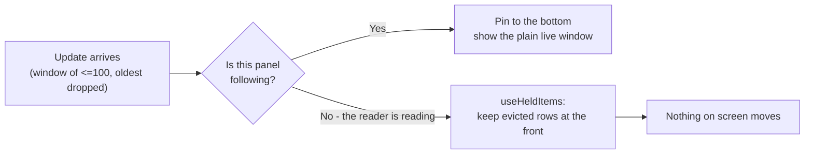

**Where the state lives.** `useFollow` (`src/hooks/useFollow.ts`) gives each panel its own follow
state, with the toolbar control in `AppBar` (store field `autoScroll`) as a **master switch** over
all of them: toggling it re-syncs every panel, and a panel may diverge again afterwards. Re-sync
happens during render, not in an effect — an effect applies a render late, which is precisely the
frame that scrolls the row out of view. `useHeldItems` (`src/hooks/useHeldItems.ts`) is active only
while a panel is *not* following, so an idle dashboard is no heavier than before.

### Counts Derived From the Update Window

**Never compute a user-facing total from a live store field.** `logMessages`, `recordedRequests`,
`proxiedRequests` and `activeExpectations` are all capped windows, so `someList.length` is the size
of the transport window, not the quantity it appears to name — it pins at the cap and stops moving.
The same trap applies to booleans (`list.some(...)` reads false once the interesting rows age out,
silently hiding a feature) and to watermark signals (a saturating count can never differ from its
stored snapshot again).

| Surface | Before | Now |
|---|---|---|
| Active Expectations count | `activeExpectations.length` | **`activeExpectationsTotal`** — sent explicitly by the server, falling back to the list length for older servers |
| Log Messages / Received Requests counts | list length | removed |
| Traffic inspector: `Hosts (N)`, per-host chip and `aria-label`, `N unmatched` | window-derived | removed (including inside the `aria-label` — a wrong number read to a screen reader is no better for being invisible) |
| Composer `Existing <kind> mocks (N)` | filtered window length | removed — a filtered subset has no accurate server-side total |
| Received-request row ordinal | position in the window, renumbering on every push | **`timestamp`**, sent per entry and comparable with the log panel |
| `OptimiseView` staleness | `proxied.length + recorded.length` vs a snapshot | a *signature* (tail row key + length), which changes even at saturation |
| `FilterPanel` LLM filter | `activeExpectations.some(...)` | **`activeExpectationsIncludeLlm`** — a server-side flag decided over the whole retrieved matcher list rather than the capped page, falling back to the latched window check for older servers. Note what it is of: the retrieval is filtered by the dashboard's own request filter, so it means "an LLM expectation matches the current filter" — the whole server set only when no filter is active. The control therefore comes and goes with the filter, which is intended: filtering by provider inside a view holding no LLM expectation would return nothing |

**How the LLM Provider filter decides whether to appear.** The server computes
`activeExpectationsIncludeLlm` in `DashboardWebSocketHandler.sendUpdate` — `true` iff *any* expectation
it holds carries an `httpLlmResponse` action (`Expectation.getHttpLlmResponse() != null`), evaluated
over the **whole** matcher list, not the capped `activeExpectations` page. It is derived from the same
already-retrieved list as `activeExpectationsTotal` (no second matcher-store walk) and short-circuits on
the first LLM expectation. `FilterPanel` uses this flag as the authoritative source whenever it is
present. Only when it is absent — an older server that predates the signal — does the client fall back to
inspecting the page and latching (once an LLM expectation has been seen this session, keep the filter),
so a new dashboard against an old server keeps the behaviour it had.

This closes what used to be a residual gap: because `activeExpectations` is a capped page, a server
holding more than `EXPECTATION_UPDATE_ITEM_LIMIT` (100) non-LLM expectations *ahead* of its LLM ones
never sent an LLM expectation in the page, so a page-only check (even latched) never offered the filter
on exactly the busy server where it was wanted. The server-side flag sees the whole set, so it does.

### Per-Expectation Delete and Edit

Each row in `ExpectationPanel` exposes two inline actions (shown only when the row has an `expectationId`):

- **Delete** — opens a `ConfirmDialog` describing what will be removed; on confirmation calls `deleteExpectation(params, id)` from `src/lib/expectations.ts`, which issues `PUT /mockserver/clear?type=expectations { "id": "<id>" }`. The row is optimistically removed from the local store; a success toast confirms. Recorded requests and logs are kept.
- **Edit** — calls the store action `editExpectation(item.value)`, which sets `pendingEditExpectation` in the store and switches `view` to `'composer'`. `ComposerView` detects the non-null `pendingEditExpectation` in a `useEffect`, loads the expectation JSON into the form, and switches to **Advanced** mode automatically. `clearPendingEditExpectation()` is called after loading so the signal is consumed once.

### Bulk Select and Delete (Expectations)

A **Select** toggle in the `ExpectationPanel` header turns on bulk-select mode: each row shows a leading checkbox (`JsonListItem` renders it when `onSelectToggle` is passed), and a toolbar strip above the list offers a select-all checkbox, a running count, and a **Delete selected** action. Only rows carrying an `expectationId` are selectable. On confirmation (`ConfirmDialog`), the panel batches per-id clears client-side via `Promise.allSettled(ids.map(id => deleteExpectation(params, id)))` — there is no bulk-clear endpoint — optimistically drops the succeeded rows from the store, and reports success / partial-failure / all-failed as a success / warning / error toast. Selected keys are always intersected with the currently-selectable rows so a WebSocket refresh that removes a row cannot act on a stale key.

### Generate Stub on Unmatched Requests

Log entries for unmatched requests (description contains `EXPECTATION_NOT_MATCHED`) show an
extra "Generate Stub" action button (alongside the "Debug Mismatch / Why?" button) in
`LogEntry`. It follows the same React-context pattern as Debug Mismatch: a nullable async
callback is provided via `GenerateStubContext` (hook `useGenerateStubContext`) from `App`,
backed by the `useGenerateStub` hook and Zustand UI state (`generateStubOpen` /
`generateStubSuggestions` / `generateStubConfidence` / `generateStubLoading` /
`generateStubError`). Clicking it extracts the request from the log entry, calls
`PUT /mockserver/generateExpectation` via `lib/generateStub.ts`, and opens `GenerateStubDialog`
with the returned suggestion(s) and confidence so the user can register the stub or open it in
the Composer. The button is gated to unmatched entries only and hidden when no context is provided.

### Fix an Expectation from Explain Unmatched

`ExplainUnmatchedDialog` asks `PUT /mockserver/explainUnmatched` for suggested fixes
(`suggestFixes: true`), and each of the closest expectations the server returned a non-empty
`suggestedFix` for shows a **Preview Fix** button. It never applies anything by itself:

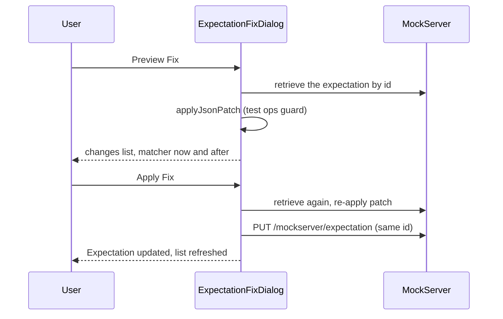

- `lib/jsonPatch.ts` applies the RFC 6902 subset the server emits (`add`, `remove`, `replace`,
  `test`) to a copy; a failed `test` throws `JsonPatchTestFailedError`, which the dialog reports
  as "changed since the explanation" and leaves Apply Fix disabled.
- `lib/expectationFix.ts` previews with `fetchExpectation` (the whole expectation, not the capped
  live list) and applies by re-reading and re-patching before `registerExpectation`, so an edit
  made between preview and apply to a value the patch changes fails the patch instead of being
  overwritten.
- When `matchesAfterPatch` is false, or some fields could not be patched (`unpatchedFields`, for
  example a value the event log redacts or a truncated body), the dialog says so before Apply.
- The before and after panes are plain `<pre>` blocks, not the Monaco diff viewer, so opening a
  preview loads no editor bundle.

### Explain a Request From a Log Group

Every log group (the correlation-ID roll-up in **Log Messages**) carries the `correlationId` its
entries share, sent by `DashboardLogEntryDTOGroupSerializer` as a top-level field and pinned in
`dashboardFrameContract.json`. The group header shows it as a click-to-copy chip and, when one of the
group's entries holds a request the server can explain (`RECEIVED_REQUEST`, `EXPECTATION_RESPONSE`,
`FORWARDED_REQUEST` or `NO_MATCH_RESPONSE`, decided by `isExplainableGroup` in `lib/explainRequest.ts`),
an **Explain** button. It opens `ExplainRequestDialog`, which calls
`PUT /mockserver/explain?correlationId=` and shows what happened at arrival, what would happen now, and
three sections: **Matched**, **Skipped** (reason chip, plain-language explanation, per-field
differences and remediation hints) and **Shadowed**. `LogPanel` owns the dialog, not the row: a row
unmounts as soon as it leaves the virtualized window, which would close a row-owned dialog mid-read.
Like opening a row, Explain turns the panel's Follow off. The dialog keeps its state locally (no store
fields) and shows the server's own reason for a `400`/`404` (an evicted or unknown correlation ID)
instead of the generic "feature not available" message.

Before this, the chip parsed its value from the group `key`, which is the first entry's log id, not the
correlation ID; servers that do not send `correlationId` now show no chip and no Explain button.

### Lint Expectations

The **Lint** button in the **Active Expectations** header opens `LintDialog`, which calls
`PUT /mockserver/lint` with an empty body (`lib/lint.ts`), so the server lints every active
expectation in serving order. Each finding shows its severity, rule and message, the expectation's
position, `METHOD path` and id, and for `SHADOWED` a **Shadowed by** line naming the expectation
evaluated earlier that always matches first. Summary chips give the checked, error, warning and info
counts, and an alert says when the shadowing check hit its pair budget or the list was capped.

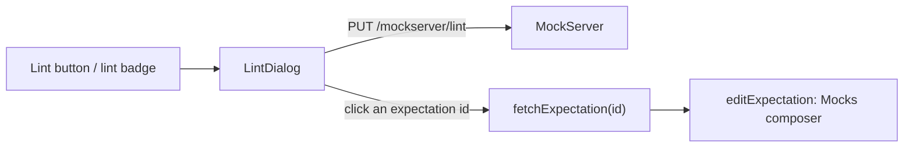

- **Links.** Every expectation id in the dialog, including the shadowing one, is a link that loads
  the whole expectation with `fetchExpectation` (not the capped live list) and opens it in the Mocks
  composer through `editExpectation`. An expectation removed since the lint keeps the dialog open
  with the reason.
- **Badge on create.** `PUT /mockserver/expectation` counts the per-expectation lint warnings in
  `x-mockserver-lint-warnings`. Every dashboard path that sends that PUT shows the count as a
  `LintWarningsBadge` chip (`N Lint Warnings`) that opens the same dialog: the composer's **Mock
  Registered** banner, an Expectation JSON import, Generate Stub's success alert (per suggestion),
  Apply Fix's **Expectation updated.** alert, and Capture as Mock, which stays open with a success
  alert instead of closing when the count is non-zero, its fields read-only and focus on **Close**
  (an LLM capture goes through MCP and has no count). No header, or `0`, shows nothing. The badge needs the header to be readable: a dashboard
  on another origin sees it only if CORS exposes it.
- **Cost.** Lint runs only when the dialog opens or **Refresh** is pressed; the server bounds the
  shadowing work (see [request-processing.md](request-processing.md#expectation-lint)).

### Row Layout in Requests and Expectations

Each collapsed item row has two lines:

1. `[expand-chevron] [timestamp-or-#] [expectationId-if-present]: METHOD …/right-aligned/path`
   — requests carrying a `timestamp` show `hh:mm:ss.mmm`; the ordinal remains only as a
   fallback for entries that have none (see *Counts Derived From the Update Window*)
2. LLM badge chips (provider / model / `turn N of M` / stream / tool count / isolation key), indented to align with the expectation id column

The expanded JSON tree also aligns with the id column. The `turn N of M` chip is computed from `scenarioName` + `scenarioState` ordering and is always present for LLM expectations, regardless of which predicate type the turn uses.

## Traffic Inspector

`TrafficInspector.tsx` is a full-width master/detail layout. It shows **all captured traffic** — both mock-matched requests (from `recordedRequests`) and upstream-proxied requests (from `proxiedRequests`) — in a single unified list, because the user thinks of both as "traffic". No server-side changes are needed beyond the request/response pairing described below.

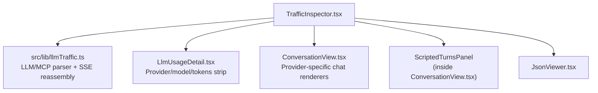

**Master list** — one row per captured call:

| Column | Source |
|--------|--------|
| Time | When the request was received (the row number only when there is no timestamp) |
| Provider chip | Detected kind: Anthropic / Bedrock / OpenAI / OpenAI Resp / Gemini / Ollama / MCP / HTTP |
| Method | `httpRequest.method` |
| Host + path | `httpRequest.headers.host` + `httpRequest.path` |
| Status chip | `httpResponse.statusCode` |
| Model chip | Parsed by `llmTraffic.ts` from request/response bodies |
| Token summary | Input/output tokens from response body |

Each row is a button in a roving tab index: Tab reaches one row (the last one focused, else the open one, else the newest), Enter or Space opens or closes it, and ArrowUp/ArrowDown move focus between rows. Neighbours are found among the rows mounted in the scroll region (the windowed list keeps rows near the viewport mounted), and when the reader scrolls the Tab-reachable row out of the window the tab stop moves to the first row in view. In Compare and Select mode the row's checkbox is the control, so the row is not a button. The header has no row count (the list is the capped live window), and the path tooltip is non-interactive so it cannot cover the next row and take its click. When the server logs above `INFO` (`serverConfiguration.logLevel` is `WARN`, `ERROR` or `OFF`), the 404 for a request that matched nothing is not logged (`NO_MATCH_RESPONSE` is an `INFO` entry), so such rows have no response, no unmatched badge and no Why Didn't This Match? or Generate Stub; a dismissible hint (`traffic-log-level-hint`) says so whenever a recorded row has no response.

**Detail pane** — shown on row selection. The tab row and the action buttons share a header that wraps: when they do not fit side by side the actions move to their own line, so a tab label is never cut behind a scroll arrow. A thin **LLM Usage** strip appears above the tab row for any LLM-kind row, showing: provider chip, model name, tokens (`<in> in / <out> out`), estimated USD cost, and stop reason. This strip is rendered by `LlmUsageDetail.tsx`.

Below the strip, the adaptive tab row:

| Traffic kind | Tabs rendered |
|-------------|---------------|
| Anthropic, OpenAI, OpenAI Responses, Gemini, Ollama | **Messages**, **Conversation**, optionally **Scripted Turns** (when active scripted expectations exist), optionally **SSE Timeline** (when stream events present), **Raw JSON** |
| MCP JSON-RPC (`jsonrpc` field present) | **MCP**, **Raw JSON** |
| All other traffic | **Request**, **Response**, **Raw JSON** — structured request/response tabs (method/path or status prominent, query and header tables, pretty-printed JSON or raw body) with the raw tree last |

**Injected-vs-real latency waterfall.** When the selected row's `httpResponse.timing` block is present, the detail pane renders `TimingWaterfall` — a stacked bar that separates **real** time (connect / wait-TTFB / receive for proxied flows, or a single processing segment for mock-served flows) from latency **MockServer injected**: `injectedDelayMillis` (the action's configured response delay, deep purple), `injectedChaosLatencyMillis` (a chaos-profile latency fault, red), and `breakpointHeldMillis` (time held at a response breakpoint, pink). A grouped legend labels the two sets ("Real" vs "Injected by MockServer"), each segment has an ms tooltip, and an `injected <n>ms` chip summarises the total injected time. This block now renders for **both** proxied entries and mock-served entries **that injected latency** (the server attaches a timing block to a mock response only when it applied a chaos fault, a configured delay, or a breakpoint hold — see [request-processing.md](request-processing.md)), so it is no longer proxy-only. A plain mock with no injected latency has no timing block and shows no waterfall. The injected fields are additive and optional, so older servers that omit them simply render the real segments.

A **Promote to Mocks** button in the Traffic header (enabled when proxied recordings exist) opens a dialog that calls `PUT /mockserver/recordings/promote` — optionally scoped by a method/path filter prefilled from the current search — and reports how many consolidated, redacted expectations were activated. A **Capture as mock** button appears top-right of the detail pane for LLM-kind rows. Clicking it opens `CaptureAsMockDialog.tsx`, which calls the MCP `mock_llm_completion` tool to register a mock expectation from the captured traffic. For non-LLM (generic HTTP) traffic, the same dialog is opened with a generic draft. In the generic case a **Refine in Composer** button appears alongside the Register button in the dialog actions: clicking it calls the store's `editExpectation` action, which loads the draft into the Composer and switches to `view = 'composer'`, so the capture and the Composer share a single creation flow rather than being two divergent engines. Only the generic draft maps cleanly onto the Composer form; LLM drafts go directly to the MCP tool.

### ConversationView Component

`ConversationView.tsx` exports five provider-specific conversation views:

| Export | Provider | Format |
|--------|----------|--------|
| `AnthropicConversationView` | Anthropic Messages API | System banner + user/assistant bubbles + tool-call/tool-result bubbles |
| `OpenAiConversationView` | OpenAI Chat Completions | Same layout, OpenAI message structure |
| `OpenAiResponsesConversationView` | OpenAI Responses API | Input/output item rendering |
| `GeminiConversationView` | Gemini | Contents/candidates rendering |
| `OllamaConversationView` | Ollama | Messages + response rendering |

All five use a chat-transcript layout: user messages left-aligned, assistant messages right-aligned (WhatsApp-style bubbles), system prompts as a distinct banner.

The component is a pure renderer — it receives a parsed object from `llmTraffic.ts` and has no direct store or network dependencies.

### LLM/MCP Parser (`llmTraffic.ts`)

`src/lib/llmTraffic.ts` is a pure client-side parser. It detects traffic kind and extracts structured data for the detail pane.

**Traffic detection:**

| Pattern | Detection logic |
|---------|----------------|
| Anthropic Messages API | Path ends with `/v1/messages`; extracts `model`, `usage.input_tokens`, `usage.output_tokens`, `stop_reason`, messages array, tool-use blocks, SSE events |
| OpenAI Chat Completions | Path ends with `/v1/chat/completions`; extracts `model`, `usage.prompt_tokens`, `usage.completion_tokens`, `finish_reason`, messages array, `tool_calls` |
| OpenAI Responses API | Path contains `/v1/responses` (also Azure's `/openai/v1/responses`), Azure's dated-version `/openai/responses`, or the Codex backend's `/codex/responses`, matched case-insensitively and at a path-segment boundary as the server's `LlmProviderSniffer` does; extracts `model`, input/output items |
| Azure OpenAI | A `*.openai.azure.com` host, a `*.services.ai.azure.com` (Azure AI Foundry) host on an `/openai/` path, or an `/openai/deployments/.../chat/completions` path. Parsed as OpenAI Chat Completions, or as OpenAI Responses on a Responses path, mirroring `LlmProviderSniffer.isAzureOpenAiHost` |
| Anthropic on Vertex AI | `.../publishers/anthropic/models/{model}:rawPredict` or `:streamRawPredict`; parsed as Anthropic, model taken from the path |
| AWS Bedrock Runtime | `/model/{modelId}/invoke`, `/invoke-with-response-stream`, `/converse` or `/converse-stream` for any model id (region-prefixed inference profiles and URL-encoded ARNs included), or a `bedrock*.amazonaws.com` host. Parsed into the Anthropic shape with `platform: 'bedrock'` (chip "Bedrock"): InvokeModel on Claude is already that shape; Converse `text` / `toolUse` / `toolResult` / `reasoningContent` blocks, `system`, `toolConfig`, `inferenceConfig.maxTokens` and `usage` (`inputTokens`, `outputTokens`, `cacheReadInputTokens`, `cacheWriteInputTokens`) are mapped onto it. The model comes from the path unless the body names one. InvokeModel bodies of the other model families are mapped too: Llama `prompt` / `generation`, Titan Text `inputText` / `results[].outputText`, Mistral `prompt` / `outputs[].text`, Cohere Command `prompt` / `generations[].text`, and Cohere Command R `message` + `chat_history` + `preamble` / `text` + `tool_calls`. Token counts come from the body (Llama, Titan, Cohere R `meta.billed_units`), else from the `x-amzn-bedrock-input-token-count` / `x-amzn-bedrock-output-token-count` response headers (Mistral and Cohere bodies carry none) |
| Gemini | `/v1beta/models/{model}:generateContent`, `/v1/models/gemini-*:…`, or Vertex `.../publishers/google/models/{model}:…` (`generateContent` / `streamGenerateContent`); extracts `model`, contents, candidates. Output tokens are `usageMetadata.candidatesTokenCount` plus `thoughtsTokenCount`, because Gemini bills thinking tokens as output |
| Ollama | Path is `/api/chat`; extracts `model`, messages, response message. `stream` defaults to true, as in Ollama |
| Ollama generate | Path is `/api/generate`; `system` and `prompt` (with `images`) are shown as system and user messages and `response` (with `thinking`, and the final object's top-level `tool_calls`) as the assistant reply, with `endpoint: 'generate'`. Capture to mock makes an `OLLAMA` LLM expectation on the captured path, which the mock answers in the generate shape |
| MCP JSON-RPC | `Content-Type: application/json` body with a `jsonrpc` field; extracts `method`, `id`, `params`, `result`, `error` |
| Fallback | Generic display — Raw JSON only |

**SSE reassembly:** For streamed responses (body contains `data:` lines), `llmTraffic.ts` splits the captured body on `\n\n`, parses each `data:` chunk as JSON, and merges incremental delta fields to reconstruct the final message content. The per-chunk elapsed timestamps are preserved for the SSE Timeline tab.

**Base64 body decoding:** When a response body has a `BINARY` body type, the content is base64-encoded. `llmTraffic.ts` detects the `BINARY` type and decodes before parsing. Textual streaming responses are normally delivered as `STRING` bodies; this is a defensive fallback.

**Other stream formats:** Ollama streams newline-delimited JSON (`application/x-ndjson`); each line is a chunk, and message content (`response` on `/api/generate`), `thinking` and `tool_calls` are concatenated while `done`, `done_reason` and the eval counts come from the final line. Gemini `streamGenerateContent` without `?alt=sse` returns a JSON array of response chunks, reassembled like the SSE form. Bedrock streams use the AWS event-stream binary framing (`application/vnd.amazon.eventstream`), stored as a `BINARY` body: `src/lib/awsEventStream.ts` decodes the frames from the raw bytes (checking each frame's message CRC and stopping at a truncated frame), `InvokeModelWithResponseStream` `chunk` frames are unwrapped from their base64 `bytes` into Anthropic events (or, for Llama, Titan, Mistral and Cohere, their text fields are concatenated and the token counts read from the last chunk's `amazon-bedrock-invocationMetrics`; text streamed before an exception frame is kept, and the exception shows in the SSE Timeline), and `ConverseStream` frames are reassembled by their `:event-type` (`contentBlockStart`, `contentBlockDelta`, `messageStop`, `metadata`). In all three the chunks also fill the SSE Timeline tab.

## Trace (Sessions) Inspector

`SessionInspector.tsx` (view = `sessions`, nav label **Trace**) groups all captured requests into swim-lanes by `<scenarioName> / <isolation-value>`. Each swim-lane displays chips for the captured turns, where each chip shows the turn index, method, path, and status code. Clicking a chip opens a per-request detail panel directly below the swim-lane, showing the Conversation view for the selected turn.

Requests that do not match any isolated scenario are grouped by upstream host (from the `Host` header) into **unscoped** sessions. This proxy-aware fallback means proxied traffic to different LLM providers (e.g. `api.anthropic.com` vs `api.openai.com`) appears in separate swim-lanes even without any conversation-isolation expectations configured.

Each swim-lane also has a collapsible **Conversation** section (`SessionConversation`) that renders the whole session as a chat-transcript using the same provider-specific Conversation views as the Traffic tab. Because each request in an agent run re-sends the full accumulated message history, it renders the *last* conversation-capable request in the session, which carries the complete transcript. Beneath it, a compact **Show graph** link (`AgentRunGraph.tsx`) fetches the correlated agent-run call graph on demand via the `explain_agent_run` MCP tool and renders it as a real Mermaid SVG diagram — a secondary structural view alongside the chat transcript. `AgentRunGraph` imports `mermaid` via a dynamic `import('mermaid')` inside an effect so the large Mermaid bundle (~hundreds of kB) stays out of the initial dashboard chunk and is fetched only the first time a user opens a graph. The SVG is rendered with `securityLevel: 'strict'` and a theme that follows the dashboard's light/dark mode. If Mermaid fails to load or render, the component falls back to displaying the Mermaid source text and a "Could not render the diagram" note. A "Show/Hide Mermaid source" toggle and a `CopyButton` are always available below the rendered diagram. Both graph and transcript are shown for any session with a detectable LLM provider, including unscoped/proxy sessions.

The grouping logic lives in `src/lib/sessionGrouping.ts`. It uses `scenarioName` and `scenarioState` from the request data to identify which requests belong to which conversation session, with a host-based fallback for unscoped traffic.

Each session lane header displays **per-session token/cost totals**: total input tokens, total output tokens, and estimated USD cost (via `llmPricing.ts`). These are computed purely client-side by aggregating the token usage already parsed from each request's response body by `llmTraffic.ts` (`getNumericTokens`). The cost chip is shown only when a pricing entry exists for the provider/model combination; unpriced models contribute tokens but no cost.

## Mocks (composer) View

`ComposerView.tsx` (view = `composer`, surfaced under the AppBar label **Mocks**) is a unified expectation creator and editor — a single inline form covering standard HTTP expectations of every action type plus multi-turn LLM conversations.

At the top is a **Quick mock / Advanced** toggle (`ComposerMode = 'quick' | 'advanced'`), defaulting to `'quick'`. The choice is persisted to `sessionStorage` so it survives navigation within the session. When a `pendingEditExpectation` arrives from the store (set by `ExpectationPanel`'s Edit action), the form loads the expectation and switches to **Advanced** mode automatically, since Quick mode only authors a plain HTTP static mock.

Below the mode toggle is an **Expectation kind** radio: **Standard HTTP expectation** or **LLM Conversation**.

### Standard HTTP Expectation

**Quick mock mode** (`QuickMockForm`) shows only the fields needed for the 90% case — method, path, status code, and a response body — and always produces a static HTTP expectation. It is the default for new sessions and for users who have not previously chosen Advanced. Switching to Advanced retains the current form state.

**Advanced mode** exposes the full form described below.

A **template snippet palette** (`SnippetPalette.tsx`) is available in both the Response Template and Forward Template steps. It is engine-aware — clicking a snippet inserts the correct Velocity, Mustache, or JavaScript syntax for the currently selected template engine. Each snippet shows a description and example output.

Beside the palette, **Test Template** opens `TemplateTestDialog`, the template dry run. It sends the inline template, its engine, the action type (`RESPONSE_TEMPLATE` or `FORWARD_TEMPLATE`) and a sample request to `PUT /mockserver/template/test` (`lib/templateTest.ts`); nothing is registered. The sample request is editable JSON, `GET /` by default, or one of the 50 newest HTTP rows of Received Requests (DNS queries and binary messages are not offered) picked from a list; a row whose body the server shortened is loaded whole first (`useLoadFullRow`), and if that fails the picker and the JSON keep their previous values. The result shows a Valid Response / Valid Request, Failed or Timed Out chip with the duration; for a failure, the message, its template line and column, the hint, the validation errors and the template lines around the failing one with a caret under the column (a `role="note"` labelled with the column; tabs are shown as stops every 8 columns, which is how Velocity counts its columns, while a JavaScript column counts a tab as one character and is converted); each warning with its position; and the rendered response or request, or the raw rendered output when it is not one. Any field the server shortened is marked. A 429 (two dry runs already running) shows the server's reason as a warning; a 400, 401 or 403 shows its reason as an error. Closing the dialog or **Cancel** aborts the browser's request, although a Velocity or Mustache template keeps running on the server until it finishes. The button is disabled when the inline template is empty, because a template file cannot be tested here.

The Response Template and Forward Template panels also expose an **"Or load template from file"** field (`templateFile`) so the template can live in an external file instead of inline; the inline template wins when both are set. The Static HTTP response panel has a **Body source** toggle (Inline body / From file): choosing *From file* emits a `FILE` body with a path and an optional **Template engine** selector (None / Mustache / Velocity) that renders the body file as a template against the request. JavaScript is not offered for body files — it builds a full response object rather than a text fragment, so use a Response Template for that. These map to `StandardStaticState.bodyFromFile/filePath/fileTemplateType`, `StandardTemplateState.templateFile`, and `StandardForwardTemplateState.templateFile` in `standardCodegen.ts`.

- An **Existing <kind> mocks** list (`ExistingMocksList`, Advanced mode) shows the active non-LLM expectations of the selected kind as `<id-short>… METHOD path`. Clicking one prefills the matcher + response-action panel; **New / clear** drops the selection. A **Search by path or id** box filters the list. The list is fed from the store's capped live window (`activeExpectations`); when `activeExpectationsTotal` exceeds the window it says so, and a search then fetches every active expectation (`fetchActiveExpectations` in `lib/expectations.ts`, `PUT /mockserver/retrieve?type=active_expectations&format=json`, debounced) so a mock outside the window can still be found; a result outside the window loads directly (it came whole from the server).
- Status code fields (`StatusCodeField`: static, SSE and fallback responses, and the Quick form) hold a blank value as `NaN` instead of snapping to 0 or 200; `responseStatusCodeError` in `standardCodegen.ts` keeps Register disabled, with the reason, until the value is a whole number from 100 to 999 — the same range the server's schema accepts.
- **Step 1 · Match a request**: Expectation ID (optional), Method, Path, Headers (Name: value lines), Query string parameters (key=value lines), Cookies (name=value lines), Path parameters (name=value lines), Body matcher, "Body is binary (base64)" toggle, HTTPS-only toggle, Priority (higher = wins), Times (0 = unlimited). All string fields and per-line entries accept a leading `!` to negate via MockServer's NottableString convention.
- **Step 2 · Respond with**: radio for the response action — twelve for the HTTP kind: Static HTTP response / Forward to upstream / Forward with override / Forward with fallback / Class callback / Response template / Error / fault injection / WebSocket response / SSE response / Binary response / Forward template / Forward class callback (DNS and gRPC kinds get their own actions).
- **Step 3 · {action name}**: per-action panel with fields specific to that action.
- **Editing keeps fields the form does not show.** On load the composer records the action JSON its form produces for the original (`editActionBaseline`); on save `mergeUnmodeledFields` keeps the original's value wherever the form's output still equals that baseline, merging nested objects field by field and the form's lists of rows item by item. WebSocket messages, WebSocket matchers and their responses, SSE events and gRPC messages are edited one per row (`StandardListItemDraft`), and every row carries a hidden `itemId` from a module counter, assigned on load and to each added row, that moves with the row through Move up / Move down, Remove and edits. A row may hold several lines and is one message (`MessageRows`); lines pasted into an empty row become one row each unless the paste parses as one JSON value (such as pretty-printed JSON), a pasted single line loses its trailing newline, and a row with several lines offers a Split button (the first line keeps the row's id). After a move, `RowControls` returns focus to the moved row's button. `buildExpectationJson` emits only the item's wire fields and records the row ids against the emitted array in a `WeakMap` (`LIST_ITEM_IDS`), so the ids never reach the saved JSON or a code tab; `mergeItems` merges each form item with the loaded item of the same id and takes a row whose id was not loaded (a new row) as is, with no hidden fields. An original item the form cannot load, such as a binary WebSocket message, stays after its original predecessor. A list that only moved counts as changed (`sameItemIds`), so swapping two equal items swaps their hidden fields. Durations, scalars and arrays the form does not edit as rows are replaced whole. `keptActionFields` lists what the save keeps that the form does not show (fields it does not model, values it loads lossily such as a delay in HOURS, list items it cannot load); the action panel shows them in an **Other fields** box with a remove button per field (`clearKeptActionField` resets the field to what the form showed, or drops it). The Quick form shows the same box for the response. Every code tab renders the kept fields: Java builds the inherited `delay`/`primary` and the WebSocket / SSE / gRPC message lists from the saved JSON and names anything else in a `// NOTE`; the other languages render them from the saved JSON through their client models (Go names in a `// NOTE` any other wire key its struct has no field for). The Python, Ruby and Rust emitters check every action object they render against the fields their model holds (`OmittedFields` in `lib/codegen/shared.ts`): Python and Ruby name each field they cannot hold by wire path in one `# NOTE` after the snippet; Rust carries an unmodelled field in the struct's `extra` map where it has one and otherwise names it in an inline `/* NOTE */` (its `Delay`, `HttpTemplate`, message types and `HttpClassCallback` have no `extra` map). All three clients model every schema field of the actions in `actionFieldCases.ts`, so for those actions only a field newer than the client (or one the schema does not define) reaches a NOTE. `actionFieldCases.ts` holds one edit per action type with every schema field; its snippets run against the real Python and Ruby clients in `actionFieldCoverageCodegen.test.ts` and feed the client compile gates. The Rust snippets (mock, verification and load scenario) name `mockserver-client = "<major>"` in their `Cargo.toml` comment; the major comes from `mockserver-client-rust/Cargo.toml` at build time (`build-constants.ts`, injected as `__RUST_CLIENT_MAJOR_VERSION__` by both `vite.config.ts` and `vitest.config.ts`), so the build fails if that file is missing, and the goldens hold a `<rust-client-major>` placeholder so a major release does not change them.
- **Step 4 · Review & register**: client-library tabs first — Java / Node.js / Python / Go / C# / Ruby / Rust — then JSON and curl last (read-only preview generated from the current form state by `standardToJava`/`standardToNode`/`standardToPython`/`standardToGo`/`standardToCsharp`/`standardToRuby`/`standardToRust`/`standardToJson`/`standardToCurl` in `standardCodegen.ts`), then the Register expectation button. The client-library tabs hydrate the same expectation JSON via each client's native facility (Node `mockAnyResponse({...})`, Python `Expectation.from_dict({...})`, Go `json.Unmarshal → client.Upsert`, C# `JsonSerializer.Deserialize<Expectation> → client.Upsert`, Ruby `Expectation.from_hash(JSON.parse(...)) → client.upsert`, Rust `serde_json::from_str::<Expectation> → client.upsert`) instead of reimplementing each language's builder matrix. The Node client is JSON-native so it reproduces every field; the typed-model clients hydrate into model objects, so a field the installed client version does not yet model is dropped on hydration (the JSON tab stays the authoritative, lossless source). Helper text next to the button changes based on whether the Expectation ID field is filled (editing existing in place vs. creating new).

#### Scenario Bindings (Advanced)

Advanced mode has an optional **Scenario** section with three fields — **Scenario Name** (`scenarioName`), **Required State** (`scenarioState`), and **Transition To** (`newScenarioState`) — that wire the mock into a scenario state machine (it matches only while the scenario is in the required state, then advances it). Blank fields are omitted, so a fresh Advanced compose with an empty Scenario section is byte-identical to before the section existed.

These three keys are **modeled only on the Advanced path**. `StandardActionPayload.scenarioModeled` (set true only when the Advanced form rendered the section) makes them form-authoritative in `mergeUnmodeledFields` / `unmodeledFieldNames` (`standardCodegen.ts`): set when non-empty, **deleted when cleared**, and dropped from the "Preserving N fields" chip. On the **Quick path** `scenarioModeled` is never set, so the same three keys stay **unmodeled passthrough** — a quick edit of a scenario-bound mock can never drop its bindings. On edit, the fields are prefilled from the original (in both `handleLoadExisting` and the `pendingEditExpectation` hand-off), so an untouched edit round-trips the bindings identically. See `FORM_MODELED_SCENARIO_KEYS` in `standardCodegen.ts`.

### LLM Conversation

- An **Existing LLM scenarios** list, listing scenario names (e.g. `weather-agent (2 turns)`).
- The LLM Conversation wizard content is rendered inline on the same page — no modal. It uses the same "1 · / 2 · / 3 ·" step structure: **Conversation basics** (provider, path, model, isolateBy), **Turns**, **Review & register** (Java / JSON / MCP tabs + Register button).
- Picking an existing scenario from the list remounts the form via React `key` and prefills all fields. The Register button reads "Update N expectations" instead of "Register on server" when editing. A green note confirms "Editing — the existing expectation IDs will be reused so this updates in place."

The edit-existing flow works because `ComposerView.tsx` collects the current expectation IDs and passes them as `ids: string[]` to the `create_llm_conversation` MCP tool call. The server then calls `Expectation.withId(...)` on each generated expectation before `httpState.add(...)`, which performs an upsert.

## Scenarios View

`ScenarioPanel.tsx` is rendered both as the standalone **Scenarios** nav view (`view = 'scenarios'`) and as the **Scenarios** tab inside the Mocks composer — the same component in both contexts. It controls MockServer's scenario state machines via `GET/PUT /mockserver/scenario…` (`lib/scenarios.ts`) and, on top of the existing current-state / set-state / trigger / reset controls and the observed-transition Mermaid diagram, surfaces a **Scenario Details** section so a scenario is legible, not just controllable.

**Scenario Details** builds entirely client-side from the store's `activeExpectations` — each expectation carries top-level `scenarioName` / `scenarioState` / `newScenarioState`, so no extra fetch is needed (`buildScenarioDetails` in `lib/scenarioState.ts`). The `GET /mockserver/scenario` list annotates each scenario with its live current state and also surfaces scenarios that exist server-side but have no client-side expectation (e.g. cross-protocol trigger-only scenarios). Each scenario renders as an expandable card: its states (sorted by `scenarioStateSortKey`) and, under each state, the bound mocks — showing the `METHOD /path` summary, the state matched in, and the state transitioned to (`state → newState`).

Every bound mock has a per-row **Edit** action, and each scenario has a scenario-level **Edit** (edits its single mock directly, or opens a picker when several mocks are bound). All Edit actions reuse the store's `editExpectation(value)` — the exact hand-off `ExpectationPanel` uses — which loads the mock into the Composer and switches `view` to `'composer'`. From the standalone Scenarios view that navigates to Mocks; inside the Mocks view the `pendingEditExpectation` effect also flips the composer to its **Compose** tab so the loaded form is visible. Because `editExpectation` hands off the full expectation JSON and the Composer's edit-overlay preserves scenario bindings (see [Scenario Bindings](#scenario-bindings-advanced)), editing a scenario-bound mock keeps its bindings intact.

## Library View

`LibraryView.tsx` consolidates fixture management and export. Three sub-tabs:

| Sub-tab | Content |
|---------|---------|
| **Cassettes** | List / Record / Load / Export sub-tabs for cassette files. Recording writes the current MockServer state to a JSON cassette file on the server filesystem via the `record_llm_fixtures` MCP tool. Loading reads one back via `load_expectations_from_file`. A record that finds no traffic, or a load of a file with no expectations, shows a warning and lists nothing. The list keys each cassette by the absolute path the server resolved (the tool result's `file`; the server registry canonicalises every path the same way), so a relative and an absolute spelling of one file are one row. |
| **Runs** | Pick two captured sessions (Run A / Run B) and see a side-by-side structural trajectory diff (tool-call chain + per-turn token usage table). |
| **Export** | Single dropdown that crosses scope (registered expectations / recorded requests) with file format (MockServer JSON / HAR / OpenAPI 3 / Postman v2.1 / Bruno zip). Each option maps to a `PUT /mockserver/retrieve?type=ACTIVE_EXPECTATIONS\|REQUEST_RESPONSES&format=JSON\|HAR\|OPENAPI\|POSTMAN\|BRUNO` call. BRUNO returns `application/zip` since Bruno collections are multi-file (`.bru` per request + `bruno.json` manifest). Generation lives in `mockserver-core`'s `ExpectationExportSerializer` — best-effort for the non-MockServer formats (positive-string matchers round-trip, NottableString negation and dynamic actions appear as placeholders). |

## Verification View

`VerificationView.tsx` (view = `verification`, AppBar label **Verify**) builds and runs request verifications against the requests MockServer has already received. A toggle switches between two modes:

- **Single request** — one `httpRequest` matcher (method, path, header lines, query `key=value` lines, substring/JSON body) plus a times assertion. The times mode (`VerificationTimesMode`) is one of `atLeast` / `atMost` / `exactly` / `between`; `between` reveals a second count field. Submitting calls `verifyRequest(...)` in `lib/verification.ts`.
- **Ordered sequence** — an ordered list of matcher rows (add / remove steps) that must have been received in order (other requests may occur in between). Submitting calls `verifySequence(...)`.

Empty form fields are omitted from the built `httpRequest` (`buildHttpRequest`). The response matcher has a **Status code** and a **Status range** (`statusCodeRange`: a class such as `4XX` or one comparison such as `>= 400`, the forms the server's `StatusCodeMatcher` accepts); a range the server could not parse, or a code and a range together (the server ignores the code when a range is set), is a field error that disables Verify. The quick scope accepts `status:` and fills these fields through `verificationStatusFor` in `lib/filterScope.ts`: an exact code goes to Status code, a whole class (`status:>=400 status:<500`) to `4XX`, and a single bound to `>= N` or `<= N`; a range only two comparisons express (`status:>=400 status:<450`) is refused rather than widened, since `statusCodeRange` holds one expression. A test checks the translation against `matchesItemSearch` for every status from 100 to 599. Applying a `status:` scope opens the response matcher. The generated Java calls `.withStatusCodeRange(...)`; the Go client's `ResponseBuilder` cannot set a range, so with one the Go tab sends the verification with `net/http` instead of emitting a looser client call. The request and response **body** fields go through `bodyMatcher` in `lib/verification.ts`: text that parses as a JSON object or array becomes a `JSON` matcher (server default `ONLY_MATCHING_FIELDS`, so a fragment matches a larger document), anything else a `STRING` matcher with `subString: true`, never a plain string (which the server treats as an exact whole-body match). Header / query lines the parser cannot split (no separator, or an empty name — `ignoredKeyValueLines` in `lib/standardCodegen.ts`) are shown as inline field errors and disable Verify, because dropping them would loosen the check into a false pass; a section holding such a field cannot be collapsed. `timesSpecProblem` likewise blocks a count above a Java `int` and a `between` max below its min (the max is sent as entered, never raised to the min). A pass (202) renders a green "Verified" alert; a failed verification (406) renders the server's `failureMessage` (closest matches + actual count) in a red alert; any other status (a 400 for bad input, a 5xx) is thrown and shown as an error, not as a verdict. `lib/verification.ts` is framework-agnostic (plain `fetch`) so it is unit-tested independently of the component. This is the visual equivalent of the verification REST API (`PUT /mockserver/verify` and `PUT /mockserver/verifySequence`).

## SLO View

`SloPanel.tsx` (view = `slo`, AppBar label **SLO**, under the **Verify** group) lets the user define SLO objectives against recorded traffic and assert them on demand. It calls `PUT /mockserver/verifySLO` via `lib/slo.ts` with a `SloCriteria` body — a `window` object (`{ type: 'LOOKBACK', lookbackMillis }` for a trailing window, or `{ type: 'EXPLICIT', fromEpochMillis, toEpochMillis }` for an absolute range) and an array of `SloObjective` entries each specifying:
- `sli` — one of `LATENCY_P50` / `LATENCY_P95` / `LATENCY_P99` / `ERROR_RATE`
- `comparator` — one of `LESS_THAN` / `LESS_THAN_OR_EQUAL` / `GREATER_THAN` / `GREATER_THAN_OR_EQUAL`
- `threshold` — the numeric threshold value

The server evaluates the objectives and returns an `SloVerdict` with `result` (`PASS` / `FAIL` / `INCONCLUSIVE`) and `objectiveResults` array. The panel renders per-objective pass/fail chips showing the measured value alongside the threshold.

## Contract View

`ContractTestPanel.tsx` (view = `contract`, AppBar label **Contract**, under the **Verify** group) validates mocks and recorded traffic against an OpenAPI spec. A ToggleButtonGroup switches between two modes; both take the OpenAPI spec as a URL, file path, or inline YAML/JSON document (the same spec `TextField`):

- **Live Contract Test** — calls `PUT /mockserver/contractTest` with a spec, a target `baseUrl`, and an optional `operationId` to exercise the live service and report pass/fail per operation. Results render as a table with columns: result (PASS/FAIL), operation, method, path, status code received, and validation errors. The UI result type `ContractTestOperationResult` (`lib/contractTest.ts`) has fields `operationId`, `method`, `path`, `statusCodeReceived`, `passed`, and `validationErrors: string[]`.
- **Validate Recorded Traffic** — calls `PUT /mockserver/trafficValidate` with only a spec (no `baseUrl`; the endpoint contacts no live service). The server locates every request/response pair it has already recorded against the spec and validates each in place — the safer, CI-style twin of the live contract test. Results render as a table with columns: result, method, path, matched operation, request errors, and response errors. The UI result type `TrafficValidationResult` has fields `method`, `path`, `matchedOperation: string | null`, `passed`, `requestErrors: string[]`, and `responseErrors: string[]`; the report adds `totalRequests`/`passed`/`failed`/`allPassed`. When no traffic has been recorded (`totalRequests === 0`) the panel shows an info alert prompting the user to record or proxy traffic first.

Both modes surface the server's `{ "error": ... }` envelope on failure via `HumanErrorAlert`. `lib/contractTest.ts` is framework-agnostic (plain `fetch`) so `runContractTest` and `validateRecordedTraffic` are unit-tested independently of the component.

## Cluster View

`ClusterPanel.tsx` (view = `cluster`, AppBar label **Cluster**, under the **Inspect** group) shows the status of MockServer cluster nodes when the Infinispan state backend is active. It polls the cluster status endpoint and renders per-node health, the cluster name, and shared-state metrics. When clustering is not enabled the panel shows a configuration prompt.

## LLM Optimise View

`OptimiseView.tsx` (view = `optimise`, AppBar label **LLM Optimise**, under the **AI** group) analyses captured LLM proxy traffic and exports a brief recommending optimisations to prompts, inference cost, safety, and speed. It calls the LLM optimise REST endpoint, renders per-call signals (token usage, cost, cache-hit rate, one-shot rate, latency), and assigns an A–F verdict with a dollar-value "recoverable" attribution capped at actual spend. An export button downloads the full JSON report.

## MCP Server Health View

`McpServerHealthPanel.tsx` (view = `mcp-health`, AppBar label **MCP Health**, in the **AI** group) shows which MCP servers your proxied coding-assistant CLI traffic is calling, and which ones are slow or erroring. The MCP server is often the real bottleneck while MockServer's own forwarding is fast; this view surfaces the culprit at a glance.

**Data source.** The panel reads `proxiedRequests` + `recordedRequests` from the Zustand store — both pushed over the main dashboard WebSocket — and passes their `.value` objects to the pure client-side function `aggregateMcpServerHealth` in `src/lib/llmTraffic.ts`. Only MCP JSON-RPC entries (where the parsed kind is `mcp`) contribute to the table; all other traffic is silently ignored. No independent polling is performed.

**Columns.**

| Column | Content |
|--------|---------|
| Server | Upstream `Host` header value (or `(unknown host)` when absent) |
| Errors | Count and rate — a JSON-RPC `error` field or a non-2xx HTTP status counts as an error |
| Median | Median round-trip latency (ms or s), nearest-rank percentile |
| p95 | 95th-percentile latency (ms or s), nearest-rank percentile |
| Max | Slowest single exchange; shown in warning colour when the `slow` flag is set |
| Slowest method | JSON-RPC method name of the single slowest exchange |

There is no call-count column: the panel aggregates the server's capped live window (100 rows by default), so a count would sum to at most the cap however much traffic ran. The rates and percentiles are ratios over that sample and stay meaningful.

**Flags.** Each row carries two optional flags:

- **errors** (red chip) — `errorCount > 0`; the row gets an error-tinted background
- **slow** (amber chip, only when no errors) — p95 (or max when p95 is unavailable) is at or over `MCP_SLOW_THRESHOLD_MS` (5 000 ms); the row gets a warning-tinted background

Rows are sorted worst-first: most errors → highest error rate → slowest (p95 or max) → busiest → host name for a stable tie-break.

**Empty state.** When no MCP traffic has been captured, an info alert reads: "No MCP traffic captured. Proxy a tool that talks to MCP servers (JSON-RPC over HTTP) and its per-server health will appear here."

**Lazy loading.** `McpServerHealthPanel` is lazy-loaded in `App.tsx` via `React.lazy`, so the chunk is not fetched until the MCP Health tab is first opened.

## AsyncAPI View

`AsyncApiPanel.tsx` (view = `async`, AppBar label **Async**) shows the live status of the AsyncAPI broker mock (the `mockserver-async` module). It **polls** `GET /mockserver/asyncapi` every 5s via `getAsyncApiStatus` in `lib/asyncApi.ts` (with a manual refresh button) rather than using the WebSocket. It renders:

- a **status header** — a connection chip (`connected` / `no spec loaded` / `unavailable`) plus the loaded spec title and version when present,
- a **Channels** table — one row per channel/topic with a schema-present indicator and example count,
- a **publisher / subscriber summary** — chips for active publisher count, subscriber count, and recorded-message count,
- a **Recorded Messages** table — messages captured from broker subscriptions (channel, key, truncated payload with full-text tooltip, schema-valid indicator, timestamp), with a free-text filter over channel / key / payload.

When the `mockserver-async` jar is not on the server's classpath the helper returns `null` and the panel shows a "Module unavailable" warning. A spec is loaded from the **AsyncAPI broker mock** entry in the Tools menu (`AsyncApiDialog`) or via `PUT /mockserver/asyncapi`.

## gRPC Services View

`GrpcServicesPanel.tsx` (view = `grpc`, AppBar label **gRPC**) lists the gRPC services and methods loaded from compiled protobuf descriptors, together with the health-check serving status of each service. It **polls** every 5 s via `useAutoRefresh`, fetching both data sources in parallel via `lib/grpc.ts`:

| Endpoint | Method | Purpose |
|----------|--------|---------|
| `PUT /mockserver/grpc/services` | `listGrpcServices` | Returns the services and methods from loaded FileDescriptorSets |
| `GET /mockserver/grpc/health` | `fetchGrpcHealth` | Returns a map of service name → `ServingStatus` |

`fetchGrpcStatus` wraps both calls; the health fetch is best-effort — if the endpoint is unavailable (older server), the panel still renders services with an empty health map rather than failing.

The panel renders:
- a **header** with service count, total method count, and an overall server `ServingStatus` chip (derived from the `_default` or empty-string key in the health map),
- one **collapsible card per service** — service name in monospace, a per-service health chip (`SERVING` / `NOT_SERVING` / `SERVICE_UNKNOWN` / `UNKNOWN`), and a method count,
- within each card, a **methods table** with columns: Method (name), Input (fully-qualified message type), Output (fully-qualified message type), and Kind (`unary` / `server stream` / `client stream` / `bidi stream`).

When no descriptors are loaded, a centred prompt directs the user to `PUT /mockserver/grpc/descriptors`. Errors are surfaced via `HumanErrorAlert`. Health chip colours: `SERVING` → success, `NOT_SERVING` → error, `SERVICE_UNKNOWN` / `UNKNOWN` → warning.

## MCP Session Handshake

`mockserver-ui/src/lib/mcpClient.ts` manages all MCP tool calls from the UI (capture-as-mock, conversation registration, cassette record/load). It performs the MCP `initialize` + `notifications/initialized` handshake lazily on first use and caches the resulting `Mcp-Session-Id` per base URL in a module-level `Map`. If a call fails with a "Missing or invalid Mcp-Session-Id" error, the client reinitializes automatically before retrying.

Prior to this, any UI feature that called an MCP tool was broken with a session-not-initialized error.

## Breakpoints Panel

`BreakpointsPanel.tsx` (view = `breakpoints`) registers **breakpoint matchers** and resolves paused HTTP exchanges and streaming frames interactively. Unlike the polling views, it is a real **callback-WebSocket client**: it opens `/_mockserver_callback_websocket` (the server assigns it a `clientId`, since a browser WebSocket cannot send the registration header) and paused items are **pushed** to it live — there is no REST polling of paused state. Only the matcher list is fetched over REST. (`lib/breakpoints.ts` holds the matcher REST helpers; `lib/breakpointCallbackClient.ts` holds the WebSocket client.)

The panel has **three tabs**:

**Matchers tab** — register a breakpoint matcher (method, path regex, headers, query parameters, cookies, and an optional inclusive response status range sent as `responseStatusCodeMin`/`responseStatusCodeMax`) together with the phases to break at (`REQUEST` / `RESPONSE` / `RESPONSE_STREAM` / `INBOUND_STREAM`), and list / remove / clear the active matchers. The list shows a matcher's status range as a chip (`formatStatusRange`).

The server checks the status range at the `RESPONSE` phase only (`BreakpointMatcherRegistry.findResponseMatch`); the request and stream phases pause regardless of it. So registration refuses a status range without the Response phase ticked, a caption warns when other phases are ticked beside it, and a min above the max or a value outside 0-999 is refused before the request is sent.

**Breakpoint scope** — the `OperatorSearchField` above the form (accessible name "Breakpoint scope") takes `BREAKPOINT_SCOPE_FIELDS`: `method:`, `path:`, `host:` and `status:`. **Apply scope** fills the form through `lib/filterScope.ts` `parseRequestScope`: globs become anchored regexes, `host:` becomes a `Host` header row, and each `status:` comparator becomes inclusive bounds (`>N` is `>=N+1`, `<N` is `<=N-1`, a bare code is one exact code); repeated `status:` operators intersect, as the search box ANDs them, and a range that selects no code is refused. A `status:` scope also sets the phases to Response only, since a ticked Request phase would pause every matching request. A test compares the translated range with `matchesItemSearch` for every status from 100 to 599. Verification's scope takes `status:` too (`VERIFICATION_SCOPE_FIELDS`, see [Verification View](#verification-view)); each of its scope boxes is named ("Quick scope", "Scope for step N") so a screen reader can tell an ordered sequence's steps apart.

The matcher REST endpoints:

| Action | Endpoint |
|--------|----------|
| Register matcher | `PUT /mockserver/breakpoint/matcher` (requires a `clientId`) |
| List matchers | `GET /mockserver/breakpoint/matchers` |
| Remove one matcher | `PUT /mockserver/breakpoint/matcher/remove` (`{id}`) |
| Clear all matchers | `PUT /mockserver/breakpoint/matcher/clear` (routed through a confirmation dialog) |

The matcher list loads on mount and via a manual Refresh button (no interval).

**Live Exchanges tab** — one row per paused request/response exchange that arrived over the callback WebSocket. Each row shows the phase (`REQUEST` or `RESPONSE`), method or status code, path or reason phrase, age, exchange ID, and the matched breakpoint/expectation ID. Resolution is sent back over the **same callback WebSocket** (not REST):

| Button | Effect |
|--------|--------|
| Continue | Resolve the exchange unchanged (`resolveRequest` / `resolveResponse` with the original) |
| Modify | Opens a JSON editor prefilled with the request (REQUEST phase) or response (RESPONSE phase); resolves with the edited JSON |
| Abort | Resolve the REQUEST with a synthetic error response so it is not forwarded |

**Live Streams tab** — paused frames from forwarded streaming responses (SSE, chunked transfer, gRPC server-streaming, gRPC bidi inbound), grouped by `streamId`. Each row shows a direction badge (`Inbound` / `Outbound`) alongside the sequence number, method, path, body preview, size, and age. Per-frame decisions are sent over the WebSocket as a `StreamFrameDecisionDTO` whose `action` is one of `CONTINUE` / `MODIFY` / `DROP` / `INJECT` / `CLOSE` (continue, modify body, drop/discard, inject an extra frame after this one, close stream). The modify and inject actions each open a text editor dialog.

Held items are bounded client-side and cleared when the callback WebSocket disconnects (a reconnect issues a new `clientId`, so older paused items can no longer be resolved). There is one callback client per MockServer target (see [Per-workspace MockServer target](#per-workspace-mockserver-target)); the panel remounts on a target change and always uses the live target's client.

**Items MockServer resolves itself** — when the breakpoint timeout continues a paused item, or a stream ends before a held frame can be delivered, the server sends a `BreakpointReleasedDTO` (the dashboard asks for these by connecting with `?capabilities=breakpointReleased`). The client removes the item from its store and tells subscribers (`subscribeReleaseNotices`); the panel shows the message in a dismissible notice (`data-testid="breakpoint-release-notice"`), and an open Modify / Inject dialog for that item shows an error and no longer sends. The client remembers the correlation ids it has replied to, so a notice that crosses the user's own decision is shown as "Your decision was not applied".

**Catch-all confirmation** — registering with no method, path, header, query parameter or cookie would create a `.*` matcher that pauses every request, so the Register Matcher button opens a confirmation dialog ("Pause every request?") first. A Response-only matcher with a status range is not confirmed, since the range limits what it pauses.

**Empty-state guidance**: when there are no paused exchanges or stream frames yet, each tab shows a contextual prompt directing the user to the correct next step — e.g. "Register a breakpoint matcher (Matchers tab) to pause matching forwarded requests or responses." If the callback WebSocket is not yet `connected`, an info banner explains the state and tells the user that items will appear once the connection establishes and matchers are registered.

See [docs/code/breakpoints.md](breakpoints.md) for the server-side architecture (`BreakpointRegistry`, `PausedExchange`, phases) and the callback-WebSocket resolution protocol.

## Get-Started / Onboarding View

`OnboardingPanel.tsx` (view = `get-started`) is the initial landing view. The Zustand store starts with `view: 'get-started'` and **stays there** — `applyMessage` never changes the view, so incoming data does not bounce the user to the dashboard. The user navigates away themselves via the AppBar. (A reset returns the view to `get-started`.)

## Traffic View: Replay and Compare

`TrafficInspector.tsx` exposes two extra per-row actions in the detail pane for captured requests:

**Replay button** — appears top-right of the detail pane for each traffic row. Clicking opens `ReplayDialog`, which calls `PUT /mockserver/replay` with the captured `HttpRequest` JSON and displays the upstream response (or an error) in a `JsonViewer`. This uses the same `NettyHttpClient`-backed handler as any other forward request (see [Request Replay](request-processing.md#request-replay)).

**Compare (diff) button** — a `CompareArrowsIcon` checkbox on each row. Selecting two rows enables structural comparison of those two requests or their responses via the `DiffPanel` (`PUT /mockserver/diff`). This is the same diff engine used by the Tools menu "Diff two requests" dialog.

**Select mode (bulk clear)** — a `ChecklistIcon` **Select** toggle in the master-list header turns on bulk-select mode: each `TrafficRow` renders a checkbox (uncapped, unlike the two-row compare cap) and the header gains a select-all checkbox and a **Clear (N)** button. Select mode and compare mode are mutually exclusive — entering one exits the other. On confirmation (`ConfirmDialog`), `handleBulkClear` batches one `clearLoggedRequest(params, requestDefinitionOf(item.value))` call per selected row (`src/lib/traffic.ts` → `PUT /mockserver/clear?type=log` with the request definition as the matcher body), because MockServer has no delete-by-id for captured requests. Cleared rows are optimistically removed from `recordedRequests` / `proxiedRequests` and the outcome is reported as a success / warning / error toast. Because the server clears by request *shape* (not a unique id), identical requests captured alongside a selection may also be removed — the confirmation dialog says so.

## Log-Pressure Banner (dropped and evicted log events)

`src/components/LogPressureBanner.tsx` warns when MockServer's event log has lost entries — the most common cause of "verification intermittently fails" and "the dashboard is missing requests" — and names the fix for each cause, because the causes need opposite remedies:

| Cause (counter) | Banner line | Remedy shown |
|-----------------|-------------|--------------|
| `mock_server_dropped_log_events_total{reason="ring_full"}` | events arrived faster than the single logging thread could record them | lower the log level (`WARN`/`ERROR`), or keep it and set `maxLoggedMatchFailures` to cap the did-not-match entries per request; a bigger `ringBufferSize` only absorbs short bursts |
| `mock_server_dropped_log_events_total{reason="in_flight_bytes"}` | bodies waiting to be logged exceeded the in-flight memory cap | lower the log level, or raise `maxEventLogSizeInBytes` |
| unlabelled `mock_server_dropped_log_events_total` (a server that predates the label), or a `reason` the dashboard does not know | events dropped before being recorded | lower the log level |
| `mock_server_evicted_log_entries_total` | oldest entries evicted to stay within the retention limit | raise `maxLogEntries` or `maxEventLogSizeInBytes` |

Any drop makes it a warning titled **Log Events Dropped**; eviction alone is an info `Alert` titled **Log Events Evicted**, since a busy server keeps evicting by design. Drops use `role="alert"`; the eviction-only notice uses `role="status"` so a count that grows on every poll is announced politely rather than as an alert. Every cause present gets its own line. `App.tsx` mounts it only on the Dashboard and Traffic views (the request/log views that the loss would make incomplete, which also avoids polling metrics from unrelated tabs). The counts come from `useLogPressure` (`src/hooks/useLogPressure.ts`, parsed by `src/lib/logPressure.ts`), which polls the existing `GET /mockserver/metrics` endpoint slowly (15s) only while the server's configuration (`GET /mockserver/configuration`, loaded by `App.tsx` at startup into the store's `serverConfiguration` and refreshed whenever the Configuration dialog loads it) says `metricsEnabled` is true, so a server without metrics (the default) is never asked and the browser logs no `404`. If the configuration cannot be loaded (for example control-plane authentication refuses it), it probes the metrics endpoint as before rather than silently disabling the warning. It pauses while the tab is hidden, and still stops permanently on a `404` (metrics switched off since the configuration was read). Dismissal is remembered at the counts seen at dismiss time: more drops re-show it, further eviction alone does not, and a counter falling below its dismissed value (a server restart) clears the dismissal. It stays hidden on a healthy server (all counts 0) or when metrics are disabled. "Learn more" links to the performance page on www.mock-server.com.

## Failed Verification on an Incomplete Event Log

A verification that asserts an upper bound fails, rather than passes, once the event log has lost entries (see [memory-management.md](memory-management.md)). Its `VERIFICATION_FAILED` log entry carries the per-cause counts and bounds as a JSON message part, and `LogEntry` renders that part with `src/components/EventLogLossDetails.tsx` instead of the generic JSON viewer, so the entry shows what a REST client reads in the failure message:

| Field(s) in the message part | Line shown | Remedy shown |
|------------------------------|------------|--------------|
| `droppedRingFull` | N log events were dropped because the ring buffer was full | lower the log level, or keep it and set `maxLoggedMatchFailures`; a larger `ringBufferSize` only absorbs short bursts |
| `droppedInFlightBytes`, `inFlightBytesBudget` | N log events were dropped because the bodies waiting to be logged exceeded the in-flight byte budget of B bytes | lower the log level, or raise `maxEventLogSizeInBytes` above the budget (not `maxLoggedBodyBytes`) |
| `evictedAtMaxLogEntries`, `maxLogEntries` | N recorded entries were evicted at `maxLogEntries=…` | raise `maxLogEntries`, or lower the log level, or keep it and set `maxLoggedMatchFailures` |
| `evictedAtMaxEventLogSizeInBytes`, `maxEventLogSizeInBytes` | N recorded entries were evicted at `maxEventLogSizeInBytes=…` | raise `maxEventLogSizeInBytes`, or set `maxLoggedBodyBytes` |

Only the causes that happened are listed, followed by the two alternatives common to all (reset the event log between tests, or `failVerificationOnEvictedLog=false`). Unlike the log-pressure banner, this needs no metrics endpoint and its counts are since the event log was last reset, not lifetime totals.

`src/lib/eventLogLoss.ts` holds the parsing and the wording. `parseEventLogLoss` is strict: a part with a field it does not know, a value that is not a number, or no loss at all is left to the JSON viewer, so an unrecognised summary is shown raw rather than partly. The same check keeps the summary from being taken for the entry's request (the "Create from this request" menu and the breakpoint prefill read the request part), and the copy button copies the sentences the row shows. The field names are the server's; `src/__fixtures__/incompleteLogVerificationFailure.json` is the entry as the dashboard receives it and is read by the UI tests, by `DashboardLogEntryDTOSerializerTest` (wire shape) and by `MockServerEventLogVerifyIncompleteLogCauseTest` (the text and field names the server logs).

## AppBar Styling and Responsive Behaviour

The AppBar navigation is driven by `NAV_GROUPS` — six top-level group-button entries, each of which opens a dropdown `Menu` of its member views. Groups, in order:

| Group | Views |
|-------|-------|
| **Mock** | Get Started, Mocks, gRPC, Async |
| **Observe** | Dashboard, Traffic, Trace, Metrics |
| **Verify** | Verify, Contract, SLO, Drift |
| **Resilience** | Chaos, Performance |
| **AI** | LLM Optimise, MCP Health, Trace |
| **Inspect** | Breakpoints, Library, Cluster |

The group button whose group contains the active view is highlighted (a translucent-black overlay in light mode, which keeps the white label above 4.5:1; the theme action-selected overlay in dark mode) and carries `aria-current="true"`; the current view's menu item carries `aria-current="page"`, so screen readers announce the location too. Clicking a group button opens a dropdown `Menu`; selecting an item calls `setView` and closes the menu. One shared `<Menu>` is reused across all groups rather than one per group.

Below the `lg` breakpoint (`useMediaQuery(theme.breakpoints.down('lg'))`) all six group buttons are replaced by a single hamburger icon that opens one flat `Menu` organised into the same six labelled sections (`ListSubheader` + `Divider` separators). The current view name appears inline next to the icon.

**Light mode**: group buttons use `color="inherit"` (white text) with a translucent white border and a dark-overlay active background. The connection-status chip uses pale tints (`#ccffd8` connected, `#fff0d6` connecting, `#ffe3e6` error, 90% white disconnected), each at least 4.5:1 against the primary-coloured bar (`AppBarLightContrast.test.tsx`).

**Dark mode**: MUI defaults are kept; no overrides applied.

**Responsive layout across views:**

| Breakpoint | Effect |
|-----------|--------|
| `< lg` | AppBar nav collapses from six group-dropdown buttons to hamburger menu |
| `< md` | `DashboardGrid` collapses from 2×2 to a single stacked column |
| `< md` | `TrafficInspector` stacks master list above detail pane (column layout) |
| `< sm` | Dialogs rendered with `fullScreen` |

Icon-only toolbar buttons carry both a `Tooltip` and an `aria-label`.

## Tools Menu

The AppBar "Import / export" (wrench) menu groups one-off control-plane tools, each opening a dialog:

| Menu item | Dialog | Endpoint(s) |
|-----------|--------|-------------|
| Import OpenAPI / WSDL | `OpenApiImportDialog` / `WsdlImportDialog` | `PUT /mockserver/openapi?includeLoadProblems=true` (the spec's load problems are shown by `OpenApiLoadProblemsAlert`, as in the Composer's Import form) / WSDL import |
| Pact contract (export / verify) | `PactExportDialog` | `PUT /mockserver/pact`, `PUT /mockserver/pact/verify` |
| Mock OIDC provider | `OidcDialog` | `PUT /mockserver/oidc` |
| Mock SAML provider | `SamlDialog` | `PUT /mockserver/saml` |
| AsyncAPI broker mock | `AsyncApiDialog` | `PUT/GET /mockserver/asyncapi`, `PUT /mockserver/asyncapi/verify` |
| Register CRUD resource | `CrudDialog` | `PUT /mockserver/crud` |
| Mock file store | `FileStoreDialog` | `PUT /mockserver/files/{store,list,retrieve,delete}` |
| Diff two requests | `DiffRequestsDialog` | `PUT /mockserver/diff` (renders `DiffPanel`) |
| Compare against baseline | `BaselineCompareDialog` | `PUT /mockserver/baseline/compare` |

**Baseline Compare** (`BaselineCompareDialog.tsx`, backed by `lib/baseline.ts`) lets the user paste a known-good array of expectations as the baseline and optionally a second array as the current state. When the current array is omitted, the server diffs the baseline against its live recorded expectations. It calls `PUT /mockserver/baseline/compare` with `{ baseline: [...], current?: [...] }` and displays a `BaselineDiffReport` with `added`, `removed`, and `changed` arrays keyed by `METHOD path`, plus a `hasDrift` boolean, rendered as summary chips and a `JsonViewer` tree. The dialog is full-screen below the `sm` breakpoint and surfaces errors via `HumanErrorAlert`.

`SamlDialog` is backed by `src/lib/saml.ts` (`createSamlProvider`), which calls `PUT /mockserver/saml` with a `SamlConfig` body and returns the count of expectations registered. All fields are optional; the server supplies sensible defaults so an empty submit produces a fully functional mock SAML 2.0 IdP. Errors are surfaced via `humanizeError`.

## Destructive-Action Safety & Feedback

- **Confirmation**: all three clear-menu items ("Clear Server Logs", "Clear Server Expectations", "Reset Server (all)") route through a reusable `ConfirmDialog` instead of firing immediately; Reset is styled in the error colour and separated by a divider. "Clear Server Logs" sends `clear?type=log`, which also removes recorded and proxied requests because they are entries in the same server event log; its prompt says so (the copy lives in `src/lib/clearServerText.ts`, shared with the keyboard shortcut).
- **Keyboard**: `⌘⇧L` / `Ctrl+Shift+L` opens the same "Clear Server Logs" confirmation — a full reset is intentionally not bound to a keystroke.
- **Toasts**: a global `notification` in the store (`setNotification`) drives a `Snackbar` in `App.tsx`, giving success feedback for clear/reset and operating-mode changes. Failed operations use `severity="error"` consistently (not `warning`).

## Frontend Application

### Technology Stack

| Component | Technology |
|-----------|-----------|
| Framework | React 19 |
| State management | Zustand |
| Build tool | Vite |
| UI library | MUI v9 |
| Language | TypeScript |
| Testing | Vitest + React Testing Library |

### Zustand Store

```typescript
{
  logMessages: [],               // Log entries (grouped by correlationId)
  activeExpectations: [],        // Currently active expectations
  recordedRequests: [],          // All received requests (with paired responses)
  proxiedRequests: [],           // Forwarded request+response pairs
  connectionStatus: 'disconnected',
  error: null,
  filterEnabled: false,
  filterExpanded: false,
  autoScroll: true,
  logSearch: '',
  expectationSearch: '',
  receivedSearch: '',
  proxiedSearch: '',
  trafficSearch: '',
  view: 'get-started',          // 21 values — see ViewMode in store/index.ts; 'sessions' is labelled "Trace", 'composer' is "Mocks", 'async' is AsyncAPI, 'slo' is SLO, 'contract' is Contract, 'cluster' is Cluster, 'optimise' is "LLM Optimise", 'mcp-health' is "MCP Health"
  selectedTrafficIndex: null,
  actionTypeFilter: [],
  llmProviderFilter: [],
  pendingEditExpectation: null,  // Set by editExpectation(); consumed once by ComposerView to pre-fill the form
  workspaces: [...], activeWorkspaceId: 'workspace-1',
  connection: null,             // active workspace's own target; null follows the dashboard URL
  connectionEpoch: 0,           // incremented on every effective target change
}
```

### WebSocket Hook

The `useWebSocket` hook manages the WebSocket lifecycle:

```typescript
const url = `${protocol}://${host}:${port}/_mockserver_ui_websocket`;
const ws = new WebSocket(url);
```

- `onopen`: Sends the current filter (serialized `HttpRequest`), resets reconnect counter
- `onmessage`: Parses JSON, calls `applyMessage()` to update all four entity arrays
- `onclose`: Sets `disconnected` and schedules a reconnect with a linear, capped back-off (3 s, 6 s, 9 s, 12 s, then every 15 s, with no retry limit); after the second failure it sets an error naming the host and port
- `onerror`: Sets error status in store (immediately followed by `onclose`)

`App.tsx` shows a dismissable **Connection lost** banner once the socket has not been `connected` for 8 s (`CONNECTION_LOSS_BANNER_DELAY_MS`). The outage spans every retry: an attempt's `connecting` state neither restarts the delay nor re-arms a dismissed banner; only a successful reconnect ends the outage.

### Component Architecture

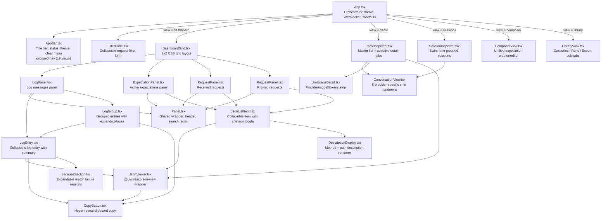

### UI Components

| Component | File | Purpose |
|-----------|------|---------|
| `AppBar` | `AppBar.tsx` | Title bar with connection status chip, keyboard shortcut hints, auto-scroll toggle, dark/light mode toggle, clear/reset menu; on wide screens (`>= lg`): six grouped dropdown buttons (Mock / Observe / Verify / Resilience / AI / Inspect), each opening a `Menu` of its views; on narrow screens: hamburger icon with all 19 views in labelled sections |
| `FilterPanel` | `FilterPanel.tsx` | Collapsible request filter form (method, path, headers, query params, cookies) with debounced WebSocket send; shown on dashboard/traffic/sessions |
| `DashboardGrid` | `DashboardGrid.tsx` | 2×2 CSS grid layout for the four panels |
| `TrafficInspector` | `TrafficInspector.tsx` | Full-width master list + adaptive detail pane for all captured traffic (mock-matched + proxied) |
| `SessionInspector` | `SessionInspector.tsx` | Swim-lane grouped view of isolated LLM conversation sessions |
| `ComposerView` | `ComposerView.tsx` | Mocks (composer) view — unified expectation creator/editor; inline Standard HTTP and LLM Conversation forms |
| `LibraryView` | `LibraryView.tsx` | Cassettes / Runs / Export sub-tabs |
| `ConversationView` | `ConversationView.tsx` | Five provider-specific chat-transcript renderers: Anthropic, OpenAI, OpenAI Responses, Gemini, Ollama |
| `LlmUsageDetail` | `LlmUsageDetail.tsx` | Thin strip shown above the detail pane tab row for LLM traffic: provider chip, model, tokens, cost, stop reason |
| `Panel` | `Panel.tsx` | Shared panel wrapper with title, count chip, search box, auto-scroll content area |
| `LogEntry` | `LogEntry.tsx` | Renders a single log entry; supports `collapsible` mode and `divider` mode |
| `LogGroup` | `LogGroup.tsx` | Groups related log entries (same correlation ID) with orange left border, expand/collapse |
| `JsonListItem` | `JsonListItem.tsx` | Renders request/expectation items with chevron toggle, index number, and description |
| `JsonViewer` | `JsonViewer.tsx` | Thin wrapper around `@uiw/react-json-view` with theme-aware styling |
| `CopyButton` | `CopyButton.tsx` | Hover-reveal icon button that copies text to clipboard |
| `DescriptionDisplay` | `DescriptionDisplay.tsx` | Renders description variants: plain string, structured `{first, second}`, or JSON object |
| `BecauseSection` | `BecauseSection.tsx` | Expandable list of match failure reasons for `EXPECTATION_NOT_MATCHED` entries |
| `EventLogLossDetails` | `EventLogLossDetails.tsx` | What the event log lost and the setting to change, inside a `VERIFICATION_FAILED` entry for a verification that failed on an incomplete log |
| `ErrorBoundary` | `ErrorBoundary.tsx` | Catches render-time exceptions; shows a recoverable inline fallback; keyed-reset on `view`; hard-reload for chunk-load failures |
| `LintDialog` | `LintDialog.tsx` | Lint Expectations dialog over `PUT /mockserver/lint` (`lib/lint.ts`): severity, rule, message and a link to the shadowing expectation; ids open in the composer |
| `LintWarningsBadge` | `LintWarningsBadge.tsx` | `N Lint Warnings` chip from `x-mockserver-lint-warnings` after a create; opens `LintDialog` |
| `HumanErrorAlert` | `HumanErrorAlert.tsx` | Shared error alert: short `message` + inline "Details" expander for the raw server body |
| `SamlDialog` | `SamlDialog.tsx` | Mock SAML 2.0 IdP registration dialog; backed by `lib/saml.ts` → `PUT /mockserver/saml` |
| `GrpcServicesPanel` | `GrpcServicesPanel.tsx` | gRPC Services view: polls services + health every 5 s via `lib/grpc.ts` (`PUT /mockserver/grpc/services`, `GET /mockserver/grpc/health`); renders per-service method tables with streaming kind chips |
| `BaselineCompareDialog` | `BaselineCompareDialog.tsx` | Tools-menu dialog: paste baseline + optional current expectation arrays, calls `PUT /mockserver/baseline/compare` via `lib/baseline.ts`, renders `BaselineDiffReport` summary chips and `JsonViewer` tree |

### Collapsible Items

All data items are **collapsed by default** across all four dashboard panels:

- **Requests and expectations** (`JsonListItem`): Show a chevron (`▸`), index number, and method+path description. Click to expand and reveal the full JSON body rendered by `JsonViewer`.
- **Standalone log entries** (`LogEntry` with `collapsible=true`): Show a chevron, description (timestamp + type), and a grey summary (first 80 chars of message text, truncated with `…`). Click to expand and see the full message parts.
- **Grouped log entries** (`LogGroup`): Show an expand button with the group header entry. Click to expand and reveal all child entries.

### Rendering Performance

The four dashboard panels can each hold up to 100 rows and receive a full state
snapshot over the WebSocket up to once per second, so the panels are tuned to
avoid re-render storms and keep interaction smooth:

| Technique | Where | Effect |
|-----------|-------|--------|
| Reference-stable reconciliation | `store` `reconcileByKey` (in `applyMessage`) | Each push reuses the previous object reference for any row whose content is unchanged (matched by stable `key`, structural compare), so memoized rows and their `useMemo([item.value])` hooks stay valid across pushes |
| Row memoization | `React.memo` on `LogEntry`, `JsonListItem` | Unchanged rows skip re-rendering entirely on each push |
| Deferred expand body | `useDeferredValue(expanded)` in `LogEntry` / `JsonListItem` | The chevron/layout reacts to the click immediately; the expensive expanded JSON tree (`@uiw/react-json-view`) builds in a non-blocking follow-up render |
| Viewport windowing | `ProgressiveList` (used by `LogPanel`, `ExpectationPanel`, `RequestPanel` and `TrafficInspector`) | Only the rows in or near the visible area are mounted, however long the list is (200 rows went from 2,234 DOM elements to 145, and that figure no longer grows with the dataset). Heights vary as rows expand, so they are measured with `measureElement` rather than assumed. First paint renders just `initial` rows before the scroll ancestor is resolved; where there is no scrollable ancestor or the viewport measures 0px — jsdom, or a panel laid out at zero height — it falls back to rendering every row so nothing becomes unreachable |
| Scroll anchoring on prepend | `ProgressiveList` (`src/components/ProgressiveList.tsx`) | The lists are newest-first, so a live push inserts rows *above* the viewport and shifts everything below it down; windowing then unmounts whatever the reader had open. The list remembers which row was at the top of the viewport and restores its position after each update, resolved from the virtualizer's measurements so it works even when that row is no longer mounted. See [Panel scroll behaviour](#panel-scroll-behaviour) |
| Lifted expand state | `useExpansion` hook (per panel) | Expand/collapse state is held in the panel keyed by row key, passed to rows as controlled `expanded`/`onToggle` props (with an uncontrolled fallback for standalone use), so it survives independently of any row remount |
| Monaco keyboard + teardown | `JsonEditor` / `JsonDiffViewer` | Every editor sets `tabFocusMode: true`, so Tab / Shift+Tab move focus like any field (no keyboard trap, WCAG 2.1.2); `JsonEditor` binds Monaco's own toggle chord (Ctrl+M, Ctrl+Shift+M on macOS) to flip its option, because Monaco's built-in toggle flips a global flag the per-editor option overrides; and `ariaLabel` (the diff: `originalAriaLabel` / `modifiedAriaLabel`) so the input is announced by the field's name. `@monaco-editor/react` disposes a diff editor's models before its widget, which throws; `JsonDiffViewer` keeps the models (`keepCurrent*Model`) and, in a layout-effect cleanup that runs before the wrapper's, detaches them (`setModel(null)`) and disposes them |
| Monaco code-split | `JsonEditorLazy` / `JsonDiffViewerLazy` (`src/components/`) | `monaco-editor` and its web-worker bundles are multi-MB; both components wrap the real editor in `React.lazy()` so Monaco is only fetched when an editor is first rendered, reducing the initial bundle from ~4.66 MB to ~912 kB. Both real editors import `monacoSetup.ts`, which points `@monaco-editor/react` at the bundled Monaco and sets `MonacoEnvironment.getWorker` to the bundled editor and JSON workers; whichever editor a page opens first (often Capture as Mock's Preview Diff) therefore wires them, and without it the diff editor's worker fails to load and no diff is shown |
| `LogGroup` collapse | `LogGroup.tsx` — `<Collapse unmountOnExit>` | Log-entry children within a collapsed group are unmounted from the DOM rather than hidden with CSS, eliminating the DOM pressure from large numbers of collapsed log groups |

`ProgressiveList` windows with `@tanstack/react-virtual`. An earlier iteration
mounted the whole list progressively during browser idle time instead; that kept
first paint cheap but left DOM weight growing with the dataset, so it was
replaced. The cheap-first-paint property is preserved by the `initial` phase:
the list renders only a screenful until its scroll ancestor is resolved in a
layout effect, then windows.

#### Panel scroll behaviour

Two behaviours pull in opposite directions when data is live, and they are owned
by different components:

- **Tail-following** — `Panel` (`src/components/Panel.tsx`). A reader parked at
  the very top wants new entries to appear there, so `Panel` snaps back to
  `scrollTop = 0` on new data — but *only* while `atTopRef` says the reader is
  already within `AT_TOP_THRESHOLD_PX` of the top. Scroll down and following
  stops; scroll back up and it resumes.
- **Scroll anchoring** — `ProgressiveList` (`src/components/ProgressiveList.tsx`).
  Once the reader has scrolled away from the top, new rows are inserted above
  them; every existing row's offset grows while `scrollTop` does not, so the
  content under their eye slides down and, once it leaves the window, unmounts.
  `ProgressiveList` remembers which row was at the top of the viewport and how
  far its top sat above it, and restores that relationship after each update.

Two properties of the real data rule out the obvious implementations, and both
were learned the hard way:

- **The list length does not change.** `DashboardWebSocketHandler` caps a panel
  at `DEFAULT_LOG_UPDATE_ITEM_LIMIT` (100) rows and evicts the oldest as it
  prepends the newest, so on any server that has handled more than 100 entries
  the count is constant for the rest of the session. Anything gated on the row
  count growing — an effect keyed on `count`, or a height delta — is inert
  exactly when traffic is live and the reader most needs their position held.
- **The anchor row can be unmounted by the same update.** After a prepend the
  window is recomputed from the unchanged `scrollTop`, which now addresses
  different rows, so the row being held is frequently gone from the DOM before
  any layout effect could measure it.

Together those force the anchor to be resolved from the **virtualizer's
measurements** rather than from the DOM, because the virtualizer knows where
every row sits whether or not it is mounted. Two public accessors do it:
`virtualizer.measurementsCache` to find the row at the top of the viewport on
capture, and `virtualizer.getOffsetForIndex(index, 'start')` to ask where that
row has moved to on restore, located by the caller's stable `getKey`. Note
`getMeasurements()` is typed **private** — it would work today and go silently
inert on a library bump, which is the same class of quiet failure this fix
exists to correct. The anchor effect deliberately has **no dependency array** — it must
run after every commit, because the update that moves the reader need not change
anything `count`-shaped. Anchoring is skipped while the reader is within
`ANCHOR_MIN_OFFSET_PX` of the top, where following the newest rows is the wanted
behaviour, so it never fights `Panel`'s tail-following (child effects run before
parent effects, so `Panel` gets the last word there anyway).

CSS `overflow-anchor` cannot substitute for any of this: the virtualizer's rows
are `position: absolute`, which browsers exclude from native scroll anchoring,
and windowed rows leave the DOM entirely.

`TrafficInspector` renders `ProgressiveList` directly rather than through
`Panel`, so it gets the anchoring but not the tail-following, and its list is not
capped at 100 the way the WebSocket-fed panels are.

Both behaviours are guarded by `mockserver-ui/e2e/scroll-anchor.pw.ts`, real
browser (Playwright) tests over the harness in `mockserver-ui/e2e/anchor-harness/`
that render the actual `Panel` + `ProgressiveList`. One covers the initial growth
phase; the other covers the steady state, where rows are evicted as fast as they
arrive and the length never moves. They **cannot** be jsdom/vitest tests: jsdom
has no layout engine, so `scrollTop`, `scrollHeight` and `offsetHeight` are always
0, the list never windows, and the prepend shift cannot occur. Run them with
`npm run test:e2e:anchor` from `mockserver-ui`.

### Copy to Clipboard

Copy buttons appear on hover (CSS `opacity: 0` → `opacity: 1` on parent `:hover .copy-btn`):

- `JsonViewer`: Copy button in top-right copies the full JSON as formatted text
- `LogEntry`: Copy button copies description + all message parts as text
- `LogGroup`: Separate `.group-copy-btn` copies the full group (header + all child entries joined by `\n\n`)

### Theme System

- Default: dark mode (unless user explicitly saved `'light'` in `localStorage` key `mockserver-theme`)
- `getInitialTheme()` in store checks `localStorage` first; falls back to `'dark'`
- `prefers-color-scheme` media query is **not** used — dark is always the default for new users
- `buildTheme()` in `theme.ts` creates an MUI theme from the mode
- Toggle via AppBar sun/moon icon; saved to `localStorage`

`src/theme.ts` is now a full design system. Beyond `buildTheme()`, it exports:

| Export | Purpose |
|--------|---------|
| `logTypeColors` | Flat `rgb(…)` map keyed by log type — the colours the server sends in each row's `style.color` |
| `logTypeColor(type, mode)` | Mode-aware accessor; returns a light or dark variant of each type's colour that reaches WCAG AA (4.5:1) on that mode's paper and default backgrounds (`theme.test.ts` checks every type) |
| `logRowColor(serverColor, mode)` | Maps a server `style.color` back to its log type and returns `logTypeColor(type, mode)`; an unknown colour passes through. `LogEntry` renders rows with it |
| `transitions` | Shared motion tokens — `fast` (150 ms), `standard` (220 ms), `forProps(props[], ms?)` for property-scoped transitions |
| `monospaceFontFamily` | Monospace font stack shared by log/JSON/code surfaces |

`buildTheme()` now sets MUI `shape.borderRadius: 8`, a tuned typography scale (`h5`/`h6`/`subtitle1`/`subtitle2`/`body2`/`caption` all mapped to the rem sizes the dashboard already uses), shortened `transitions.duration` values, and component overrides for `MuiPaper`, `MuiCard`, `MuiAppBar`, `MuiButton`, `MuiChip`, `MuiToggleButton`, `MuiTooltip`, and `MuiTableRow`. Shadow tokens are mode-aware (deeper spreads on dark canvas) and are applied to Paper elevations, Cards, and the AppBar.

### Keyboard Shortcuts

Handled by `useKeyboardShortcuts` hook in `App.tsx`:

| Shortcut | Handler | Action |
|----------|---------|--------|
| `⌘K` / `Ctrl+K` | `onSearch` | Focus the Log Messages search input through `src/lib/logSearchFocus.ts` (LogPanel registers its field while mounted); from another view, switch to the Dashboard and focus the field when it mounts |
| `⌘⇧L` / `Ctrl+Shift+L` | `onClear` | Open the "Clear Server Logs" confirmation |
| `⌘⇧F` / `Ctrl+Shift+F` | `onToggleFilter` | Toggle filter panel expanded/collapsed |
| `?` | `onShowShortcuts` | Open the keyboard-shortcuts help |

### Clear and Reset

The AppBar clear menu provides three server-side operations:

| Menu Item | API Call | UI Behavior |
|-----------|----------|-------------|
| Clear server logs | `PUT /mockserver/clear?type=log` | Empties the local log messages, recorded requests and proxied requests (all removed server-side); keeps expectations |
| Clear server expectations | `PUT /mockserver/clear?type=expectations` | Empties the local active expectations; keeps logs and requests |
| Reset server (all) | `PUT /mockserver/reset` | Calls `clearUI()` + reconnects WebSocket (server closes it on reset) |

### Filtering

Users can filter all panels by sending an `HttpRequest` JSON object as a text WebSocket frame. The server stores the filter per client and uses it when assembling data:

- **Active expectations**: Filtered by `requestMatchers.retrieveRequestMatchers(filter)`
- **Log entries**: Filtered by matching `LogEntry.httpRequests` against the filter
- **Recorded requests**: Filtered by type `RECEIVED_REQUEST` + request match
- **Proxied requests**: Filtered by type `FORWARDED_REQUEST` + request match

### WebSocket Reconnection

The `connect()` function in `useWebSocket.ts` handles reconnection safely:

1. Clears any pending reconnect timer (`reconnectTimerRef`)
2. Nullifies `onclose`/`onerror` on the old socket before calling `close()` — prevents stale handlers from triggering spurious reconnection
3. Sets `socketRef.current = null` before creating the new socket
4. On `onclose`, schedules reconnection with the capped linear back-off described above

### Test Coverage

Vitest + React Testing Library + jsdom — see `mockserver-ui/src/__tests__/` for the full set. The suite is grouped roughly as follows:

| Area | Example test files |
|------|--------------------|
| Store + hooks | `store.test.ts`, `workspaces.test.ts`, `workspaceTargets.test.ts`, `connectionTarget.test.ts`, `useConnectionParams.test.ts`, `useKeyboardShortcuts.test.ts`, `useWebSocket.test.ts`, `useAutoRefresh.test.ts` |
| App-chrome components | `AppBar.test.tsx`, `Panel.test.tsx`, `BecauseSection.test.tsx`, `CopyButton.test.tsx`, `DescriptionDisplay.test.tsx`, `HumanErrorAlert.test.tsx` |
| Log and request panels | `LogEntry.test.tsx`, `EventLogLossDetails.test.tsx`, `LogGroup.test.tsx`, `LogPanel.test.tsx`, `RequestPanel.test.tsx`, `ExpectationPanel.test.tsx`, `FilterPanel.test.tsx`, `JsonListItem.test.tsx` |
| Traffic / Sessions inspectors | `TrafficInspector.test.tsx`, `SessionInspector.test.tsx`, `PredicatePills.test.tsx`, `AgentRunGraph.test.tsx` |
| Responsive layout | `responsiveLayout.test.tsx` |
| Metrics view | `MetricsView.test.tsx` |
| Composer quick/advanced | `composerW6.test.tsx` |
| LLM mocking flows | `CaptureAsMockDialog.test.tsx`, `ConversationWizard.test.tsx`, `CassetteManager.test.tsx`, `CompareRunsDialog.test.tsx`, `cassetteRegistry.test.ts`, `conversationCodegen.test.ts`, `expectationFromCapture.test.ts`, `llmExpectationCodegen.test.ts`, `llmPricing.test.ts`, `llmTraffic.test.ts`, `trajectoryDiff.test.ts`, `sessionGrouping.test.ts`, `mcpClient.test.ts`, `callGraph.test.ts` |

Run `npm test` from `mockserver-ui/` to execute the full suite; the JUnit report is written to `mockserver-ui/test-reports/junit.xml`.

#### Choosing a Test Layer

Default to jsdom (Vitest): it is fast and needs no server. Use the Playwright suite in
`mockserver-ui/e2e/` only when jsdom structurally cannot see the behaviour: anything that depends
on real layout, on live WebSocket data arriving, or on the real server's contract.

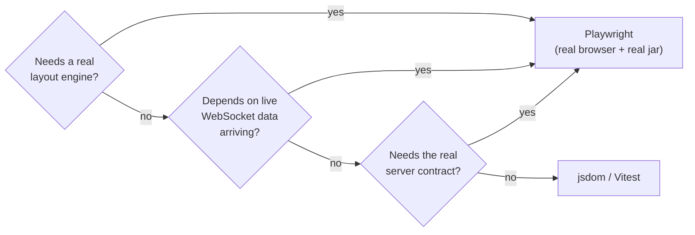

| What the test exercises | jsdom | Playwright |
|-------------------------|-------|------------|
| React state and derived values | yes | yes |
| User interactions (click, type, keyboard) | yes | yes |
| API calls and error handling | yes (mocked `fetch`) | yes (real server) |
| `getComputedStyle` and CSS that needs layout | partial (no layout, so no percentage `calc()`) | yes |
| `scrollTop`, `scrollHeight`, `offsetHeight` | no (always 0) | yes |
| `ProgressiveList` windowing | no (no viewport, so every row mounts unless the suite stubs `offsetHeight`, as `perf-domWeight.test.tsx` does) | yes |
| A row scrolled off-screen being unmounted | no | yes |
| Live WebSocket arrival triggering a side-effect | no (suites stub `WebSocket` per file) | yes |
| Monaco editor, workers | no (replaced by a textarea in `test-setup.ts`) | yes |
| Focus restoration after DOM removal | partial (jsdom's focus model has diverged from browsers before) | yes |

The trap this table guards against: a jsdom test asserting "the expansion state survives a live
update" stayed green while opened rows vanished in the browser, because state really was kept;
the row was scrolled away and unmounted by windowing. Retained state and "the row I opened is
still on screen" are different invariants, and only the second is what a user sees. The jsdom
tests in `selectionSurvivesLiveUpdate.test.tsx` and `openRowStopsFollowing.test.tsx` say so;
the on-screen invariant is covered by `e2e/scroll-anchor.pw.ts` and, against a real server,
`e2e/dashboard-live-scroll.spec.ts`.

Two cheaper-looking alternatives were rejected. Stubbing `scrollTop` in jsdom tests the stub, not
the interaction between the scroll position, the virtualizer reading it, and live data, and it
breaks on any `ProgressiveList` refactor. A component harness (Storybook, Cypress component tests)
would have to fake the WebSocket exactly as the jsdom suite already does, so it cannot close the
full-stack gap and adds a third environment to maintain.

#### jsdom Upgrades

jsdom is pinned to a minor version (`~30.1.2` in `mockserver-ui/package.json`): patch releases
arrive through the lockfile, and a minor bump is a deliberate change. Two consecutive releases broke
the suite through upstream regressions rather than API changes. 30.0.0 made `getComputedStyle`
throw on MUI Dialog's `calc(100% - 64px)`, and 30.1.0 fired focus events with the Document as
`relatedTarget`, which crashed MUI's focus trap on unmount in every Dialog suite. Each was worked
around in `test-setup.ts` by patching a jsdom **internal** module, and each shim was deleted once
jsdom fixed the behaviour (the focus fix shipped in 30.1.1).

On every jsdom minor bump, whether it arrives alone or inside the `npm-minor-and-patch` Dependabot
group:

1. Move the tilde pin to the new minor, regenerate the lockfile, and run the full `npm test`.
2. If suites fail only under the new jsdom, find the throwing line in `node_modules/jsdom` before
   guessing at the cause, and report the defect upstream.
3. A shim in `test-setup.ts` is the fallback. It must act only on the defective input, so it goes
   inert once jsdom is fixed, and it must say which jsdom version it targets. On each later jsdom
   bump, disable it and rerun the affected suites: if they pass, delete it.

## Server-Side Data Assembly

### sendUpdate() Method

For each connected client, assembles four data categories (limited to 100 items each):

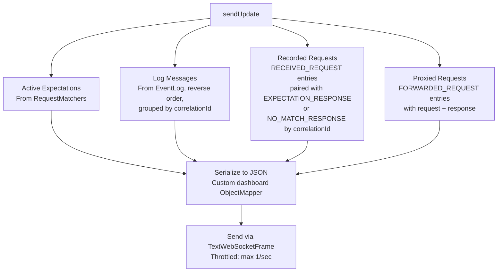

### Request/Response Pairing for Recorded Requests

`DashboardWebSocketHandler` (lines 385–450) performs a single reverse-chronological pass over the log stream to pair `RECEIVED_REQUEST` entries with their matching `EXPECTATION_RESPONSE` or `NO_MATCH_RESPONSE` entries. Because the log is iterated in reverse order, responses appear before their corresponding requests. The handler stashes each response by `correlationId` in a temporary map, then when it encounters the `RECEIVED_REQUEST` with the matching `correlationId`, it attaches the stashed response as `httpResponse` in the emitted `recordedRequests` item.

This means `recordedRequests` items are now `{ httpRequest, httpResponse }` objects — the same shape as `proxiedRequests` — allowing the Traffic, Sessions, and LLM Usage detail views to see mock-matched traffic with full request/response pairs, not just upstream-proxied traffic.

A proxied request is in **both** sections: `recordedRequests` holds every received request (the Received Requests panel shows proxied ones too) and `proxiedRequests` holds the forwarded exchange. Each request-section item therefore carries the request's `correlationId`, and every view that shows the two as one list (Traffic, Sessions, Compare Runs, Optimise, MCP Server Health) goes through `combineTraffic` (`src/lib/combineTraffic.ts`): a received row whose `correlationId` matches a proxied row is dropped in favour of the proxied one, and the two newest-first lists are interleaved by `timestamp`. A received row with no proxied row yet (a request still in flight) stays. A received DNS query or binary message (`lib/requestKind.ts`) is left out: those views, the Traffic log-level hint and the Test Template dialog's sample-request list are HTTP only, so DNS and binary rows appear only in Received Requests.

### Dashboard Model Classes

| Class | Package | Purpose |
|-------|---------|---------|
| `DashboardLogEntryDTO` | `o.m.dashboard.model` | Simplified log entry for UI display with description, style, and HTTP request/response data |
| `DashboardLogEntryDTOGroup` | `o.m.dashboard.model` | Groups related log entries by correlation ID |
| `Description` | `o.m.dashboard.serializers` | Truncated request description (method + path) for UI column display |

### Custom Serializers

The dashboard uses specialized Jackson serializers for UI-friendly output:

| Serializer | Purpose |
|------------|---------|
| `DashboardLogEntryDTOSerializer` | Color-coded log entries with message parts |
| `DashboardLogEntryDTOGroupSerializer` | Groups related entries by correlation ID |
| `DescriptionSerializer` | Truncated request/log descriptions |
| `ThrowableSerializer` | Exception stack traces as string arrays |

### Log Entry Color Coding

The server's colours live in `src/theme.ts` as `logTypeColors`; most fall below 4.5:1 on the light paper. Render with `logTypeColor(type, mode)` (or `logRowColor(serverColor, mode)` for a row's `style.color`) rather than indexing `logTypeColors` directly, so the readable light or dark variant is used.

| Log Type | Color | RGB (light) |
|----------|-------|-----|
| RECEIVED_REQUEST | Blue | `rgb(114,160,193)` |
| EXPECTATION_RESPONSE | Light blue | `rgb(161,208,231)` |
| EXPECTATION_MATCHED | Teal | `rgb(117,185,186)` |
| EXPECTATION_NOT_MATCHED | Muted pink | `rgb(204,165,163)` |
| FORWARDED_REQUEST | Sky blue | `rgb(152,208,255)` |
| VERIFICATION | Purple | `rgb(178,148,187)` |
| VERIFICATION_FAILED | Red | `rgb(234,67,106)` |
| WARN | Coral | `rgb(245,95,105)` |
| ERROR | Dark pink | `rgb(179,97,122)` |
| EXCEPTION | Bright red | `rgb(211,33,45)` |
| INFO | Green | `rgb(59,122,87)` |
| TEMPLATE_GENERATED | Gold | `rgb(241,186,27)` |
| CREATED_EXPECTATION | (default) | Uses log level colour |
| UPDATED_EXPECTATION | (default) | Uses log level colour |
| REMOVED_EXPECTATION | (default) | Uses log level colour |
| CLEARED | (default) | Uses log level colour |
| RETRIEVED | (default) | Uses log level colour |
| VERIFICATION_PASSED | (default) | Uses log level colour |
| NO_MATCH_RESPONSE | (default) | Uses log level colour |
| SERVER_CONFIGURATION | (default) | Uses log level colour |
| AUTHENTICATION_FAILED | (default) | Uses log level colour |
| DEBUG | (default) | Uses log level colour |
| TRACE | (default) | Uses log level colour |
| RUNNABLE | (hidden) | Internal — not displayed in UI |

### JSON Message Structure

```json
{
  "logMessages": [
    {
      "key": "<id>_log",
      "value": {
        "description": "2024-01-15 10:30:45.123 RECEIVED_REQUEST",
        "style": { "paddingTop": "4px", "color": "rgb(114,160,193)" },
        "messageParts": [
          { "key": "<id>_0msg", "value": "received request:" },
          { "key": "<id>_0arg", "json": true, "argument": true, "value": { "method": "GET", "path": "/api/users" } }
        ]
      }
    }
  ],
  "activeExpectations": [ ... ],
  "recordedRequests": [ ... ],
  "proxiedRequests": [ ... ]
}
```

## Dashboard vs Callback WebSockets

MockServer has two distinct WebSocket systems:

| Feature | Dashboard WebSocket | Callback WebSocket |
|---------|--------------------|--------------------|
| URI | `/_mockserver_ui_websocket` | `/_mockserver_callback_websocket` |
| Handler | `DashboardWebSocketHandler` | `CallbackWebSocketServerHandler` |
| Purpose | Real-time UI data push | Closure callback execution |
| Direction | Server → Client (push) | Bidirectional (request/response) |
| Client | Browser (React SPA) | Java `WebSocketClient` |
| Upgrade checks | Origin, then control-plane auth (`ControlPlaneWebSocketUpgradeGate`) | Origin, then control-plane auth (`ControlPlaneWebSocketUpgradeGate`) |
| Pipeline impact | Keeps all handlers | Removes downstream handlers |
| Max clients | 100 (CircularHashMap) | Bounded by configuration |

## Build Integration

The UI is built from source during the Maven build via the `build-ui` profile in `mockserver-netty/pom.xml`:

| Step | Plugin | Phase | Action |
|------|--------|-------|--------|
| Install Node | `frontend-maven-plugin` | `generate-resources` | Downloads Node v22.23.1 |
| Install dependencies | `frontend-maven-plugin` | `generate-resources` | Runs `npm ci` |
| Build UI | `frontend-maven-plugin` | `generate-resources` | Runs `npm run build` (tsc + vite) |
| Copy to classpath | `maven-resources-plugin` | `process-resources` | Copies `mockserver-ui/build/` to `target/classes/org/mockserver/dashboard/` |

The profile auto-activates when `../../mockserver-ui/package.json` exists. To skip the UI build: `./mvnw ... -P!build-ui`.

### Static Resources

All frontend files are bundled in the JAR at `/org/mockserver/dashboard/`:

| File | Type | Purpose |
|------|------|---------|
| `index.html` | HTML | SPA entry point |
| `assets/index-*.js` | JS | Application bundle (React, MUI, Zustand, all components) |
| `apple-touch-icon.png` | PNG | Touch icon |
| `favicon.ico` | ICO | Browser favicon |

## Opening the Dashboard

From client code:

```java
MockServerClient client = new MockServerClient("localhost", 1080);
client.openUI();  // Opens http://localhost:1080/mockserver/dashboard in browser
```

Or directly in a browser: `http://localhost:1080/mockserver/dashboard`

## Local Development

### Node Version

The UI build requires Node.js v22 (pinned in `.nvmrc`). CI uses the `node:22` Docker image. Locally, use nvm: `nvm use` in `mockserver-ui/` picks up the pinned version. If you use Homebrew node instead of nvm, Homebrew node v26+ breaks the `@rolldown/binding-darwin-arm64` native module — the build silently fails or errors at the rolldown binding step. The fix is to unset the Homebrew nvm shims (`unset -f nvm`) and activate nvm's v22.21.1 before running any `npm` command in `mockserver-ui/`.

### Dev Environment Script

`scripts/local_ui_dev.sh` launches both MockServer and the Vite dev server for UI development:

```bash
./scripts/local_ui_dev.sh              # Build JAR if needed, start both servers, open browser
./scripts/local_ui_dev.sh --rebuild    # Force rebuild the MockServer JAR
./scripts/local_ui_dev.sh --no-browser # Don't auto-open browser
./scripts/local_ui_dev.sh --port 9090  # Use custom MockServer port
```

The script:
1. Checks port availability (offers to kill blocking processes interactively)
2. Builds the MockServer shaded JAR if not present
3. Installs UI npm dependencies if `node_modules/` is missing
4. Starts MockServer (logs to `mockserver-dev.log` in repo root)
5. Loads example data via `scripts/ui_dev_populate_data.sh`
6. Starts Vite dev server on port 3000
7. Opens `http://localhost:3000/mockserver/dashboard/`

### Vite Dev Proxy

`vite.config.ts` proxies API and WebSocket requests to the MockServer backend to avoid CORS issues during development:

| Path | Proxy Target | Notes |
|------|-------------|-------|
| `/_mockserver_ui_websocket` | `MOCKSERVER_URL` (default: `http://localhost:1080`) | WebSocket proxy |
| `/mockserver/*` (except `/mockserver/dashboard*`) | `MOCKSERVER_URL` | API proxy via `bypass` function |
| `/mockserver/dashboard*` | — | Served by Vite (returns `req.url` in bypass) |

The `MOCKSERVER_URL` env var is set by `local_ui_dev.sh` to match the configured MockServer port.

### Cross-Origin (CORS) Support

The dashboard can connect to a MockServer at another `host`/`port` (set per workspace or via the
`?host=`/`?port=` query parameters), which is a cross-origin request when the dashboard is not served
from that MockServer. MockServer returns CORS headers on every control-plane response
(`ResponseWriter.writeResponse(...)` with `apiResponse == true`) and answers the preflight for
every request the control plane serves (`HttpActionHandler`, by `HttpState.isControlPlaneRequest`: any
`/mockserver/*` path, a bare legacy alias with a method the control plane routes there, and the
liveness path), independent of `enableCORSForAPI`, but **only to origins `controlPlaneCorsAllowOrigin`
allows** (`CORSOriginPolicy`): when blank, a loopback origin (`localhost`, `127.0.0.1`, `[::1]`); always,
one matching the request's `Host` when that is a rebinding-safe name (localhost, an IP literal, a single-label
name, a name ending in `.svc`, `.svc.cluster.local` or `.internal`, or a `controlPlaneTrustedHostSuffixes` entry). A
dashboard MockServer serves at any other name, such as `mockserver.example.com` or the Kubernetes
`service.namespace` short form, needs its origin listed in `controlPlaneCorsAllowOrigin` (even when that property
already lists other origins) or its suffix in `controlPlaneTrustedHostSuffixes`. A control-plane request, or a `/_mockserver_ui_websocket` upgrade,
from any other origin is refused with `403` (`HttpState.handle`, `ControlPlaneWebSocketUpgradeGate`). So a dashboard served from `localhost` (the
Vite dev server, the demo launcher's `?port=`, the VS Code and JetBrains panels) can target any
MockServer, while a dashboard on another host needs `controlPlaneCorsAllowOrigin` set on the target
server. See [tls-and-security.md → Browser Origins](tls-and-security.md#browser-origins-cors-and-websocket-upgrades).

Mock/proxy responses (`apiResponse == false`) only receive CORS headers when
`enableCORSForAllResponses` is enabled, under `corsAllowOrigin`, so the dashboard's settings never
change how mocked APIs respond.

## Usage Analytics

Anonymous, cookieless dashboard usage analytics are available via a self-hosted PostHog instance. The module is inert by default — no events are sent unless an operator explicitly supplies both an endpoint and a key.

### Activation gate chain

`initAnalytics(config)` in `mockserver-ui/src/lib/analytics.ts` runs all gates once at startup. If any gate fails, the module becomes a permanent no-op for the lifetime of the page; the decision can never be reversed without a fresh load.

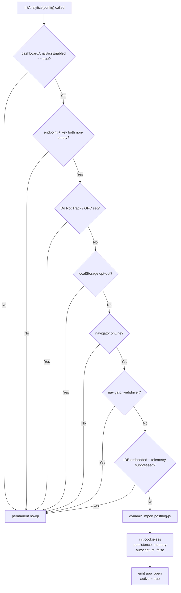

### Event taxonomy

Every public function only ever emits a value from a **closed set** — there is no code path that accepts a free-text string (URL, hostname, header value, body, error message, file path, expectation JSON) and forwards it to the backend.

| PostHog event | Function | Properties |
|---|---|---|
| `app_open` | emitted by `initAnalytics` | `app_version`, `surface` (`browser`/`ide-embedded`), `theme`, `distribution` (see below) |
| `view_change` | `trackView(view)` | `view` — the active tab name (e.g. `traffic`, `chaos`) |
| `feature_used` | `trackFeature(feature, params?)` | `feature` from the `Feature` union type; optional `mode` (`quick`/`advanced`) |
| `error_shown` | `trackError(category)` | `category` from the `ErrorCategory` union type |

The `distribution` property on `app_open` identifies which official artefact produced the event. It is sourced from the `dashboardAnalyticsDistribution` configuration property and is normalised to a closed allow-list value before sending — values not on the list become `unknown`, and free-text is never forwarded:

| Allow-list value | Set by |
|---|---|
| `docker-standard` | Standard Docker image (`mockserver/mockserver`) |
| `docker-graaljs` | GraalJS Docker image |
| `docker-clustered` | Clustered Docker image |
| `docker-http3` | HTTP/3 Docker image (`-http3` tags) |
| `helm` | Helm chart deployment |
| `binary` | Official binary launcher bundles (per-OS/arch GitHub release assets) |
| `unknown` | Any other value supplied by an operator |

Both `feature` and `category` are runtime-guarded against non-enumerated values: values outside their `ReadonlySet` are dropped silently before any `posthog.capture` call.

### `view_change` wiring

Navigation tracking is wired in `App.tsx`, not inside the store, to keep the store pure. A `useEffect` subscribes to the store's `view` selector and calls `trackView(view)` on every change (and once for the initial view). The store itself has no analytics dependency.

### PostHog init options

```typescript
ph.init(key, {
  api_host: endpoint,
  persistence: 'memory',        // no cookie, no localStorage identifier
  autocapture: false,           // only our explicit closed event set
  capture_pageview: false,      // SPA tab switches sent manually as view_change
  capture_pageleave: false,
  disable_session_recording: true,
  disable_surveys: true,
});
```

`posthog-js` is loaded via a **dynamic `import()`** only after all gates pass, so it is a lazily-fetched first-party chunk that is never fetched when analytics is inactive.

### Configuration properties

| Property | System property / Env var | Default | Purpose |
|---|---|---|---|
| `dashboardAnalyticsEnabled` | `mockserver.dashboardAnalyticsEnabled` / `MOCKSERVER_DASHBOARD_ANALYTICS_ENABLED` | `true` | Master kill switch. `false` ⇒ module never loads. |
| `dashboardAnalyticsEndpoint` | `mockserver.dashboardAnalyticsEndpoint` / `MOCKSERVER_DASHBOARD_ANALYTICS_ENDPOINT` | `""` | PostHog `api_host` URL. Blank ⇒ disabled. |
| `dashboardAnalyticsKey` | `mockserver.dashboardAnalyticsKey` / `MOCKSERVER_DASHBOARD_ANALYTICS_KEY` | `""` | PostHog write-only project key. Blank ⇒ disabled. |
| `dashboardAnalyticsDistribution` | `mockserver.dashboardAnalyticsDistribution` / `MOCKSERVER_DASHBOARD_ANALYTICS_DISTRIBUTION` | `""` | Artefact label sent as `distribution` on `app_open`. Set automatically by official artefacts (`docker-standard`, `docker-graaljs`, `docker-clustered`, `docker-http3`, `helm`, `binary`). Out-of-list values become `unknown`. Most users should not set this. |

Analytics is active in the official Docker images, Helm deployments, and the official per-OS/arch binary launcher bundles (which have the endpoint and key baked in via `-D` system properties by the release bundle build). The plain downloadable JAR and any embedded/library/dependency use have both endpoint and key empty, so analytics is always inactive there.

### Opt-out

Users can opt out via the dashboard banner (persisted to `localStorage` under `mockserver.analytics.optOut`), browser Do Not Track, or Global Privacy Control. `setAnalyticsOptOut(true)` also calls `posthog.opt_out_capturing()` immediately to stop any in-flight capture.
