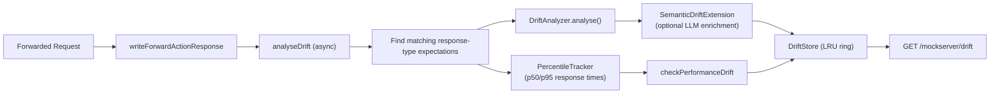
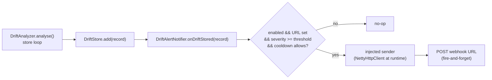

# Mock Drift Detection

## Overview

Mock drift detection identifies structural discrepancies between forwarded (real) upstream responses and stub expectations configured in MockServer. When a request is forwarded through the proxy and there are also response-type stub expectations matching the same request, MockServer compares the real response against each stub to surface drifts -- fields added or removed, type changes, status code mismatches, and header differences.

This helps teams detect when a real service has evolved in ways that their stubs no longer reflect, preventing silent test regressions.

## Architecture



### Key Components

| Component | Location | Responsibility |
|-----------|----------|---------------|
| `DriftType` | `mock/drift/DriftType.java` | Enum of drift categories (STATUS, SCHEMA_FIELD_ADDED, etc.) |
| `DriftRecord` | `mock/drift/DriftRecord.java` | Single drift observation with expectation ID, field, expected/actual values, confidence, timestamp |
| `DriftStore` | `mock/drift/DriftStore.java` | Thread-safe LRU-capped store (max 1000 entries) of drift records |
| `DriftAnalyzer` | `mock/drift/DriftAnalyzer.java` | Compares real response vs stub response; emits DriftRecords |
| `SemanticSeverity` | `mock/drift/SemanticSeverity.java` | Enum: BREAKING, WARNING, INFORMATIONAL |
| `SemanticDriftExtension` | `mock/drift/SemanticDriftExtension.java` | LLM-powered severity classification of drift records |
| `PercentileTracker` | `mock/drift/PercentileTracker.java` | Sliding-window p50/p95 response time tracker per expectation |
| `DriftAlertNotifier` | `mock/drift/DriftAlertNotifier.java` | Fires a fire-and-forget webhook POST when a stored drift meets the configured severity (off by default) |

### Drift Categories

| DriftType | Description | Confidence |
|-----------|-------------|------------|
| `STATUS` | HTTP status code differs | 1.0 |
| `SCHEMA_FIELD_ADDED` | JSON field present in real but not stub (`actualValue` = its JSON type) | 0.9 |
| `SCHEMA_FIELD_REMOVED` | JSON field present in stub but not real (`expectedValue` = its JSON type) | 0.95 |
| `SCHEMA_TYPE_CHANGED` | JSON field type changed (e.g. `expectedValue` `integer`, `actualValue` `string`) | 0.95 |
| `HEADER_ADDED` | HTTP header present in real but not stub | 0.9 |
| `HEADER_REMOVED` | HTTP header present in stub but not real | 0.9 |
| `HEADER_CHANGED` | HTTP header value changed | 0.85 |
| `PERFORMANCE` | p95 response time exceeds threshold | 0.8 |

### JSON Schema Comparison

Schema drift leverages `StructuralShapeDiff` from `org.mockserver.llm.drift`, which compares two JSON documents by shape (field paths and value types) ignoring values. This catches structural changes like new/removed fields and type changes without flagging benign value differences.

### Skipped Headers

Non-semantic headers that change per-request are excluded from drift analysis: `date`, `x-request-id`, `content-length`, `transfer-encoding`, `connection`, `keep-alive`, `server`.

## Integration Points

### Hook in HttpActionHandler

Drift analysis is triggered asynchronously in `HttpActionHandler.writeForwardActionResponse()` after the upstream response is received but before it is written back to the client. The `analyseDrift()` method:

1. Looks up all expectations matching the original request via `HttpState.allMatchingExpectation()`
2. Filters to those with response-type actions (stubs)
3. Passes each stub expectation + real response to `DriftAnalyzer.analyse()`

The analysis runs on a scheduler thread and never blocks the response path. It is best-effort and bounded: at most `max(16, 4 x actionHandlerThreadCount)` analyses may be queued or running at once, and a forward that arrives while the backlog is full is not analysed (counted by `mock_server_dropped_drift_analyses`). Undelayed scheduler tasks are not bounded by the scheduler, so without this bound a forward rate above analysis capacity would queue one closure — retaining the request and the upstream response — per forward. See [metrics.md](metrics.md#overload-bounds-drift-analysis-shedding-and-executor-queue-gauges).

### Master Switch and Sampling

The `analyseDrift()` call is gated so its cost can be controlled:

- **`mockserver.driftDetectionEnabled`** (boolean, default `true`) — the master switch. When `true` (the default, preserving the historical always-on behaviour) every eligible forward is analysed. When `false`, `analyseDrift()` — including the extra `allMatchingExpectation()` lookup it performs per forward — is skipped entirely.
- **`mockserver.driftSampleRate`** (double `0.0`–`1.0`, default `1.0`) — the fraction of eligible forwards to analyse. `1.0` (the default) analyses every eligible forward. A value below `1.0` analyses only that fraction, sampled with a thread-safe random draw (`ChaosProbability.shouldInject(...)`, backed by `ThreadLocalRandom`). Values outside the range are clamped to the nearest bound (`< 0` → `0`, `> 1` → `1`) with a WARN.

The gate is `configuration.driftDetectionEnabled() && ChaosProbability.shouldInject(configuration.driftSampleRate(), null)`. Because `shouldInject` treats `>= 1.0` as always-inject and `<= 0.0` as never-inject, out-of-range per-instance rates are handled safely without additional clamping at the call site. Both defaults preserve the previous behaviour, so this is a non-breaking change.

### Reset Integration

`DriftStore.getInstance().clear()` is called during `HttpState.reset()`, alongside all other registry resets.

### Several Servers in One JVM

The drift alert webhook (`driftAlertWebhookEnabled`), LLM semantic analysis (`driftSemanticAnalysisEnabled`) and the p95 threshold (`driftResponseTimeThresholdMs`) live on process-wide singletons (`DriftAlertNotifier`, `DriftAnalyzer`). So only one server's drift settings can be in effect at a time. `DriftWiring` (in `mockserver-netty`, `org.mockserver.lifecycle`) applies them when `LifeCycle` starts a server, and withdraws them when it stops:

- **Most recent wins.** A server that turns at least one of the three on puts all three of its settings in effect, replacing those of any running server.
- **Servers that turn nothing on are ignored.** A server with all three off neither applies nor withdraws anything. Plain stub, upstream or sink servers started alongside one that uses drift alerts therefore do not switch them off.
- **Settings never outlive their server.** When the server whose settings are in effect stops, the settings of the previous server that put its own in effect take over, provided it is still running (via `MostRecentRegistration`, the same pattern the request senders use). If no such server is running, the webhook, LLM enrichment and the threshold are all switched off.

**Limit:** two running servers cannot have different drift webhook, semantic-analysis or threshold settings at the same time. The later one's settings apply to drift detected by both. `driftDetectionEnabled` and `driftSampleRate` are read per server and are not affected.

## REST API

### PUT /mockserver/baseline/compare

Compares two sets of expectations offline and returns a structured drift report. This is the batch/CI counterpart to the runtime `GET /mockserver/drift` endpoint — it never touches live traffic and requires no proxy setup.

**Request body:**
```json
{
  "baseline": [ <expectations> ],
  "current":  [ <expectations> ]
}
```

`current` is optional. When omitted, MockServer uses `requestMatchers.retrieveActiveExpectations(null)` — the live active expectations.

**Response (HTTP 200):**
```json
{
  "hasDrift": true,
  "added": [
    { "key": "POST /api/orders", "requestDiffs": [], "responseDiffs": [] }
  ],
  "removed": [
    { "key": "DELETE /api/users/{id}", "requestDiffs": [], "responseDiffs": [] }
  ],
  "changed": [
    {
      "key": "GET /api/users",
      "requestDiffs": [],
      "responseDiffs": [
        {
          "field": "response.body.role",
          "diffType": "REMOVED",
          "expectedValue": "string"
        }
      ]
    }
  ]
}
```

**Error responses:** `400 Bad Request` for empty body, invalid JSON, or missing `baseline` field.

#### BaselineDiffer — key components

| Class | Location | Responsibility |
|-------|----------|---------------|
| `BaselineDiffer` | `mock/diff/BaselineDiffer.java` | Entry point; indexes interactions by request key; delegates to `TrafficDiffEngine` for request diffs and `diffResponseStructure()` for response diffs |
| `BaselineDiffReport` | `mock/diff/BaselineDiffReport.java` | Report root: `hasDrift` flag + `added`/`removed`/`changed` lists |
| `InteractionDiff` | `mock/diff/InteractionDiff.java` | Single entry in a report bucket; carries the matching `key` and optional `requestDiffs`/`responseDiffs` lists |
| `FieldDiff` | `mock/diff/FieldDiff.java` | Single field-level difference: `field` path, `diffType` (`ADDED`/`REMOVED`/`CHANGED`), `expectedValue`, `actualValue` |
| `TrafficDiffEngine` | `mock/diff/TrafficDiffEngine.java` | Request-side structural diff (method, path, headers, query, body, cookies) |

#### Matching key and normalization

`BaselineDiffer.requestKey(HttpRequest)` produces `METHOD normalized-path`. Method is upper-cased; a single trailing slash is stripped from the path (but `"/"` is preserved). Trailing-slash-only differences in the path are filtered out after matching to prevent false positives.

#### Value-insensitive JSON response body diffing

`diffBodyShape()` in `BaselineDiffer` recursively walks two JSON trees. Only the following count as drift:

- A field present in one tree but absent in the other
- A node whose JSON type changed (object, array, number, boolean, string, null)

A different value at the same field with the same type is **not** drift (e.g. `"name": "Alice"` vs `"name": "Bob"`). All numeric subtypes (int, long, double) collapse to `"number"` so `1` vs `1.5` are the same shape.

Non-JSON bodies fall back to exact-string comparison.

#### Status code and header diffing

Status code is compared as a string. Response headers are lowercased, values are comma-joined for multi-value headers, and added/removed/changed headers are each reported as separate `FieldDiff` entries under `response.header.<name>`.

### GET /mockserver/drift

Returns recent drift records.

**Query Parameters:**
- `expectationId` (optional) -- filter by expectation ID
- `limit` (optional, default 50, max 500) -- maximum number of records to return

**Response:**
```json
{
  "count": 2,
  "drifts": [
    {
      "expectationId": "abc-123",
      "driftType": "STATUS",
      "field": "statusCode",
      "expectedValue": "200",
      "actualValue": "422",
      "confidence": 1.0,
      "epochTimeMs": 1717145600000
    },
    {
      "expectationId": "abc-123",
      "driftType": "SCHEMA_FIELD_ADDED",
      "field": "$.newField",
      "actualValue": "string",
      "confidence": 0.9,
      "epochTimeMs": 1717145600000
    }
  ]
}
```

### PUT /mockserver/drift/clear

Clears all drift records.

**Response:**
```json
{"status": "cleared"}
```

## Semantic Drift Detection (F11)

When `mockserver.driftSemanticAnalysisEnabled=true` and a runtime LLM backend is configured, structural drift records are enriched with LLM-classified severity and explanations.

### How it works

1. `DriftAnalyzer` collects structural drift records into a list (status, header, schema drifts).
2. If a `SemanticDriftExtension` is installed, it sends the drift records along with truncated stub/real response bodies to the LLM.
3. The LLM classifies each drift as **BREAKING**, **WARNING**, or **INFORMATIONAL** and provides a one-sentence explanation.
4. The enriched records are then stored in the `DriftStore`.

### Components

| Component | Location | Responsibility |
|-----------|----------|---------------|
| `SemanticSeverity` | `mock/drift/SemanticSeverity.java` | Enum: BREAKING, WARNING, INFORMATIONAL |
| `SemanticDriftExtension` | `mock/drift/SemanticDriftExtension.java` | Builds LLM prompt, calls `LlmCompletionService`, parses response |
| `PercentileTracker` | `mock/drift/PercentileTracker.java` | Sliding-window p50/p95 response time tracker per expectation |

### Semantic fields on DriftRecord

`DriftRecord` has two optional fields:
- `semanticSeverity` — the LLM-assigned severity (null when semantic analysis is off)
- `semanticExplanation` — one-sentence explanation from the LLM (null when off)

### Fail-soft behaviour

Semantic enrichment is best-effort. If the LLM is unavailable, times out, or returns unparseable output, the drift records are stored with their original structural-only data. No exceptions propagate to the drift pipeline.

## Performance Drift Detection

When `mockserver.driftResponseTimeThresholdMs` is set to a positive value, MockServer tracks response times per expectation using a sliding-window `PercentileTracker` (default window size: 100 observations). If the p95 response time exceeds the threshold, a `PERFORMANCE` drift record is emitted.

### PercentileTracker

- Fixed-size circular buffer per expectation ID (default 100 slots); the write position wraps and the fill count saturates at the window size, so no per-id counter can overflow however long an expectation lives
- Thread-safe via `ConcurrentHashMap.compute()`; percentile reads copy the window under the same per-key lock
- Provides `p50()` and `p95()` queries
- An expectation's window is dropped when the expectation is removed (Times used up, TTL expiry, clear) or evicted (`RequestMatchers` calls `PercentileTracker.remove(id)` on every removal and eviction path)
- The number of tracked ids is capped at `MAX_TRACKED_EXPECTATIONS` (20,000); a record for a new id at the cap drops arbitrary existing windows first, so a record that races its expectation's removal cannot leave orphaned windows accumulating
- Cleared when `DriftStore.clear()` is called

### Configuration

| Property | Default | Description |
|----------|---------|-------------|
| `mockserver.driftDetectionEnabled` | `true` | Master switch for mock-drift analysis on forwarded responses. `false` skips it (and its per-forward expectation lookup) entirely |
| `mockserver.driftSampleRate` | `1.0` | Fraction of eligible forwards to analyse, in `[0.0, 1.0]`. `< 1.0` samples with a thread-safe draw; out-of-range values are clamped with a WARN |
| `mockserver.driftSemanticAnalysisEnabled` | `false` | Enable LLM-powered semantic drift classification |
| `mockserver.driftResponseTimeThresholdMs` | `0` (disabled) | p95 response time threshold for PERFORMANCE drift |
| `mockserver.driftAlertWebhookEnabled` | `false` | Enable the fire-and-forget drift-alert webhook (see "Drift Alerting (Push)") |
| `mockserver.driftAlertWebhookUrl` | `""` | URL to POST drift alerts to |
| `mockserver.driftAlertSeverityThreshold` | `BREAKING` | Minimum effective severity that fires the webhook |
| `mockserver.driftAlertCooldownMillis` | `60000` | De-dup window in ms per drift signature |

## Drift Alerting (Push)

When `mockserver.driftAlertWebhookEnabled=true` and a URL is configured, every drift record that
meets the configured severity threshold triggers a **fire-and-forget HTTP POST webhook** carrying the
`DriftRecord` as JSON. This lets a CI job, chat-ops bot, or alerting pipeline react the moment a real
service drifts from its stub — no polling of `GET /mockserver/drift` required. Off by default.



### Decoupling and fail-soft

- **Injected sender** — `mockserver-core` must not depend on the Netty HTTP client, so the actual
  request sender is injected via `DriftAlertNotifier.registerSender(...)` (mirrors
  `LoadScenarioOrchestrator.registerSender` / `HttpState.setReplayHandler`). The Netty runtime wires it from
  `HttpActionHandler.getHttpClient()` in `HttpRequestHandler`'s constructor, through
  `HttpState.installRequestSender(...)`; `HttpState.stop()` unregisters it (`unregisterSender(...)`): if it
  was the sender in use, the sender of the server still running that registered most recently is used
  instead. Unit tests install a fake with `setSender(...)`, which registers nothing to fall back to.
- **Fail-soft** — the whole of `onDriftStored(...)` is wrapped in a try/catch that swallows (TRACE-logs)
  every error, and the outbound send is non-blocking (no `.get()`) with an `exceptionally` handler. A
  webhook misconfiguration, a slow/unreachable endpoint, or a malformed URL can therefore **never** throw
  into the drift-analysis pipeline nor affect the served response. When disabled or unwired the call is a
  pure no-op.
- **`forwardProxyBlockPrivateNetworks`** — the installed sender applies it to the webhook URL's host; a
  refused alert is not sent and is logged as one WARN (`drift alert webhook blocked by SSRF policy`), at the
  log level of the configuration `LifeCycle` passes to `configure(...)`.

### Effective severity and structural fallback

The webhook fires when a record's **effective severity** is at least as severe as the configured
threshold (BREAKING is most severe; INFORMATIONAL fires on every drift). The effective severity is the
record's LLM-assigned `semanticSeverity` when present (semantic analysis enabled), otherwise a
deterministic structural fallback keyed on `DriftType`:

| DriftType | Structural fallback severity |
|-----------|------------------------------|
| `STATUS`, `SCHEMA_FIELD_REMOVED`, `SCHEMA_TYPE_CHANGED` | BREAKING |
| `HEADER_REMOVED`, `HEADER_CHANGED`, `PERFORMANCE` | WARNING |
| `SCHEMA_FIELD_ADDED`, `HEADER_ADDED` | INFORMATIONAL |
| (unknown / null) | WARNING |

### Webhook payload

`Content-Type: application/json`. The body is an envelope wrapping the full `DriftRecord`:

```json
{
  "event": "mockserver.drift.alert",
  "epochTimeMs": 1717145600000,
  "severity": "BREAKING",
  "drift": {
    "expectationId": "abc-123",
    "driftType": "STATUS",
    "field": "statusCode",
    "expectedValue": "200",
    "actualValue": "500",
    "confidence": 1.0,
    "epochTimeMs": 1717145600000
  }
}
```

`severity` is the effective severity that triggered the alert (after structural fallback / semantic
enrichment).

### De-dup cooldown

To avoid a flood when the same drift recurs on every request, the notifier de-dups by
`expectationId|driftType|field` signature: a given signature fires at most once per
`driftAlertCooldownMillis` window (default 60s). The cooldown map is bounded (cap 1000, with eviction of
entries older than the cooldown on write) so a high-cardinality drift stream cannot grow it unbounded.

### Reset behaviour

`DriftStore.clear()` (called during `HttpState.reset()`) calls `DriftAlertNotifier.reset()`, which clears
the de-dup cooldown map **only**. The installed sender and the webhook configuration are runtime wiring
(like `HttpState`'s replay handler) and are deliberately left intact across a reset.

### Configuration

| Property | Default | Description |
|----------|---------|-------------|
| `mockserver.driftAlertWebhookEnabled` | `false` | Enable the drift-alert webhook |
| `mockserver.driftAlertWebhookUrl` | `""` | URL to POST drift alerts to (empty leaves the webhook off) |
| `mockserver.driftAlertSeverityThreshold` | `BREAKING` | Minimum effective severity that fires the webhook (`BREAKING`, `WARNING`, or `INFORMATIONAL`) |
| `mockserver.driftAlertCooldownMillis` | `60000` | De-dup window in ms per drift signature |

## Thread Safety

`DriftStore` uses a `ReadWriteLock` for concurrent access. The deque-based storage provides O(1) insertion and oldest-eviction with a configurable capacity (default 1000 entries). `PercentileTracker` uses `ConcurrentHashMap.compute()` for atomic per-key updates.
