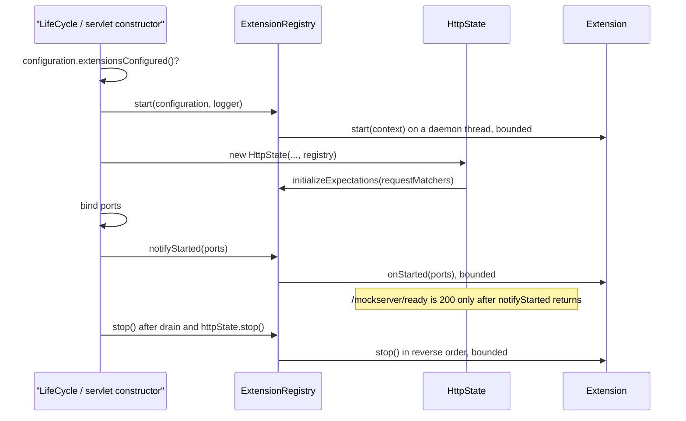

# Extensions (server extension SPI)

## TL;DR

- An extension is trusted Java code (`org.mockserver.extension.Extension`) loaded **once, at startup**, from
  `mockserver.extensions` class names, from `Configuration.extensions(Class...)` / `extensions(Supplier...)` when
  embedded, or from `META-INF/services` entries when `mockserver.extensionScanning=true`.
- Extensions start **first**, before any event loop, selector or scheduler exists, and stop in **reverse** order.
  Any load, `start()` or `onStarted()` failure refuses start-up and stops the extensions already started.
- The control plane can never change extensions: `ConfigurationDTO.applyTo` skips the three `extension*`
  properties and `HttpState.applyConfigurationUpdate` warns via `warnInitOnlyProperty`.
- **With nothing configured, nothing changes:** no `ServiceLoader` call, no `org.mockserver.extension` class
  loaded, and the request path is byte-for-byte unchanged. `ExtensionClassLoadingTest` pins this in a fresh JVM.
- Phase 1 is delivered in units. **U11a (this code)** is the core: API, loader, registry, lifecycle and the
  expectation-initializer hook. Admin routes (U11b), `$ext` template helpers (U11c) and listeners (U11d) build on
  it. A global request filter and response transformer are deliberately out of phase 1.

## Lifecycle

## Components

| Type | Role |
|---|---|
| `Extension` | Public API: `name()`, `priority()`, `start(ExtensionContext)`, `onStarted(List<Integer>)`, `stop()` |
| `ExtensionContext` | The server's live `Configuration` and `MockServerLogger` |
| `ExtensionHook` | The optional capabilities an extension adds by implementing a hook interface. U11a has `EXPECTATION_INITIALIZER`; later units add theirs |
| `LoadedExtension` | One loaded extension: instance, name, priority, class, source JAR, implemented hooks and **disabled hooks with their reasons** |
| `ExtensionLoader` | Package-private. Resolves classes through `CallbackClassLoaderResolver`, validates and de-duplicates, sorts by priority then name |
| `ExtensionRegistry` | Starts, notifies and stops extensions; disables hooks; runs the initializer hook |
| `ExtensionException` | Every refusal: load error, duplicate or invalid name, start/onStarted throw or timeout |

## Rationale

- **Startup-only.** Loading code over the control plane would be remote code execution. The properties follow
  the `controlPlaneCorsAllowOrigin` pattern: echoed read-only by `GET /mockserver/configuration`, skipped by
  `applyTo`, warned about by `applyConfigurationUpdate`, and read only through the `Configuration` instance.
- **Start before anything else.** A refused start then leaks no event loop, selector or scheduler: in
  `LifeCycle` the registry is built straight after the logger, and in both servlets straight after the logger.
- **Zero cost when unconfigured.** The gate, `Configuration.extensionsConfigured()`, lives outside the extension
  package. Fields of type `ExtensionRegistry` in `LifeCycle`, `HttpState` and the servlets stay `null`; holding,
  passing and null-checking a reference does not load its class.
- **Bounded calls.** `start`, `onStarted` and `stop` each run on a short-lived daemon thread
  (`MockServer-ext-<phase>-<name>`) awaited for `extensionStartTimeoutMillis`, because the `Scheduler` does not
  exist yet. A timed-out `start` counts as not started, is not stopped, and logs a WARN that its thread may still
  run.
- **Loaded but disabled.** A hook can be switched off for every extension that implements it, with a reason,
  without unloading the extension: `ExtensionRegistry.disableHook(hook, reason)` records the reason on each
  `LoadedExtension` and logs a WARN. U11c uses this to turn off `$ext` template helpers when HTTP/3 is enabled
  (an owner decision: warn and disable rather than refuse to start).

## Detailed behaviour

### Loading

1. Class names from `extensions()` (comma-separated, trimmed), loaded with `Class.forName(name, false,
   CallbackClassLoaderResolver.resolveClassLoader())`.
2. Embedded classes (`extensionClasses()`), then suppliers (`extensionSuppliers()`), called once per server.
3. Only when `extensionScanning()` is true: `ServiceLoader.load(Extension.class, loader).stream()`, de-duplicated
   by provider type before instantiation.

A class is instantiated once however many sources name it. Each server built from one `Configuration` gets its
own instances. Names must match `[a-z0-9-]+` and be unique. The INFO line per extension names its class, source
JAR and hooks.

### Start, ready and stop

| Deployment | `start` | `onStarted` | Refused start cleanup | `stop` |
|---|---|---|---|---|
| Netty (`LifeCycle`) | First in the constructor | `startedServer(ports)`, after every port binds | Constructor `catch` stops the registry; an `onStarted` failure calls `stop()` (server and extensions) and rethrows | `stopAsync`, after the drain and `httpState.stop()` |
| WAR / proxy WAR | First in the servlet constructor | End of the constructor, empty port list | Shuts down whatever the constructor built, then stops the registry | `shutdown()` (idempotent) |

`notifyStarted` runs at most once and skips the remaining extensions once the registry is stopping (for example a
`PUT /mockserver/stop` during start-up). `LifeCycle.stop()` waits the drain budget plus `maximumStopMillis()` (one
`extensionStartTimeoutMillis` per started extension), so a slow extension `stop()` cannot make it return early. Both
`MockServer` constructors stop everything, extensions included, when anything after `super(...)` throws.

`HttpState.isInitializationComplete()` is `initializationComplete && (registry == null ||
registry.isStartedNotified())`, so `/mockserver/ready` stays 503 until every `onStarted` returns.

### Expectation initializer hook (H4)

After the configured initialisers, `HttpState` calls `registry.initializeExpectations(requestMatchers)`. Each
started extension that implements `ExpectationInitializer` (and whose hook is enabled) has its expectations
applied with `requestMatchers.update(..., new Cause("extension:<name>", CLASS_INITIALISER))`. A throw refuses
start-up.

### Store factory overload

`ExpectationStoreFactory.Factory` gained a default five-argument `create(..., ExtensionRegistry)` that delegates to
the four-argument form, so existing factories (such as the clustered one) are unchanged. `HttpState` calls the
five-argument form; U11d uses it to give the store its listener dispatch.

## Appendix: configuration

| Property | Default | Notes |
|---|---|---|
| `mockserver.extensions` / `--extensions` | empty | Comma-separated class names |
| `mockserver.extensionScanning` | `false` | Also load `META-INF/services/org.mockserver.extension.Extension` entries |
| `mockserver.extensionStartTimeoutMillis` | `30000` | Per `start`, `onStarted` and `stop`; values below 1 read as 1 |

Spring: `MockServerPropertyCustomizer.applyProperty` maps all three, so `@MockServerInstance(properties = ...)`
gives each named instance its own extensions.

Tests: `ExtensionRegistryTest` (core), `ExtensionLifecycleTest` and `ExtensionClassLoadingTest` (netty),
`MockServerServletExtensionTest`, `ProxyServletExtensionTest`, `MockServerInstanceExtensionsTest` (Spring), plus
the startup-only cases in `HttpStateConfigurationUpdateTest` and `ConfigurationDTOTest`.
