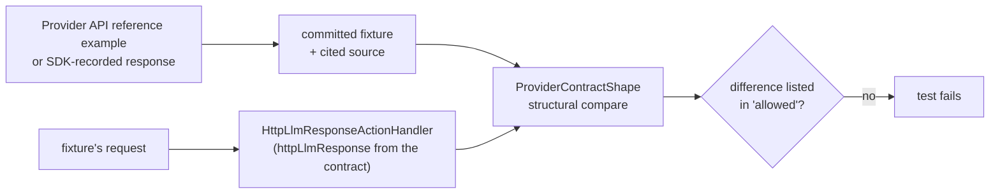

# LLM Codec Golden-File Testing

This document describes the automated golden-file drift-detection process for
LLM provider codecs. Golden files are **codec-generated** (no API keys needed),
normalized to remove volatile fields, and committed to the repository. The test
`LlmCodecGoldenFileTest` asserts them on every test run to catch wire-format
drift in our codecs.

> **Two complementary tests, one deliberate division of labour.** The golden
> bodies are regenerated *from the codec itself* (see *Regenerating golden
> files* below), so on their own they only prove the codec is **consistent with
> itself** — a structural defect (renamed field, wrong SSE event name, dropped
> `finish_reason`) bakes straight into its own golden and the drift test then
> passes forever. Two things break that self-derivation and must **not** be
> weakened by anyone regenerating goldens:
>
> 1. **`LlmCodecGoldenFileTest.shouldEncodeCanonicalTokenUsageCounts`** pins the
>    **token-count values** against hand-authored `Usage` numbers (the goldens
>    normalise usage to `0`). Its sibling
>    `shouldEncodeStreamingUsageChunkForOpenAiChatFamilyWhenIncludeUsageRequested`
>    does the same for the OpenAI-family streaming usage chunk.
> 2. **`LlmCodecStructuralContractTest`** pins the **wire body/streaming
>    structure** against hand-authored, provider-schema-sourced expectations. It
>    reads live codec output only — it never reads the golden files and is not
>    affected by `-Dmockserver.updateLlmGoldens=true`. See
>    [Structural contract test](#structural-contract-test-breaks-self-derivation).
>
> 3. **`LlmProviderContractTest`** compares MockServer's response with **real
>    provider responses** (API reference examples and SDK-recorded fixtures,
>    each cited). See [Provider contract tests](#provider-contract-tests-real-responses).

## How it works

1. **Fixed canonical inputs** -- the test encodes two fixed `Completion` objects
   (text-completion and tool-call) through each provider codec's `encode()` and
   `encodeStreaming()` methods.
2. **Normalization** -- volatile fields (IDs, timestamps, usage counts) are
   replaced with deterministic placeholders so goldens are stable across runs.
3. **Golden comparison** -- the normalized output is compared byte-for-byte
   against the committed golden file. Any mismatch fails the test with a
   line-by-line diff.
4. **Refresh switch** -- when system property `mockserver.updateLlmGoldens`
   (or env `MOCKSERVER_UPDATE_LLM_GOLDENS`) is `true`, the test writes the
   normalized output to the golden files instead of asserting, then passes.

## Structural contract test (breaks self-derivation)

`LlmCodecStructuralContractTest` is the answer to the golden files'
self-derivation weakness. Where `LlmCodecGoldenFileTest` compares codec output
against a golden **that was generated from that same codec**,
`LlmCodecStructuralContractTest` compares codec output against **hand-authored
structural expectations taken from each provider's published API schema**.

Key properties a future maintainer must preserve:

- **It never reads the golden files.** It encodes the same canonical
  completions and asserts the live codec output directly (like the token-count
  test). Running `-Dmockserver.updateLlmGoldens=true` therefore cannot silence
  it — regenerating goldens does not touch it. **Do not "fix" a failure of this
  test by regenerating goldens.** A failure means the codec no longer matches
  the provider's real wire contract; either the codec regressed (fix the codec)
  or the provider genuinely changed its API (update the hand-authored assertion
  *and* the golden together, deliberately).
- **The assertions are external knowledge, not derived from our output.** They
  pin required fields, JSON types, the enum discriminators each provider uses
  (`object` / `type` / `finish_reason` / `stop_reason` / `finishReason` /
  `status` / `done`), the tool-call envelope shape (arguments as a JSON *string*
  for OpenAI/Responses vs a structured *object* for Anthropic/Gemini/Ollama),
  and the exact SSE event-name sequence for the event-typed providers
  (Anthropic/Bedrock `message_start … content_block_delta … message_stop`;
  Responses `response.created … response.output_text.delta …
  response.completed`). For Responses it also pins the stream envelope
  (`type` and a `sequence_number` counting from 0 on every event, a full
  Response object on `response.created` / `.in_progress` / `.completed`, the
  completed `output`), the `function_call` `call_id`, and the
  `function_call_arguments` delta/done events.
- **Streaming text is asserted by reassembly, not by chunk boundaries.** The
  test concatenates the streamed deltas and asserts the whole text, so it is not
  coupled to streaming physics / token chunking (which `LlmAgentLoopE2eTest`
  covers over a real socket).

### Coverage and the two families

Seven chat/completion providers are pinned. Because Azure OpenAI delegates to
`OpenAiChatCompletionsCodec` and Bedrock InvokeModel delegates to `AnthropicCodec`, the
assertions are grouped by wire family, so a defect in a base codec is caught for
both the base and the delegating provider. Bedrock's second wire API, **Converse**,
has its own test (`shouldEncodeBedrockConverseStructureOnConversePaths`). It drives the
registered `BEDROCK` codec with `/converse` and `/converse-stream` requests and pins
the AWS API reference shape: `output.message.content[]` union-keyed blocks,
`stopReason`, `usage.{inputTokens,outputTokens,totalTokens}`, and the
`messageStart … metadata` event sequence.

### Proven to bite

Each defect class named in the coverage-gap ticket was injected into a codec and
confirmed to turn this test red **without** regenerating any golden:

| Provider (family)        | Injected defect                                   | Caught by |
|--------------------------|---------------------------------------------------|-----------|
| OpenAI (→ Azure)         | renamed `finish_reason` → `finishReason`          | non-streaming body |
| Anthropic (→ Bedrock)    | SSE event `content_block_delta` → `content_delta` | streaming framing |
| Gemini                   | dropped `finishReason` emission                   | non-streaming body |
| OpenAI-Responses         | renamed `status` → `state`                        | non-streaming body |
| Ollama                   | renamed terminal `done` → `finished`              | non-streaming body |

## Provider contract tests (real responses)

`LlmProviderContractTest` checks MockServer against what each provider actually
sends. Each case is a `<case>.contract.json` under
`mockserver/mockserver-core/src/test/resources/llm/provider-contracts/<provider>/`
next to the real response it names (`.response.json`, `.response.sse`, or
`.response.events.json` for a stream the source printed as separate objects).



| Contract field | Meaning |
|---|---|
| `source`, `retrieved` | where the real response comes from (a pinned commit URL where one exists) and when it was copied |
| `request` | method, path, `queryStringParameters` and JSON `body` sent to the handler, so request-dependent shapes (Bedrock Converse paths, Gemini `alt=sse`, OpenAI `include_usage`) are exercised |
| `httpLlmResponse` | the action, in expectation JSON, that asks MockServer for the same content as the real response |
| `response`, `format` | the real response file and its format: `JSON`, `SSE`, or `EVENTS` |
| `wireFormat` | for a stream, the `StreamingFormat` the real provider uses; MockServer must choose the same for this request |
| `partial` | the source elides part of the stream (for example `: Intermediate chunks omitted`); event order need only be a subsequence and discriminator values a subset |
| `ignoreRealEvents` | real events a client must tolerate but a mock need not send (Anthropic `ping`), with the reason |
| `allowed` | every remaining difference: `kind`, `path`, optional `scope`, a `reason`, and an `openItem` when a plan item will remove it |

**Normalisation.** The comparison is structural, so ids, timestamps, token counts and
generated text never need masking: each document becomes a map of field paths (array
elements merged under `[]`, as in `choices[].message.content`) to JSON types. Values are
compared only for the discriminators clients branch on (`type`, `object`, `role`,
`status`, `finish_reason`, `stop_reason`, `finishReason`, `stopReason`, `done`,
`done_reason`). `null` matches any type, because a schema that allows null allows the
value. Streams are compared by event order, with consecutive repeats collapsed (an event's
name, or `<data>` for an unnamed JSON payload, or the literal for a sentinel such as
`[DONE]`), then by each event name's merged payload shape. SSE is parsed with the WHATWG
rules, so `:` comment lines are ignored.

**Differences.** `MISSING` (real has it, MockServer does not), `EXTRA`, `TYPE`, `VALUE`,
`SEQUENCE` and `FORMAT`. Only the topmost missing or extra path is reported. An `allowed`
entry without `openItem` is a permanent, reasoned difference (an optional field MockServer
does not model, for example); an entry with `openItem` names the plan item whose fix will
remove it. Either kind fails the test once it stops occurring, so the change that closes an
item must delete its entries, and the list cannot go stale.

**Proven to bite.** Each of these codec defects turns the provider's contracts red: OpenAI
`finish_reason` renamed (OpenAI and Azure), Anthropic `content_block_delta` renamed, Gemini
`finishReason` dropped, Responses `status` renamed, Ollama `done` renamed, and Converse
`stopReason` renamed.

**Adding a case.** Copy the provider's response verbatim from its API reference or an SDK's
recorded test data (never from MockServer output, never invented), remove any credential,
cite the source, write the request and the `httpLlmResponse`, run the test, and fix the
codec or justify each reported difference. Do not regenerate anything to make it pass: this
test reads no golden file.

Current coverage: OpenAI Chat Completions (text, tool call, stream), OpenAI Responses (text,
function call, stream), Anthropic Messages (text, stream, stream with text then tool use),
Gemini (text, thinking with function call, `alt=sse` stream), Bedrock Converse (text,
stream), Azure OpenAI (text), Ollama `/api/chat` (text, tool call, both streamed, model load and unload), Ollama
`/api/generate` (text, streamed text, model load and unload), DeepSeek (text), Groq (text) and OpenRouter (text, tool
call, stream). Not yet covered: Bedrock InvokeModel, the other OpenAI-compatible providers
(Mistral, xAI, OrcaRouter), embeddings and rerank,
and a recorded Gemini JSON-array stream (that framing is tested by
`GeminiJsonArrayStreamingTest` and `LlmAgentLoopE2eTest`).

## Where fixtures live

```
mockserver/mockserver-core/src/test/resources/llm/fixtures/<provider>/
```

One subdirectory per provider: `anthropic`, `openai`, `openai-responses`,
`gemini`, `bedrock` (InvokeModel), `bedrock-converse` (Converse / ConverseStream),
`azure-openai`, `ollama`. That makes 32 golden files in all.

Each directory contains:

- `text-completion.json` -- normalized non-streaming encode of a text completion
- `tool-call.json` -- normalized non-streaming encode of a tool-call completion
- `streaming-text.jsonl` -- normalized streaming encode of a text completion (one event per line)
- `streaming-tool-call.jsonl` -- normalized streaming encode of a tool-call completion

Embedding shapes have their own directory, `embeddings/`, asserted by
`LlmEmbeddingGoldenFileTest`: one `<provider>-<case>.json` per wire shape (OpenAI batch
and base64, Azure, Gemini `embedContent` and `batchEmbedContents`, Ollama `/api/embed` and
`/api/embeddings`, Bedrock Titan G1 / V2 / V2 binary / Multimodal, Cohere v3 / v4 by type / v4 `inputs`).
Each sends a fixed request in the provider's real request shape through
`HttpLlmResponseActionHandler`. The first line is the status code. Vectors become
`"<vector:N>"`, base64 vectors `"<base64-float32:N>"` and Cohere's `id` `"<id>"`, so the
goldens pin the envelope, the number and length of vectors, and the token counts (which are
not zeroed). The same `-Dmockserver.updateLlmGoldens=true` switch regenerates them. The
hand-authored shape assertions for these responses are in `EmbeddingProviderWireShapeTest`.

## Regenerating golden files

After intentional codec changes, regenerate goldens:

```bash
mvn -pl mockserver/mockserver-core test \
  -Dtest=LlmCodecGoldenFileTest \
  -Dmockserver.updateLlmGoldens=true
```

Or set the environment variable:

```bash
MOCKSERVER_UPDATE_LLM_GOLDENS=true mvn -pl mockserver/mockserver-core test \
  -Dtest=LlmCodecGoldenFileTest
```

Then review the diff with `git diff` and commit the updated golden files
alongside the codec changes.

> **Regeneration cannot make a structural regression pass.**
> `-Dmockserver.updateLlmGoldens=true` rewrites the golden bodies but has **no
> effect on `LlmCodecStructuralContractTest`** (it reads live codec output, not
> the goldens). If that test is red after a codec change, regenerating goldens
> will not turn it green — and should not be attempted as a workaround. Fix the
> codec, or, if the provider genuinely changed its API, update the hand-authored
> structural assertion deliberately in the same change as the golden refresh.

## Asserting golden files (normal test run)

```bash
mvn -pl mockserver/mockserver-core test \
  -Dtest=LlmCodecGoldenFileTest
```

The test also runs as part of the standard `mvn test` suite.

## Normalization rules

The following fields are replaced with deterministic placeholders before
writing/comparing:

| Field | Applies to | Placeholder |
|-------|-----------|-------------|
| `id`, `item_id`, `tool_call_id`, `toolUseId` | All providers | `"<id>"` |
| String values matching `chatcmpl-*`, `msg_*`, `resp_*`, `call_*`, `toolu_*`, `tooluse_*`, `fc_*` | All providers | `"<id>"` |
| `created` (numeric) | OpenAI, Azure OpenAI, OpenAI Responses | `0` |
| `created_at` (numeric) | OpenAI Responses | `0` |
| `completed_at` (numeric) | OpenAI Responses | `0` |
| `created_at` (ISO 8601 string) | Ollama | `"<timestamp>"` |
| `system_fingerprint` | OpenAI | `"<fp>"` |
| `usage.*`, `usageMetadata.*` (numeric values) | All providers | `0` (structure preserved) |
| `*_duration` fields | Ollama | `0` |
| `prompt_eval_count`, `eval_count`, `prompt_eval_duration`, `eval_duration` | Ollama | `0` |

## Streaming golden file format

Streaming goldens use JSONL (one entry per line):

- **SSE with event types** (Anthropic, OpenAI Responses): each line is a JSON
  object `{"event":"<type>","data":<normalized-json>}` capturing both the SSE
  event name and normalized payload.
- **SSE without event types** (OpenAI, Azure OpenAI, Gemini): each line is the
  normalized JSON payload directly. Non-JSON sentinels (e.g. `[DONE]`) are
  quoted as JSON strings.
- **NDJSON** (Ollama): each line is the normalized JSON chunk directly.
- **AWS_EVENT_STREAM** (Bedrock InvokeModel): uses the same SSE-with-events format as
  Anthropic (since Bedrock delegates to the Anthropic codec internally). The
  binary event-stream framing is not exercised in this test -- it is covered by
  `BedrockEventStreamEncoderTest`.
- **AWS_CONVERSE_EVENT_STREAM** (Bedrock ConverseStream, `bedrock-converse`): each
  line is `{"event":"<Converse event name>","data":<event JSON>}`. The binary
  framing is covered by `BedrockEventStreamEncoderTest` and, over a real socket, by
  `LlmAgentLoopE2eTest`.

## Streaming physics

The test passes `null` for `StreamingPhysics` so no timing delays are injected.
This ensures the golden files capture only the wire-format content, not timing
behavior.

## Request-dependent streaming: OpenAI `include_usage`

The OpenAI Chat Completions stream depends on the request. Only when the request
sets `stream_options.include_usage: true` does every chunk carry `"usage": null`,
with one extra `"choices": []` chunk holding the usage before `[DONE]`. The default
goldens use no request, so the opt-in shape has its own golden,
`openai/streaming-text-include-usage.jsonl`. It is written and asserted by
`shouldEncodeStreamingUsageChunkForOpenAiChatFamilyWhenIncludeUsageRequested`, which
also pins the usage-chunk token counts for OpenAI, Azure OpenAI and every
OpenAI-compatible alias, and each alias's non-streaming counts.

Ollama answers a request to `/api/generate` in a different shape from `/api/chat` (text in a
top-level `response`, no `message`), so that shape has two goldens of its own,
`ollama/generate-text-completion.json` and `ollama/generate-streaming-text.jsonl`, written
and asserted by `shouldEncodeOllamaGenerateShape`.

## Live provider capture (optional)

The golden-file test does NOT require API keys -- it tests our codec output.
For additional confidence, you can optionally diff against real provider
responses. The `curl` recipes below require real API keys:

### Anthropic

```bash
curl -s https://api.anthropic.com/v1/messages \
  -H "x-api-key: $ANTHROPIC_API_KEY" \
  -H "anthropic-version: 2024-10-22" \
  -H "content-type: application/json" \
  -d '{
    "model": "claude-sonnet-4-20250514",
    "max_tokens": 256,
    "messages": [{"role": "user", "content": "Say hello in one sentence."}]
  }' | jq .
```

### OpenAI Chat Completions

```bash
curl -s https://api.openai.com/v1/chat/completions \
  -H "Authorization: Bearer $OPENAI_API_KEY" \
  -H "Content-Type: application/json" \
  -d '{
    "model": "gpt-4o",
    "messages": [{"role": "user", "content": "Say hello in one sentence."}]
  }' | jq .
```

Focus on structural fields when comparing live output: presence/absence of
keys, value types, nesting depth. Exact token counts, IDs, and timestamps
will differ.

## Refresh cadence

Regenerate goldens whenever codec encode logic changes. Also check when
providers announce breaking API changes. After regenerating, run the full
codec test suite to confirm no regressions:

```bash
mvn -pl mockserver/mockserver-core test \
  -Dtest="*CodecTest" \
  -Dsurefire.failIfNoSpecifiedTests=false
```
