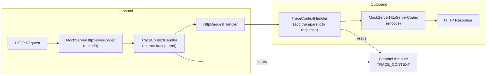

# Telemetry — OpenTelemetry Integration

## Overview

MockServer integrates with OpenTelemetry (OTEL) for both metrics export and trace context propagation. The telemetry subsystem lives in `mockserver-core/src/main/java/org/mockserver/telemetry/` and is designed to be fail-soft: telemetry failures never affect served responses.

## Components

### GenAI Span Export (`GenAiSpans`, `GenAiSpanExporter`)

Emits explicit OpenTelemetry GenAI semantic-convention spans for LLM completions MockServer serves **or forwards**. Each span carries provider (`gen_ai.system`), model, token usage, and finish reason. Controlled by `mockserver.otelTracesEnabled`.

- **`GenAiSpans`** — static emit point; no-op unless a tracer is installed by `GenAiSpanExporter`
- **`GenAiSpanExporter`** — configures the OTel trace SDK (OTLP HTTP/protobuf, JDK sender) and installs the tracer

GenAI spans fire on two paths:
1. **Mock action path** — `HttpLlmResponseActionHandler` calls `GenAiSpans.recordCompletion()` for mocked LLM responses (streaming and non-streaming).
2. **Forward/proxy path** — `HttpActionHandler.emitForwardGenAiSpan()` detects LLM traffic via `LlmProviderSniffer`, reads the upstream response's usage using the provider's `LlmClient`, and records a completion span. Covers matched-expectation forwards, breakpoint-continuation forwards, the unmatched proxy path and `proxyPassMappings` routes. A streamed response is read as it is relayed, by `LlmStreamUsageScanner`, and its span is emitted when the stream ends; a stream that reports no usage gets a span with no `gen_ai.usage.*` attributes and a log line saying it was not counted. See [Proxied LLM usage and cost](llm-mocking.md#proxied-llm-usage-and-cost).

### LLM Provider Sniffer (`LlmProviderSniffer`)

Maps a forwarded request's target host to an LLM `Provider` for forward-path GenAI observability. Detection order:

1. Well-known hosts: `api.openai.com` (OPENAI), `*.openai.azure.com` and `*.services.ai.azure.com` on an `/openai/` path (AZURE_OPENAI; OPENAI_RESPONSES on a `/responses` path, whose usage is the Responses shape), `api.anthropic.com` (ANTHROPIC), `generativelanguage.googleapis.com` (GEMINI), `bedrock*.amazonaws.com` (BEDROCK)
2. Configured `mockserver.llmBaseUrl` host match (OLLAMA)
3. Fallback to configured `mockserver.llmProvider` — **path-gated**: only applies when the request path looks like an LLM endpoint (case-insensitive contains any of `/chat/completions`, `/messages`, `/completions`, `/responses`, `/embeddings`, `/v1/`, `:generatecontent`, `/api/generate`, `/api/chat`). This prevents a forward to e.g. `example.com/api/users` from being misclassified as LLM traffic when a provider is configured.
4. Empty Optional (not LLM traffic — skip GenAI span)

Located at `mockserver-core/src/main/java/org/mockserver/llm/client/LlmProviderSniffer.java`. Pure, stateless, and unit-tested.

### Metrics Export (`OtelMetricsExporter`)

Pushes MockServer's explicitly-defined metrics to OTLP. Controlled by `mockserver.otelMetricsEnabled`.

Located in `mockserver-core/src/main/java/org/mockserver/metrics/OtelMetricsExporter.java`.

**What is exported:**
- All `Metrics.Name` enum gauges (request counts, action counts, WebSocket counts) as OTLP observable gauges.
- JVM memory, thread, and GC gauges (`jvm_memory_used_bytes`, `jvm_threads_current`, etc.).
- Chaos-related counters and gauges.
- The full `mock_server_load_*` family — **load-run metrics are exported via OTLP** (this is the first metric family produced by MockServer that is also pushed over OTLP in addition to the Prometheus scrape endpoint).

**Load-run OTLP instruments:**

| OTEL instrument name | OTEL type | Unit |
|----------------------|-----------|------|
| `mock_server_load_request_duration_seconds` | DoubleHistogram | `s` |
| `mock_server_load_requests` | LongCounter | — |
| `mock_server_load_request_bytes` | LongCounter | `By` |
| `mock_server_load_response_bytes` | LongCounter | `By` |
| `mock_server_load_iterations` | LongCounter | — |
| `mock_server_load_throttled` | LongCounter | — |
| `mock_server_load_errors` | LongCounter | — |
| `mock_server_load_active_vus` | Observable gauge | — |
| `mock_server_load_inflight_requests` | Observable gauge | — |

Custom labels from scenario/step `labels` maps are passed as OTEL `Attributes` on every instrument record call. Unlike Prometheus, the OTEL path does not require an allowlist — all key/value pairs are forwarded.

**Exemplars on the load histogram:** `mock_server_load_request_duration_seconds` attaches a `trace_id` exemplar to each histogram observation when the upstream response carries a W3C `traceparent` header. This allows a latency spike in an OTEL-connected backend (e.g. Grafana Tempo) to be pivoted directly to the trace that produced it.

#### Aggregation Temporality (`cumulative` vs `delta`)

`mockserver.otelMetricsTemporality` selects the OTLP aggregation temporality for the exporter's **counter and histogram** instruments. Default `cumulative` reproduces the prior behaviour exactly. Setting `delta` chains `AggregationTemporalitySelector.deltaPreferred()` onto the `OtlpHttpMetricExporter` builder in `OtelMetricsExporter.startIfEnabled()`, so counters/histograms report per-interval deltas while gauges stay cumulative (a gauge has no temporality). Resolution is fail-safe: only the literal `delta` (trimmed, case-insensitive) opts in; any unknown/blank value keeps `cumulative`, and a bad value never throws.

Delta is what backends such as **New Relic** prefer: a delta counter carries the change within the interval, so the backend does not need to track a monotonic cumulative series per producing pod/instance, which collapses time-series cardinality. This is an OTLP-only concept — the Prometheus scrape endpoint and Prometheus remote write are inherently cumulative.

To make delta meaningful for the two counter *mirror* series, `mock_server_slow_requests_total` and `mock_server_http_chaos_injected_total` are registered as OTLP observable **counters** (monotonic sums), not gauges — they carry the `_total` suffix and are genuinely monotonic, so under cumulative they export as monotonic sums and under delta the SDK converts them to per-interval deltas. Genuinely non-monotonic series (JVM, `mock_server_active_service_chaos`, load VUs/inflight, LLM-optimisation gauges) remain gauges.

### OTLP Endpoint Resolution (`OtelEndpoints`)

Resolves per-signal OTLP HTTP endpoints (`/v1/metrics`, `/v1/traces`) from the single configured base URL (`mockserver.otelEndpoint`). Shared by both the metrics and trace exporters. When the MockServer-specific property/env is unset, `ConfigurationProperties.otelEndpoint()` falls back to the OpenTelemetry-standard `OTEL_EXPORTER_OTLP_ENDPOINT` environment variable before defaulting to empty, so existing OTel deployments work without extra configuration; the MockServer-specific value always takes precedence.

### W3C Trace Context Propagation (`W3CTraceContext`, `TraceContextHandler`)

Extracts W3C `traceparent` and `tracestate` headers from incoming HTTP requests and optionally propagates them to mock responses. This enables distributed tracing correlation when MockServer sits in a service mesh or test harness that uses W3C Trace Context.

#### `W3CTraceContext` (mockserver-core)

Value type that parses and validates W3C `traceparent` header values. Format: `{version}-{traceId}-{parentId}-{flags}`.

Validation rules:
- `traceId` must be 32 hex characters
- `parentId` must be 16 hex characters
- `version` and `flags` must be present

#### `TraceContextHandler` (mockserver-netty)

Netty `ChannelDuplexHandler` that sits in the pipeline between `MockServerHttpServerCodec` and `HttpRequestHandler`:

```
... -> MockServerHttpServerCodec -> TraceContextHandler -> HttpRequestHandler
```

**Inbound (channelRead):**
1. Extracts `traceparent` and `tracestate` headers from MockServer `HttpRequest`
2. Parses into `W3CTraceContext` and stores as a channel attribute
3. If `otelGenerateTraceId` is enabled and no traceparent header exists, generates a new random trace context
4. Otherwise (no header and generation off, or an invalid header) clears the attribute — it is overwritten on **every** request, because an HTTP/1.1 keep-alive connection is one channel for many requests and a stale context would otherwise be propagated onto, and parent the spans of, a later request that sent none. HTTP/2 and HTTP/3 requests each get their own stream channel, so they start with no context anyway.

**Outbound (write):**
1. If `otelPropagateTraceContext` is enabled, copies the stored trace context headers to the MockServer `HttpResponse` before it reaches `MockServerHttpServerCodec` for encoding

The handler is `@Sharable` (no per-channel mutable state; state lives in the channel attribute `TRACE_CONTEXT`).

## Configuration Properties

| Property | Type | Default | Description |
|----------|------|---------|-------------|
| `mockserver.otelMetricsEnabled` | boolean | false | Export metrics via OTLP |
| `mockserver.otelTracesEnabled` | boolean | false | Export GenAI spans via OTLP |
| `mockserver.otelEndpoint` | string | (empty) | OTLP collector base URL; falls back to the standard `OTEL_EXPORTER_OTLP_ENDPOINT` env var when unset |
| `mockserver.otelMetricsExportIntervalSeconds` | long | 60 | Metrics push interval |
| `mockserver.otelMetricsTemporality` | string | `cumulative` | OTLP aggregation temporality for counters/histograms: `cumulative` or `delta`. Any unknown/blank value falls back to `cumulative` |
| `mockserver.otelPropagateTraceContext` | boolean | false | Copy W3C trace headers to responses |
| `mockserver.otelGenerateTraceId` | boolean | false | Generate trace IDs for requests without `traceparent` |

All OTEL properties are opt-in (off by default) and available as both system properties (`-Dmockserver.*`) and environment variables (`MOCKSERVER_*`).

## Pipeline Integration

The `TraceContextHandler` is wired into all three HTTP pipeline setup methods in `PortUnificationHandler`:

- `switchToHttp` (HTTP/1.1)
- `switchToHttp2` (HTTP/2 via ALPN)
- `switchToH2c` (HTTP/2 cleartext)

It is always present in the pipeline but is effectively a no-op when both `otelPropagateTraceContext` and `otelGenerateTraceId` are disabled (their defaults). The handler reads the configuration at request time, so properties can be changed at runtime.

## Architecture Diagram



## Request-Level Spans (`RequestSpans`)

When `otelTracesEnabled` is set, MockServer emits a `SERVER`-kind OpenTelemetry span
for each served HTTP request/response (in addition to the GenAI spans produced by
`GenAiSpans`). The emitter is `org.mockserver.telemetry.RequestSpans`, which mirrors the
`GenAiSpans` pattern: a static `volatile Tracer` installed by `GenAiSpanExporter`, an
`isEnabled()` short-circuit, and a fully fail-soft `recordRequest(...)` (telemetry never
affects the served response).

Span attributes (OpenTelemetry semantic conventions where applicable):

| Attribute | Source |
|-----------|--------|
| `http.request.method` | request method |
| `http.route` | matched expectation path (else request path) |
| `http.response.status_code` | response status code |
| `mockserver.expectation_id` | matched expectation id (when an expectation matched) |
| `mockserver.response_time_ms` | forward path response time (omitted on mocked path) |
| `server.address` | resolved upstream host on the forward/proxy path (omitted on the mocked path) |
| `server.port` | resolved upstream port on the forward/proxy path (omitted when unknown or on the mocked path) |

On the forward/proxy paths, `server.address`/`server.port` are populated from the resolved upstream
(the matched forward action's host where available — the real upstream even behind an HTTP
forward-proxy — else the resolved socket address), giving per-upstream visibility in traces. They are
omitted on the mocked-response path. The same forward paths also feed two Prometheus metrics
(`mock_server_forward_request_duration_seconds`, `mock_server_forward_requests`) labelled by upstream
host — see [metrics.md](metrics.md).

The span parent is taken from the inbound W3C trace context when present. The
`AttributeKey<W3CTraceContext>` is defined once in `org.mockserver.telemetry.TraceContextAttributes`
(in `mockserver-core`) so both the core `HttpActionHandler` (which reads the channel attribute
to find the parent context) and the netty `TraceContextHandler` (which sets it) share one key
without `mockserver-core` depending on `mockserver-netty`. Emission happens at the mocked-response
and **all** forwarded-response write points in `HttpActionHandler`, each guarded by `RequestSpans.isEnabled()`:

- Mocked response path (`writeResponseActionResponse`)
- Matched-expectation forward path (`writeForwardActionResponse` — both streaming and non-streaming)
- Unmatched proxy-pass path (`handleUnmatchedProxyForward` — both streaming and non-streaming)
