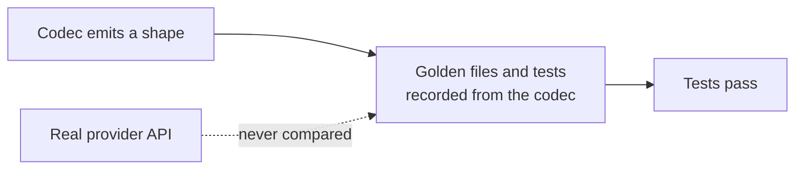

# LLM Provider Wire-Shape Fixes

## Outcome

Every `httpLlmResponse` provider should return what the real provider API returns, and accept
what real SDKs send, so client libraries, agent frameworks and gateways work against a mock
without special cases. GitHub discussion
[#2757](https://github.com/mock-server/mockserver-monorepo/discussions/2757) found that
`BEDROCK` returned Anthropic's Messages shape where the docs promised the AWS Converse API. An
audit of every provider on 2026-10-03 then found the same class of bug elsewhere. The items
below are worked in batches, most SDK-breaking first. The release is **not** gated on finishing
this plan: each item ships when it lands. When every item is closed this file is deleted in the
same commit. Updated 2026-10-12: every item listed below is still open; items closed on
2026-10-12 have been removed.

## Why this class of bug got through

The codec tests derive their expected values from the codec itself. Examples:
`shouldEncodeCanonicalTokenUsageCounts` checks only non-streaming bodies and excludes the
OpenAI-compatible aliases, and the Responses tests set `call_id` equal to `id`. Item 16 closes
this gap.

## What remains

| # | Item | Batch |
|---|---|---|
| 24a | Per-provider embedding batch limits do not match the real APIs | 5 |
| 42a | DeepSeek responses lack `system_fingerprint` and `usage.prompt_tokens_details` | 5 |
| 33c | Anthropic non-refusal messages omit `stop_details: null` | 5 |
| 41a | Ollama load-only and unload requests get a generated completion | 5 |
| 39a | Forwarded Cohere, Voyage and Bedrock embeddings and rerank calls get no token counts | 5 |
| 39b | Mocked embeddings and rerank responses get no GenAI span or token metrics | 5 |
| 39c | Gemini and legacy text-completion spans use the `chat` operation name (decided: rename, changelog BREAKING) | 5 |

## Items

| # | Problem | Fix |
|---|---|---|
| 24a | From item 24's review: the per-request embedding batch limits are not each provider's own. Gemini `:batchEmbedContents` accepts up to `EmbeddingWire.MAX_INPUTS` (2,048) requests (`GeminiCodec.encodeEmbedding`), where the real API allows 100. Voyage's 1,000-document rerank limit (MockServer mocks Voyage only for rerank) and OpenAI's 300,000-token total per embedding request are not enforced. | Give each codec its provider's own input count (Gemini 100, Voyage rerank 1,000 documents), and reject an OpenAI request whose inputs total over 300,000 tokens by the codec's token estimate. |
| 42a | Found while closing item 42: DeepSeek's API reference (https://api-docs.deepseek.com/api/create-chat-completion) marks `system_fingerprint` and `usage.prompt_tokens_details` (with `cached_tokens`) as required on the chat completion object, and its example sends both. A mocked `DEEPSEEK` response has no `system_fingerprint` (MockServer sends it for no provider) and has `prompt_tokens_details` only when the expectation sets cached input tokens. The DeepSeek contract case allows both with `openItem` 42a. | Send `system_fingerprint` (a generated `fp_` value) and always send `usage.prompt_tokens_details.cached_tokens` for DEEPSEEK, streamed usage included; delete the two 42a allowances from `provider-contracts/deepseek/chat-text.contract.json`. Check whether Groq and xAI, whose examples also send `system_fingerprint`, should get it too. |
| 33c | Anthropic non-refusal messages omit `stop_details: null` | The real API sends `"stop_details": null` on every message whose stop reason is not `refusal` (refusals-and-fallback page). MockServer omits the field; SDKs treat absent and null the same (anthropic-sdk-python defaults it to None), so this matters only to byte-exact consumers. | Emit `stop_details: null` on whole messages and in every `message_delta` delta, and regenerate the Anthropic golden fixtures; do it alone, as it touches every Anthropic golden file. |
| 41a | Found in the item 41 review: Ollama answers an `/api/generate` or `/api/chat` request with an empty prompt or no messages with a load-only reply (`done: true`, `done_reason: "load"`, no text), and one with `keep_alive: 0` and nothing to generate with an unload reply (`done_reason: "unload"`) (https://github.com/ollama/ollama/blob/main/docs/api.md, "Load a model" and "Unload a model"). The mock generates a completion for both. | Return the documented load and unload replies for those requests on both endpoints, with tests against the documented examples. |
| 39a | Found while fixing item 39: the forward path now recognises every provider's embeddings and rerank endpoints, but only OpenAI and its compatibles, Azure, Mistral, Gemini and Ollama `/api/embed` have their tokens counted. Cohere and Voyage have no `LlmClient`, so their calls get no span at all. `BedrockLlmClient` reads neither Titan's `inputTextTokenCount` nor the `X-Amzn-Bedrock-Input-Token-Count`/`X-Amzn-Bedrock-Output-Token-Count` headers InvokeModel returns, so a Bedrock embedding or rerank invocation gets a span with no tokens. Bedrock Agent Runtime `/rerank` names its model only inside `rerankingConfiguration`, so its span is `rerank unknown`. Vertex `:predict` embeddings are not accounted, and a Vertex `:rawPredict` call to a partner model other than Claude (such as Mistral) is sniffed as Gemini, so it gets a span with no tokens. | Add Cohere and Voyage clients that read `meta.billed_units` and `usage.total_tokens`; read the Bedrock token-count headers (all InvokeModel models) and Titan's body count; take the Agent Runtime rerank model from its `modelArn`; decide whether Vertex `:predict` is accounted; sniff Vertex `publishers/mistralai` as Mistral. Test each against the real response shape. |
| 39b | Found while fixing item 39: `HttpLlmResponseActionHandler` records a GenAI span and token metrics only for completions; an `httpLlmResponse` with `embedding` or `rerank` returns before recording anything, so a mocked embeddings call is invisible in traces and metrics while the same call forwarded is counted. | Record an `embeddings`/`rerank` span (`GenAiSpans.record`) and token metrics from the usage the codec encodes, with a test per provider codec. |
| 39c | Found while fixing item 39: the OpenTelemetry GenAI semantic conventions say a well-known `gen_ai.operation.name` MUST be used when it applies: `generate_content` for Gemini `generateContent`/`streamGenerateContent`, `text_completion` for legacy `/v1/completions` (and Ollama `/api/generate` and Mistral FIM). MockServer names all of these `chat`, on both the mock and the forward path. Decided (owner, 2026-10-12): rename, as a separate BREAKING unit. | Extend `LlmProviderSniffer.Operation` with `GENERATE_CONTENT` and `TEXT_COMPLETION`, apply it on the forward path and in `HttpLlmResponseActionHandler`, and add a `BREAKING:` changelog entry naming the renamed spans. |
