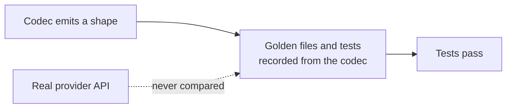

# LLM Provider Wire-Shape Fixes

## Outcome

Every `httpLlmResponse` provider should return what the real provider API returns, and accept
what real SDKs send, so client libraries, agent frameworks and gateways work against a mock
without special cases. GitHub discussion
[#2757](https://github.com/mock-server/mockserver-monorepo/discussions/2757) found that
`BEDROCK` returned Anthropic's Messages shape where the docs promised the AWS Converse API. An
audit of every provider on 2026-10-03 then found the same class of bug elsewhere. The items
below are worked in batches, most SDK-breaking first. The release is **not** gated on finishing
this plan: each item ships when it lands. When every item is closed this file is deleted in the
same commit. Updated 2026-10-13: every item listed below is still open; closed items have been removed.

## Why this class of bug got through

The codec tests derive their expected values from the codec itself. Examples:
`shouldEncodeCanonicalTokenUsageCounts` checks only non-streaming bodies and excludes the
OpenAI-compatible aliases, and the Responses tests set `call_id` equal to `id`. Item 16 closes
this gap.

## What remains

| # | Item | Batch |
|---|---|---|
| 39m | Mocked Bedrock InvokeModelWithResponseStream streams have no amazon-bedrock-invocationMetrics on their last chunk | 5 |
| 33f | The chaos content-filter Anthropic refusal body sends a short usage object | 5 |
| 39n | Native Vertex AI Gemini 2.0 Flash calls are priced at the Gemini API rate | 5 |

## Items

| # | Problem | Fix |
|---|---|---|
| 39m | Found while closing item 39i: real Bedrock adds `amazon-bedrock-invocationMetrics` (`inputTokenCount`, `outputTokenCount`, `invocationLatency`, `firstByteLatency`) to the event inside the last `chunk` of an InvokeModelWithResponseStream stream, for Claude on its `message_stop` event. langchain-aws (`llms/bedrock.py`, `prepare_output_stream`) builds a streamed call's `usage_metadata` only from that object, at `message_stop` for Claude. `BedrockCodec.encodeStreaming` wraps AnthropicCodec's events unchanged, so a mocked stream has no such object and LangChain's `ChatBedrock` (non-Converse) may report no usage for it. | Verify first against langchain-aws: if `ChatBedrock` streaming reports no usage from a mocked stream, add the object to the event of the mock's last chunk (`message_stop`), with counts equal to the completion's usage, and test it as the real wire shape. |
| 33f | Found while closing item 33e. The Anthropic and Bedrock InvokeModel codecs now send the full Usage object the real APIs send (both cache counts, 0 when unset, `cache_creation`, `service_tier`, and `inference_geo` for the Claude API only). The fixed refusal body a chaos content-filter block returns (`LlmRefusalPresets.ANTHROPIC_REFUSAL_BODY` / `BEDROCK_INVOKE_REFUSAL_BODY`) still sends only `{"input_tokens":0,"output_tokens":0}`. It was left alone because 33e was scoped to the codec. | Build the refusal body's usage the way `AnthropicCodec` does (Claude API with `inference_geo`, Bedrock without) and assert it in the content-filter wire-shape tests. |
| 39n | Found while closing item 39l (low priority): a native Vertex AI Gemini call (`:generateContent`, `:streamGenerateContent` on an `aiplatform` host) is sniffed as `GEMINI` and priced from the Gemini API table, which is right for Gemini 2.5 and 2.0 Flash-Lite but not for Gemini 2.0 Flash: Vertex AI bills it at 0.15 / 0.60 USD per million input / output tokens (cloud.google.com/vertex-ai/generative-ai/pricing, captured 2026-10-13), the Gemini API at 0.10 / 0.40. `LlmPricing` sees only the provider and model, so it cannot tell the two hosts apart. | Pass the host (or a Vertex AI flag) from the forward path into pricing, or have the sniffer return a Vertex AI provider variant, and price native Vertex AI Gemini calls from the Vertex AI Gemini table that 39l added for the OpenAI-compatible endpoint. Keep the dashboard table (`mockserver-ui/src/lib/llmPricing.ts`) in step. |
