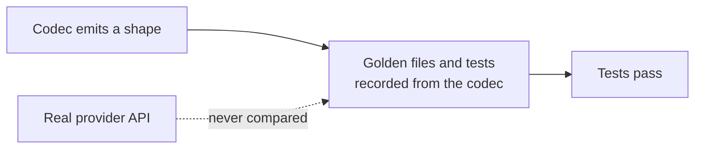

# LLM Provider Wire-Shape Fixes

## Outcome

Every `httpLlmResponse` provider should return what the real provider API returns, and accept
what real SDKs send, so client libraries, agent frameworks and gateways work against a mock
without special cases. GitHub discussion
[#2757](https://github.com/mock-server/mockserver-monorepo/discussions/2757) found that
`BEDROCK` returned Anthropic's Messages shape where the docs promised the AWS Converse API. An
audit of every provider on 2026-10-03 then found the same class of bug elsewhere. The items
below are worked in batches, most SDK-breaking first. The release is **not** gated on finishing
this plan: each item ships when it lands. When every item is closed this file is deleted in the
same commit. Updated 2026-10-12: every item listed below is still open; items closed on
2026-10-12 have been removed.

## Why this class of bug got through

The codec tests derive their expected values from the codec itself. Examples:
`shouldEncodeCanonicalTokenUsageCounts` checks only non-streaming bodies and excludes the
OpenAI-compatible aliases, and the Responses tests set `call_id` equal to `id`. Item 16 closes
this gap.

## What remains

| # | Item | Batch |
|---|---|---|
| 39d | Forwarded Vertex AI calls to the OpenAI-compatible endpoint and to partner models other than Claude and Mistral get no token counts | 5 |
| 39h | Forwarded Bedrock InvokeModel calls to legacy text-completion models are named `chat` | 5 |
| 39i | Forwarded Bedrock InvokeModelWithResponseStream calls to non-Anthropic models are not counted | 5 |
| 39j | No include_usage hint when a Bedrock OpenAI-endpoint stream reports no usage | 5 |
| 39k | Mocked Bedrock InvokeModel responses send no prompt-cache token headers | 5 |
| 33e | Anthropic usage omits fields the real API always sends | 5 |

## Items

| # | Problem | Fix |
|---|---|---|
| 39d | Found while fixing item 39a: on a Vertex AI host every path that is not `/publishers/anthropic/` or `/publishers/mistralai/` is sniffed as `GEMINI`, so `GeminiLlmClient` reads the response. That gives no token counts for the OpenAI-compatible endpoint (`/v1/projects/{p}/locations/{l}/endpoints/openapi/chat/completions`, used for Gemini and for Llama and other Model Garden MaaS models), whose usage is OpenAI's `usage.prompt_tokens`/`completion_tokens`, nor for `:rawPredict` on any other partner publisher. | Sniff the Vertex `endpoints/openapi` path as an OpenAI-shaped provider (or read OpenAI usage in `GeminiLlmClient` when `usageMetadata` is absent), decide per partner publisher, and test each against the real response shape. |
| 39h | Found while closing item 39c: the GenAI operation is decided by the request path, and a Bedrock `/model/{modelId}/invoke` path does not say which API the model speaks, so a legacy text-completion model such as Cohere Command (`cohere.command-text-v14`) is still recorded as `chat`, where the semantic conventions call for `text_completion`. | Decide the operation from the model family on Bedrock InvokeModel (e.g. Cohere Command text, AI21 Jurassic and Titan Text as `text_completion`), confirming each family against the AWS request and response shapes, with a test per family. |
| 39i | Found while closing item 39g: The final chunk of an InvokeModelWithResponseStream stream carries `amazon-bedrock-invocationMetrics` with `inputTokenCount` and `outputTokenCount`. langchain-aws (`llms/bedrock.py`, `_get_invocation_metrics_chunk`) reads it for every provider, including gpt-oss ("openai"), Qwen, Mistral and Llama. LlmStreamUsageScanner reads only a `usage` object, so these streams are not counted. docs/code/llm-mocking.md and the consumer page list this as a limit. | capture `amazon-bedrock-invocationMetrics` (exactly 32 bytes, the scanner's MAX_NAME_BYTES) inside the decoded `bytes` payload, map inputTokenCount/outputTokenCount in BedrockLlmClient.parseUsage, and keep Anthropic `usage` first when both are present. Verify the field against a recorded stream or the AWS SDK before relying on it. |
| 39j | Found while closing item 39g: HttpActionHandler.logStreamedUsageUnavailable adds the "set stream_options.include_usage" hint only for OPENAI and non-Responses AZURE_OPENAI. A Bedrock /openai/v1/chat/completions stream without include_usage gets the generic "not counted" line. | Extend usageIsOptIn to a BEDROCK request whose path ends in /chat/completions. This was left out of 39g because it changes HttpActionHandler, a file shared with parallel units. |
| 39k | Found while closing item 39e (low priority): real Amazon Nova InvokeModel responses also carry `X-Amzn-Bedrock-Cache-Read-Input-Token-Count` and `X-Amzn-Bedrock-Cache-Write-Input-Token-Count` (recorded in OpenTelemetry Java instrumentation testinvokemodelamazonnova.yaml), and langchain-aws and openllmetry read them. No recorded Anthropic-on-Bedrock response with them was found, so item 39e does not send them; a mocked Claude completion with cached tokens reports them only in the body. | Find a recorded Claude InvokeModel response with prompt caching to confirm whether Bedrock sends the cache headers for Anthropic models, then send them from `BedrockCodec.encode` when the usage has cached or cache-creation tokens. |
| 33e | Found while closing item 33d. Two contracts added by 33d replay live responses recorded on 2026-09-28 (`provider-contracts/anthropic/stream-text-recorded`, `thinking-text-recorded`) and allow, with `openItem` "33e", these gaps: the whole message and `message_start` usage lack `cache_creation` (`{ephemeral_5m_input_tokens, ephemeral_1h_input_tokens}`), `service_tier`, `inference_geo`, and `cache_creation_input_tokens` / `cache_read_input_tokens` when they are zero (MockServer emits them only when non-zero); the `message_delta` usage lacks `input_tokens`, `cache_creation_input_tokens` and `cache_read_input_tokens`; and `usage.output_tokens_details.thinking_tokens` is never emitted even when the completion sets `reasoningTokens`. The Messages API reference marks all of these required (nullable). | Fix in `AnthropicCodec`, check what Bedrock InvokeModel sends (the 2026-09-29 Bedrock recordings have `cache_creation` and `service_tier` but no `inference_geo` in `message_start`), and delete the allowances from the two contracts.  Also emit the Bedrock `message_delta` usage `output_tokens_details`, which the Bedrock recording carries. |
