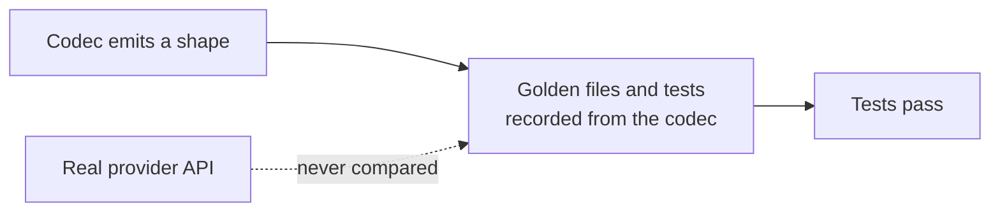

# LLM Provider Wire-Shape Fixes

## Outcome

Every `httpLlmResponse` provider should return what the real provider API returns, and accept
what real SDKs send, so client libraries, agent frameworks and gateways work against a mock
without special cases. GitHub discussion
[#2757](https://github.com/mock-server/mockserver-monorepo/discussions/2757) found that
`BEDROCK` returned Anthropic's Messages shape where the docs promised the AWS Converse API. An
audit of every provider on 2026-10-03 then found the same class of bug elsewhere. The items
below are worked in batches, most SDK-breaking first. The release is **not** gated on finishing
this plan: each item ships when it lands. When every item is closed this file is deleted in the
same commit. Updated 2026-10-12: every item listed below is still open; items closed on
2026-10-12 have been removed.

## Why this class of bug got through

The codec tests derive their expected values from the codec itself. Examples:
`shouldEncodeCanonicalTokenUsageCounts` checks only non-streaming bodies and excludes the
OpenAI-compatible aliases, and the Responses tests set `call_id` equal to `id`. Item 16 closes
this gap.

## What remains

| # | Item | Batch |
|---|---|---|
| 42b | DeepSeek streams usage only with `stream_options.include_usage` | 5 |
| 33d | Check whether Anthropic messages should send `container` and `diagnostics` | 5 |
| 39e | Mocked Bedrock InvokeModel responses send no token-count headers | 5 |
| 39f | Mistral `codestral-embed` is priced at the `codestral` chat rate | 5 |
| 39d | Forwarded Vertex AI calls to the OpenAI-compatible endpoint and to partner models other than Claude and Mistral get no token counts | 5 |
| 24b | Embedding per-input token limits and Voyage rerank token totals are not enforced | 5 |
| 39h | Forwarded Bedrock InvokeModel calls to legacy text-completion models are named `chat` | 5 |
| 39i | Forwarded Bedrock InvokeModelWithResponseStream calls to non-Anthropic models are not counted | 5 |
| 39j | No include_usage hint when a Bedrock OpenAI-endpoint stream reports no usage | 5 |

## Items

| # | Problem | Fix |
|---|---|---|
| 42b | Found while closing item 42a: DeepSeek's API reference (https://api-docs.deepseek.com/api/create-chat-completion, `stream_options.include_usage`) says "If omitted or set to false, the usage field is absent from all chunks except the last one. Either way, the last chunk before the data: [DONE] message carries the token usage statistics", and its streaming example puts `usage` on the chunk that carries `finish_reason`. A mocked `DEEPSEEK` stream follows OpenAI's rule instead: without the opt-in no chunk has `usage`, so a client or gateway that counts DeepSeek tokens from a stream reads none. `docs/code/llm-mocking.md` (the `stream_options.include_usage` paragraph) also says DeepSeek follows the opt-in rule. | Without the opt-in, put `usage` on the `finish_reason` chunk (as `MistralCodec` does); with it, keep `"usage": null` on every other chunk and the usage on the last chunk. `finishChunkFields` cannot see the opt-in today, so the hook needs it. Add DeepSeek to `usageStreamedWithoutAnOptInIsReadByTheProxyUsageScanner`, add a DeepSeek stream contract from the reference's streaming example, and correct the docs paragraph. |
| 33d | Found while closing item 33c: anthropic-sdk-typescript declares `Message.container`, `Message.diagnostics` and `RawMessageDeltaEvent.Delta.container` as required and nullable (src/resources/messages/messages.ts at 2979ed5cef4b), and anthropic-sdk-python makes them Optional with a None default; MockServer sends neither. Real captures so far omit both: the vercel/ai Anthropic stream fixture and two Bedrock InvokeModel captures have neither field, and the Python docstring says `diagnostics` is null only when requested. So the API likely sends `container` only when a container tool runs. | Verify against recorded real responses before changing anything; if a field turns out to be sent on every message, emit it in `AnthropicCodec`. `BedrockCodec` reuses `AnthropicCodec`, so strip anything Bedrock does not send rather than regenerating its golden files. |
| 39e | Found while fixing item 39b: real Bedrock `InvokeModel` responses carry the input and output token counts in the `X-Amzn-Bedrock-Input-Token-Count` and `X-Amzn-Bedrock-Output-Token-Count` headers (not listed in the InvokeModel API reference, but present in observed responses and read by boto3-based clients such as langchain-aws and litellm; item 39a reads them on the forward path), but `BedrockCodec` sends neither on any InvokeModel mock. A mocked Bedrock Cohere embedding has no token count in its body either, so its span and token metrics carry no tokens, while the same call forwarded is counted. | Confirm the header names against recorded real responses, have `BedrockCodec` send them on InvokeModel mocks (completions, Titan and Cohere embeddings), and have the mock path usage reader (`EncodedLlmCallUsage`) read them as a fallback. |
| 39f | Found in the item 39b review: the cost lookup prefix-matches model names, so Mistral `codestral-embed` picks up the chat price for `codestral`, on both the mock and the forward path. Embeddings for most other models have no price and get a null cost. | Make the price lookup match on whole model names (or treat `-embed` models separately) so an embedding model never inherits a chat rate, with a test for `codestral-embed`. |
| 39d | Found while fixing item 39a: on a Vertex AI host every path that is not `/publishers/anthropic/` or `/publishers/mistralai/` is sniffed as `GEMINI`, so `GeminiLlmClient` reads the response. That gives no token counts for the OpenAI-compatible endpoint (`/v1/projects/{p}/locations/{l}/endpoints/openapi/chat/completions`, used for Gemini and for Llama and other Model Garden MaaS models), whose usage is OpenAI's `usage.prompt_tokens`/`completion_tokens`, nor for `:rawPredict` on any other partner publisher. | Sniff the Vertex `endpoints/openapi` path as an OpenAI-shaped provider (or read OpenAI usage in `GeminiLlmClient` when `usageMetadata` is absent), decide per partner publisher, and test each against the real response shape. |
| 24b | From item 24a: OpenAI rejects an embedding input over 8,192 tokens and a request over 300,000 tokens in total; the mock enforces the total only when it is certain (token arrays exactly, each text as one token, since it has no tokeniser) and not the per-input limit, and Voyage rerank rejects a query over its model's token limit (8,000 for rerank-2.5) and a request whose query tokens x documents + document tokens exceed 600K (300K for rerank-1). The mock accepts both. | Enforce the per-input limit for token arrays, and the Voyage token totals, only where the count is certain (a token array by its length; text needs a real tokeniser or a proven bound, never the four-characters-a-token average, which would refuse requests the real API accepts), in each provider's own error shape, and confirm the live error text first (Voyage's 1,000-document message is taken from its API reference wording, not a captured response). |
| 39h | Found while closing item 39c: the GenAI operation is decided by the request path, and a Bedrock `/model/{modelId}/invoke` path does not say which API the model speaks, so a legacy text-completion model such as Cohere Command (`cohere.command-text-v14`) is still recorded as `chat`, where the semantic conventions call for `text_completion`. | Decide the operation from the model family on Bedrock InvokeModel (e.g. Cohere Command text, AI21 Jurassic and Titan Text as `text_completion`), confirming each family against the AWS request and response shapes, with a test per family. |
| 39i | Found while closing item 39g: The final chunk of an InvokeModelWithResponseStream stream carries `amazon-bedrock-invocationMetrics` with `inputTokenCount` and `outputTokenCount`. langchain-aws (`llms/bedrock.py`, `_get_invocation_metrics_chunk`) reads it for every provider, including gpt-oss ("openai"), Qwen, Mistral and Llama. LlmStreamUsageScanner reads only a `usage` object, so these streams are not counted. docs/code/llm-mocking.md and the consumer page list this as a limit. | capture `amazon-bedrock-invocationMetrics` (exactly 32 bytes, the scanner's MAX_NAME_BYTES) inside the decoded `bytes` payload, map inputTokenCount/outputTokenCount in BedrockLlmClient.parseUsage, and keep Anthropic `usage` first when both are present. Verify the field against a recorded stream or the AWS SDK before relying on it. |
| 39j | Found while closing item 39g: HttpActionHandler.logStreamedUsageUnavailable adds the "set stream_options.include_usage" hint only for OPENAI and non-Responses AZURE_OPENAI. A Bedrock /openai/v1/chat/completions stream without include_usage gets the generic "not counted" line. | Extend usageIsOptIn to a BEDROCK request whose path ends in /chat/completions. This was left out of 39g because it changes HttpActionHandler, a file shared with parallel units. |
