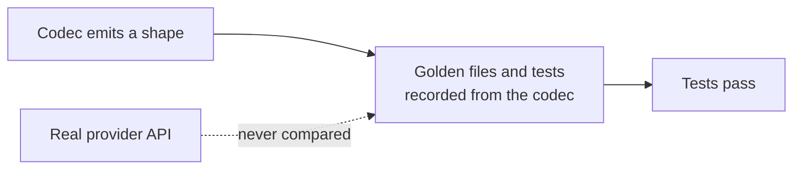

# LLM Provider Wire-Shape Fixes

## Outcome

Every `httpLlmResponse` provider should return what the real provider API returns, and accept
what real SDKs send, so client libraries, agent frameworks and gateways work against a mock
without special cases. GitHub discussion
[#2757](https://github.com/mock-server/mockserver-monorepo/discussions/2757) found that
`BEDROCK` returned Anthropic's Messages shape where the docs promised the AWS Converse API. An
audit of every provider on 2026-10-03 then found the same class of bug elsewhere. The items
below are worked in batches, most SDK-breaking first. The release is **not** gated on finishing
this plan: each item ships when it lands. When every item is closed this file is deleted in the
same commit. Updated 2026-10-13: every item listed below is still open; closed items have been removed.

## Why this class of bug got through

The codec tests derive their expected values from the codec itself. Examples:
`shouldEncodeCanonicalTokenUsageCounts` checks only non-streaming bodies and excludes the
OpenAI-compatible aliases, and the Responses tests set `call_id` equal to `id`. Item 16 closes
this gap.

## What remains

| # | Item | Batch |
|---|---|---|
| 39l | Forwarded calls to Vertex AI's OpenAI-compatible endpoint are counted in tokens but not priced | 5 |
| 33e | Anthropic usage omits fields the real API always sends | 5 |
| 39m | Mocked Bedrock InvokeModelWithResponseStream streams have no amazon-bedrock-invocationMetrics on their last chunk | 5 |

## Items

| # | Problem | Fix |
|---|---|---|
| 39l | Found while closing item 39d: forwarded calls to Vertex AI's OpenAI-compatible endpoint (`/endpoints/openapi/chat/completions`, `/responses`) and to AI21 Jamba are now sniffed as `OPENAI` (or `OPENAI_RESPONSES`) and counted in tokens, but the model names they carry have a publisher prefix (`google/gemini-2.5-flash`, `meta/llama-3.3-70b-instruct-maas`) or a version suffix (`jamba-1.5-large@001`), which the OpenAI pricing table does not match, so a Gemini call through this endpoint adds no cost and does not count towards `llmCostBudgetUsd`. | Price these calls by the vendor named in the prefix, as `LlmPricing` already does for OpenRouter (`openRouterPricing`), at Vertex AI's own list prices where they differ, and decide whether a `-maas` suffix or an `@version` suffix is stripped. Check each rate against Vertex AI's pricing page. |
| 33e | Found while closing item 33d. Two contracts added by 33d replay live responses recorded on 2026-09-28 (`provider-contracts/anthropic/stream-text-recorded`, `thinking-text-recorded`) and allow, with `openItem` "33e", these gaps: the whole message and `message_start` usage lack `cache_creation` (`{ephemeral_5m_input_tokens, ephemeral_1h_input_tokens}`), `service_tier`, `inference_geo`, and `cache_creation_input_tokens` / `cache_read_input_tokens` when they are zero (MockServer emits them only when non-zero); the `message_delta` usage lacks `input_tokens`, `cache_creation_input_tokens` and `cache_read_input_tokens`; and `usage.output_tokens_details.thinking_tokens` is never emitted even when the completion sets `reasoningTokens`. The Messages API reference marks all of these required (nullable). | Fix in `AnthropicCodec`, check what Bedrock InvokeModel sends (the 2026-09-29 Bedrock recordings have `cache_creation` and `service_tier` but no `inference_geo` in `message_start`), and delete the allowances from the two contracts.  Also emit the Bedrock `message_delta` usage `output_tokens_details`, which the Bedrock recording carries. |
| 39m | Found while closing item 39i: real Bedrock adds `amazon-bedrock-invocationMetrics` (`inputTokenCount`, `outputTokenCount`, `invocationLatency`, `firstByteLatency`) to the event inside the last `chunk` of an InvokeModelWithResponseStream stream, for Claude on its `message_stop` event. langchain-aws (`llms/bedrock.py`, `prepare_output_stream`) builds a streamed call's `usage_metadata` only from that object, at `message_stop` for Claude. `BedrockCodec.encodeStreaming` wraps AnthropicCodec's events unchanged, so a mocked stream has no such object and LangChain's `ChatBedrock` (non-Converse) may report no usage for it. | Verify first against langchain-aws: if `ChatBedrock` streaming reports no usage from a mocked stream, add the object to the event of the mock's last chunk (`message_stop`), with counts equal to the completion's usage, and test it as the real wire shape. |
