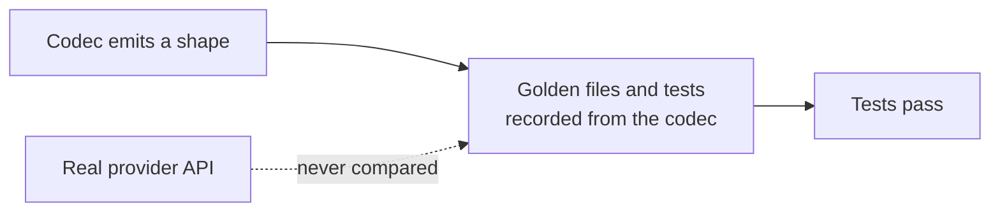

# LLM Provider Wire-Shape Fixes

## Outcome

Every `httpLlmResponse` provider should return what the real provider API returns, and accept
what real SDKs send, so client libraries, agent frameworks and gateways work against a mock
without special cases. GitHub discussion
[#2757](https://github.com/mock-server/mockserver-monorepo/discussions/2757) found that
`BEDROCK` returned Anthropic's Messages shape where the docs promised the AWS Converse API. An
audit of every provider on 2026-10-03 then found the same class of bug elsewhere. The items
below are worked in batches, most SDK-breaking first. The release is **not** gated on finishing
this plan: each item ships when it lands. When every item is closed this file is deleted in the
same commit. Checked 2026-10-11: no item below has closed since the last LLM fix, `eca80be88`
(2026-10-04); spot checks of the code (no `done_reason` in `OllamaCodec`, the streamed path still
not calling `recordOpenAiResponsesStateIfApplicable`, `isBedrockPath` still Anthropic-only) agree.

## Why this class of bug got through

The codec tests derive their expected values from the codec itself. Examples:
`shouldEncodeCanonicalTokenUsageCounts` checks only non-streaming bodies and excludes the
OpenAI-compatible aliases, and the Responses tests set `call_id` equal to `id`. Item 16 closes
this gap.

## What remains

| # | Item | Batch |
|---|---|---|
| 11 | Request-decode gaps leave conversation matchers blind | 3 |
| 34 | Dashboard shows no reply or usage for non-Claude, non-Nova Bedrock InvokeModel bodies | 4 |
| 14 | Suspected shape gaps to verify | 5 |
| 16 | Contract tests against recorded real-provider responses | 5 |
| 17 | Streamed Responses turns are not stored, so they cannot be chained or retrieved | 2 |
| 19 | `OpenAiResponsesStore` has no byte bound | 5 |
| 25 | `proxyPassMappings` LLM forwards are never costed | 2 |
| 26 | Configured-provider fallback misses Gemini streaming and Bedrock paths | 3 |
| 27 | Proxied Bedrock calls have no model, so no cost | 3 |
| 28 | Bedrock, Gemini JSON-array and Ollama default streams are buffered, not relayed | 5 |
| 30 | Non-completion streams from LLM hosts are treated as completions | 5 |
| 31 | Three LLM forward paths have no test coverage | 5 |
| 32 | Streamed token counts drop decimals and strings that the whole-response path accepts | 5 |
| 10a | Rerank leftovers: sniffer misses `/v2/rerank`, Voyage `total_tokens` is 0 | 5 |
| 22a | Bedrock Cohere image inputs: no `images` descriptions; `inputs` image parts ignored | 5 |
| 24a | Per-provider embedding batch limits do not match the real APIs | 5 |
| 33 | Chaos blocks and errors on a streaming request are plain JSON, not the provider's stream | 5 |
| 35 | Dashboard provider detection does not know the Azure Foundry host or Azure Responses paths | 3 |

## Items

| # | Problem | Fix |
|---|---|---|
| 11 | Gemini decode ignores `systemInstruction`. The OpenAI Chat decoder maps the `developer` role to user (the Responses decoder's `developer` role and `instructions` were fixed with item 2, and the Responses codec now uses a configured `ToolUse.id` as the `call_id`; the other codecs still generate their tool-call ids). Ollama `/api/generate` (`prompt` in, `response` out) decodes to an empty conversation. | Decode each into the conversation model. |
| 34 | Dashboard shows no reply or usage for non-Claude, non-Nova Bedrock InvokeModel bodies | Bedrock InvokeModel bodies of the other model families (Llama generation, Titan results, Mistral outputs, Cohere text) are labelled Bedrock but show no reply or usage, as the parser maps only the Anthropic and Nova shapes. | Map the native InvokeModel bodies of these families onto the Anthropic shape if users ask for them; ground each in the AWS model-parameters pages. |
| 14 | Not yet confirmed: Gemini `streamGenerateContent` without `alt=sse` returns a JSON array, but MockServer always sends SSE. Strict typed SDKs (Rust async-openai, openai-go) may reject Responses bodies missing `parallel_tool_calls`, `tool_choice`, `tools` or `annotations` (all now emitted, with item 2; still to confirm against those SDKs). Groq streaming usage may arrive as `x_groq.usage`. OpenRouter adds `provider`, `reasoning` and SSE comments. | Confirm each against official docs or a recorded response, then fix or drop. |
| 16 | Nothing compares a codec's output with what the real provider sends. | Contract tests against recorded, redacted real-provider requests and responses per provider, streaming included, alongside the golden files (see [llm-codec-fixtures.md](../code/llm-codec-fixtures.md)). |
| 17 | A streamed `OPENAI_RESPONSES` turn is never recorded in `OpenAiResponsesStore`: `HttpLlmResponseActionHandler.handleStreaming` returns the events without calling `recordOpenAiResponsesStateIfApplicable`, which only the non-streaming path does. A streaming client that chains with `previous_response_id` and sends only the `function_call_output` therefore gets no match on `whenContainsToolResultFor`, and `GET /v1/responses/{id}` does not find a streamed response. | Record the streamed turn from the response object of its `response.completed` event, honouring `store:false`. |
| 19 | `OpenAiResponsesStore` is bounded by count only (10,000 responses, least recently used evicted first). Since item 2 each stored turn also holds the request's echoed `tools`, `instructions` and `metadata`, so a long run that sends large tool definitions can retain far more heap than the count suggests (see [memory-management.md](../code/memory-management.md#openai-responses-store)). | Add a byte budget next to the count cap, evicting least recently used first. |
| 25 | Found while fixing proxied streaming usage (the former item 5): the `proxyPassMappings` reverse-proxy route checks `llmCostBudgetUsd` before forwarding but never calls `emitForwardGenAiSpan`, for whole or streamed responses, so LLM calls through a mapping emit no GenAI span, add no tokens or cost, and can never trip the budget they are checked against. Found by reading `HttpActionHandler`; no test covers it. | Record usage on the proxy-pass path as the other forward paths do (sniff by the mapping's target host, as its budget check does), with the stream scanner on its streaming branch. |
| 26 | Found while fixing proxied streaming usage (the former item 5): when the upstream is not a known provider host, `LlmProviderSniffer` falls back to `llmProvider` only for paths containing one of `LLM_PATH_FRAGMENTS`. `:generatecontent` does not match `:streamGenerateContent` on a `/v1beta/` path, and no fragment matches Bedrock's `/model/{id}/converse`, `/converse-stream`, `/invoke` or `/invoke-with-response-stream`. Gemini streaming and all Bedrock traffic through a gateway or private endpoint are therefore not seen as LLM traffic. Found by reading the sniffer. | Add the streaming Gemini method and the Bedrock paths to the fallback gate. |
| 27 | Found while fixing proxied streaming usage (the former item 5): a Bedrock request names its model in the path (`/model/{modelId}/...`), not the body, and a Converse response has no model. The forward path takes the model from the response, then the request body, so a proxied Converse or ConverseStream call gets a span named `chat unknown`, token counts, and no cost; `llmCostBudgetUsd` cannot count it. InvokeModel for an Anthropic model is costed because its response body carries `model`. Found by reading `emitForwardGenAiSpan` and `LlmPricing`. | Take the Bedrock model id from the request path (URL-decoded; an inference-profile or ARN id needs mapping to a priced model). |
| 28 | Found while fixing proxied streaming usage (the former item 5): the forward client relays a response as a stream only for `Content-Type: text/event-stream`, an `Accept: text/event-stream` request, or a JSON request body with `"stream": true`. Bedrock's `application/vnd.amazon.eventstream`, Gemini's `streamGenerateContent` without `alt=sse` and an Ollama request that leaves `stream` at its default of true match none of these, so the proxy buffers the whole response (up to `maxResponseBodySize`) and the client receives it only when it is complete. Usage is still counted, from the aggregated body. Found by reading `StreamingAwareHttpObjectAggregator`; not reproduced against a live provider. | Relay these as streams: recognise the event-stream content type, the Gemini streaming method, and NDJSON. |
| 30 | Found while fixing proxied streaming usage (the former item 5): the forward path treats every response from a host or path sniffed as an LLM provider as a completion. A streamed `2xx` response that is not one, such as Ollama's `/api/pull` progress stream, gets a GenAI span and the `no token usage in the streamed ... response` log line (now at most once a minute per provider and model). | Limit accounting to completion endpoints per provider (by path), so other streams are neither given a span nor reported as uncounted. |
| 31 | Found in the item 5 review (split into items 25-30): three LLM forward paths have no test coverage. `HttpActionHandler`'s `usageLogTimes` map (the 256-key clear, `USAGE_LOG_KEYS`, before an uncounted-call warning can repeat for a key) has no test exercising the clear. `LlmStreamUsageScanner.MAX_USAGE_NAME_CHARS` (64, the usage field-name length cap) is checked only in the main source, not in `LlmStreamUsageScannerTest`. The breakpoint-continuation streaming forward path (`observeForwardedLlmStream`, called from the async-only branch reached only after a request breakpoint continuation) attaches the usage observer the same as the other forward paths, but no test drives a streaming LLM response through a breakpoint continuation. | Add a test that drives `usageLogTimes` past 256 keys and confirms the warning can repeat after the clear; add an `LlmStreamUsageScannerTest` case for a field name over 64 characters; add a breakpoint-continuation test with a streaming LLM response that asserts usage and cost are recorded. |
| 32 | Found in the item 5 review: a streamed response's usage counts are kept only when `isCount` (`value.isIntegralNumber() && value.canConvertToLong()`) holds, so a decimal (`12.0`) or string (`"150"`) token count is dropped. The whole-response path's provider clients (`OpenAiResponsesLlmClient`, `BedrockLlmClient` and others) read the same fields with `JsonNode.asInt()`, which coerces both a decimal and a numeric string, so the same upstream body is costed when returned whole and silently undercounted, or left uncounted, when streamed. | Decide whether streaming should coerce the same way (decimal truncation, numeric-string parsing) or the whole-response path should require a strict integral count instead, and make the two consistent. |
| 10a | From item 10's fix: `LlmProviderSniffer` (path-only sniffing of captured traffic, used when the host is not `api.cohere.com`) still matches only `/v1/rerank`, so a mocked `/v2/rerank` call is not attributed to Cohere. Voyage rerank responses always report `usage.total_tokens` 0, which the real API never does. Cohere v1 `rank_fields` is ignored (structured documents are read by `text`). | Add `/v2/rerank` to the sniffer's Cohere path pattern; estimate Voyage `total_tokens` from the query and documents. |
| 22a | From item 22's fix: Bedrock Cohere Embed v3 returns an `images` array describing each image (`width`, `height`, `format`, `bit_depth`), which the mock omits. A Cohere v4 `inputs` item's `image_url` parts do not change its vector, so two image-only items get the same vector. | Read width, height and format from the PNG or JPEG header; mix each `image_url` part's digest into the item's text. |
| 24a | From item 24's review: the per-request embedding batch limits are not each provider's own. Gemini `:batchEmbedContents` accepts up to `EmbeddingWire.MAX_INPUTS` (2,048) requests (`GeminiCodec.encodeEmbedding`), where the real API allows 100. Voyage's 1,000-document rerank limit (MockServer mocks Voyage only for rerank) and OpenAI's 300,000-token total per embedding request are not enforced. | Give each codec its provider's own input count (Gemini 100, Voyage rerank 1,000 documents), and reject an OpenAI request whose inputs total over 300,000 tokens by the codec's token estimate. |
| 33 | Chaos blocks and errors on a streaming request are plain JSON, not the provider's stream | A chaos content-filter block on a streaming request (Bedrock ConverseStream and InvokeModelWithResponseStream, Gemini streamGenerateContent, Anthropic stream) is returned as one HTTP 200 JSON body, not as the provider's event stream, so a streaming SDK may fail to parse it. Real providers end the stream with the filtered stop reason. Errors are fine as plain JSON because providers return them before streaming starts. | Check each provider's documented streamed refusal, then encode the block through the codec's streaming path when the completion streams. |
| 35 | `llmTraffic.ts` mirrors `LlmProviderSniffer` and `ProviderDetector`, which now map `*.services.ai.azure.com` on `/openai/` paths to AZURE_OPENAI and Azure `/openai/v1/responses` and `/openai/responses` to OPENAI_RESPONSES. The dashboard still shows Azure Responses traffic as Azure chat and misses the Foundry host. Found while closing items 15 and 29. | Mirror the two rules in `llmTraffic.ts`, with tests. |
