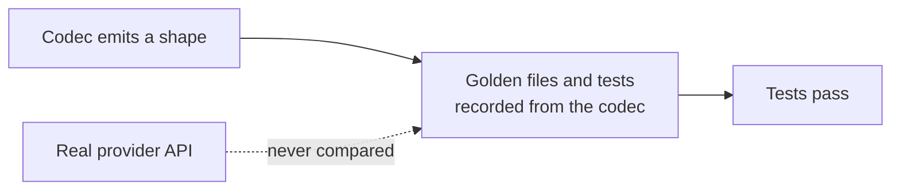

# LLM Provider Wire-Shape Fixes

## Outcome

Every `httpLlmResponse` provider should return what the real provider API returns, and accept
what real SDKs send, so client libraries, agent frameworks and gateways work against a mock
without special cases. GitHub discussion
[#2757](https://github.com/mock-server/mockserver-monorepo/discussions/2757) found that
`BEDROCK` returned Anthropic's Messages shape where the docs promised the AWS Converse API. An
audit of every provider on 2026-10-03 then found the same class of bug elsewhere. The items
below are worked in batches, most SDK-breaking first. The release is **not** gated on finishing
this plan: each item ships when it lands. When every item is closed this file is deleted in the
same commit. Checked 2026-10-11: no item below has closed since the last LLM fix, `eca80be88`
(2026-10-04); spot checks of the code (no `done_reason` in `OllamaCodec`, the streamed path still
not calling `recordOpenAiResponsesStateIfApplicable`, `isBedrockPath` still Anthropic-only) agree.

## Why this class of bug got through

The codec tests derive their expected values from the codec itself. Examples:
`shouldEncodeCanonicalTokenUsageCounts` checks only non-streaming bodies and excludes the
OpenAI-compatible aliases, and the Responses tests set `call_id` equal to `id`. Item 16 closes
this gap.

## What remains

| # | Item | Batch |
|---|---|---|
| 11 | Request-decode gaps leave conversation matchers blind | 3 |
| 17 | Streamed Responses turns are not stored, so they cannot be chained or retrieved | 2 |
| 19 | `OpenAiResponsesStore` has no byte bound | 5 |
| 10a | Rerank leftovers: sniffer misses `/v2/rerank`, Voyage `total_tokens` is 0 | 5 |
| 22a | Bedrock Cohere image inputs: no `images` descriptions; `inputs` image parts ignored | 5 |
| 24a | Per-provider embedding batch limits do not match the real APIs | 5 |
| 33 | Chaos blocks and errors on a streaming request are plain JSON, not the provider's stream | 5 |
| 36 | OpenAI spec-required nullable fields are omitted | 5 |
| 37 | A streamed Ollama tool call ends the stream instead of preceding the final message | 3 |
| 38 | OpenRouter choices lack `native_finish_reason` | 5 |
| 39 | Whole non-completion responses from LLM hosts get a GenAI span | 5 |

## Items

| # | Problem | Fix |
|---|---|---|
| 11 | Gemini decode ignores `systemInstruction`. The OpenAI Chat decoder maps the `developer` role to user (the Responses decoder's `developer` role and `instructions` were fixed with item 2, and the Responses codec now uses a configured `ToolUse.id` as the `call_id`; the other codecs still generate their tool-call ids). Ollama `/api/generate` (`prompt` in, `response` out) decodes to an empty conversation. | Decode each into the conversation model. |
| 17 | A streamed `OPENAI_RESPONSES` turn is never recorded in `OpenAiResponsesStore`: `HttpLlmResponseActionHandler.handleStreaming` returns the events without calling `recordOpenAiResponsesStateIfApplicable`, which only the non-streaming path does. A streaming client that chains with `previous_response_id` and sends only the `function_call_output` therefore gets no match on `whenContainsToolResultFor`, and `GET /v1/responses/{id}` does not find a streamed response. | Record the streamed turn from the response object of its `response.completed` event, honouring `store:false`. |
| 19 | `OpenAiResponsesStore` is bounded by count only (10,000 responses, least recently used evicted first). Since item 2 each stored turn also holds the request's echoed `tools`, `instructions` and `metadata`, so a long run that sends large tool definitions can retain far more heap than the count suggests (see [memory-management.md](../code/memory-management.md#openai-responses-store)). | Add a byte budget next to the count cap, evicting least recently used first. |
| 10a | From item 10's fix: `LlmProviderSniffer` (path-only sniffing of captured traffic, used when the host is not `api.cohere.com`) still matches only `/v1/rerank`, so a mocked `/v2/rerank` call is not attributed to Cohere. Voyage rerank responses always report `usage.total_tokens` 0, which the real API never does. Cohere v1 `rank_fields` is ignored (structured documents are read by `text`). | Add `/v2/rerank` to the sniffer's Cohere path pattern; estimate Voyage `total_tokens` from the query and documents. |
| 22a | From item 22's fix: Bedrock Cohere Embed v3 returns an `images` array describing each image (`width`, `height`, `format`, `bit_depth`), which the mock omits. A Cohere v4 `inputs` item's `image_url` parts do not change its vector, so two image-only items get the same vector. | Read width, height and format from the PNG or JPEG header; mix each `image_url` part's digest into the item's text. |
| 24a | From item 24's review: the per-request embedding batch limits are not each provider's own. Gemini `:batchEmbedContents` accepts up to `EmbeddingWire.MAX_INPUTS` (2,048) requests (`GeminiCodec.encodeEmbedding`), where the real API allows 100. Voyage's 1,000-document rerank limit (MockServer mocks Voyage only for rerank) and OpenAI's 300,000-token total per embedding request are not enforced. | Give each codec its provider's own input count (Gemini 100, Voyage rerank 1,000 documents), and reject an OpenAI request whose inputs total over 300,000 tokens by the codec's token estimate. |
| 33 | Chaos blocks and errors on a streaming request are plain JSON, not the provider's stream | A chaos content-filter block on a streaming request (Bedrock ConverseStream and InvokeModelWithResponseStream, Gemini streamGenerateContent, Anthropic stream) is returned as one HTTP 200 JSON body, not as the provider's event stream, so a streaming SDK may fail to parse it. Real providers end the stream with the filtered stop reason. Errors are fine as plain JSON because providers return them before streaming starts. | Check each provider's documented streamed refusal, then encode the block through the codec's streaming path when the completion streams. |
| 36 | Found by the item 16 contract tests: the OpenAI OpenAPI spec lists `logprobs` as required (nullable) on each Chat Completions `choices[]` entry, and `access_programs`, `temperature` and `top_p` as required on the Responses `Response` object (non-streaming, and in `response.created` / `.in_progress` / `.completed`). MockServer omits all four. openai-python and async-openai declare them optional, so those SDKs accept the omission; a client generated strictly from the spec may not. Tolerated in `provider-contracts/openai/*` and `openai-responses/*` with `"openItem": "36"`. | Emit them as `null` (or the request's value for `temperature` / `top_p`), regenerate the openai, azure-openai and openai-responses goldens, and delete the `openItem: 36` allowances (the contract test fails while they remain once the gap is closed). |
| 37 | Found by the item 16 contract tests: Ollama's `/api/chat` docs stream a tool call in a `done: false` message and then send an empty `done: true` message carrying `done_reason` and the counts. `OllamaCodec` puts the tool call in its single `done: true` message, so a client that reads tool calls only from non-final messages, or treats the final message as metadata, sees none. Tolerated in `provider-contracts/ollama/chat-stream-tool-call` with `"openItem": "37"`. | Emit the tool calls in a `done: false` message before the final one, and delete the allowance. |
| 38 | Found while closing item 14: OpenRouter's documented `NonStreamingChoice` and `StreamingChoice` types carry `native_finish_reason` (string or null, the upstream model's own value) beside `finish_reason` (openrouter.ai/docs/api-reference/overview). Item 8 added OpenRouter's `reasoning`, usage chunk, `cost` and `is_byok` but not this field, so a client that reads it gets nothing. | Write `native_finish_reason` on each OpenRouter choice, streamed and whole, and add an OpenRouter case under `provider-contracts/` from the API reference. |
| 39 | Found while fixing item 30: the completion-path gate added for item 30 applies only to streamed responses. A whole JSON response from an LLM host on a non-completion path, such as `GET /v1/models` on `api.openai.com`, is still parsed as a completion and gets a GenAI span named `chat unknown` with no tokens (no cost and no uncounted-call log line). Whole responses were left alone because embeddings and rerank responses carry usage and are counted today. | Extend `LlmProviderSniffer.isCompletionPath` into an "accountable endpoint" check that also admits embeddings and rerank paths, then apply it to whole responses too. |
