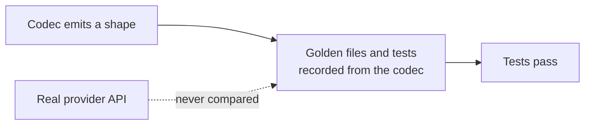

# LLM Provider Wire-Shape Fixes

## Outcome

Every `httpLlmResponse` provider should return what the real provider API returns, and accept
what real SDKs send, so client libraries, agent frameworks and gateways work against a mock
without special cases. GitHub discussion
[#2757](https://github.com/mock-server/mockserver-monorepo/discussions/2757) found that
`BEDROCK` returned Anthropic's Messages shape where the docs promised the AWS Converse API. An
audit of every provider on 2026-10-03 then found the same class of bug elsewhere. The items
below are worked in batches, most SDK-breaking first. The release is **not** gated on finishing
this plan: each item ships when it lands. When every item is closed this file is deleted in the
same commit. Updated 2026-10-12: every item listed below is still open; items closed on
2026-10-12 have been removed.

## Why this class of bug got through

The codec tests derive their expected values from the codec itself. Examples:
`shouldEncodeCanonicalTokenUsageCounts` checks only non-streaming bodies and excludes the
OpenAI-compatible aliases, and the Responses tests set `call_id` equal to `id`. Item 16 closes
this gap.

## What remains

| # | Item | Batch |
|---|---|---|
| 24a | Per-provider embedding batch limits do not match the real APIs | 5 |
| 38 | OpenRouter choices lack `native_finish_reason` | 5 |
| 39 | Whole non-completion responses from LLM hosts get a GenAI span | 5 |
| 40 | Bedrock Cohere v3 describes unsupported images as zeros instead of rejecting them | 5 |
| 41 | Ollama /api/generate returns the chat shape | 3 |
| 33a | Anthropic refusals carry no `stop_details` | 5 |
| 33b | Gemini content-filter block carries candidates as well as a prompt block | 5 |
| 42 | OpenAI-compatible providers may need `logprobs: null` on choices | 5 |

## Items

| # | Problem | Fix |
|---|---|---|
| 24a | From item 24's review: the per-request embedding batch limits are not each provider's own. Gemini `:batchEmbedContents` accepts up to `EmbeddingWire.MAX_INPUTS` (2,048) requests (`GeminiCodec.encodeEmbedding`), where the real API allows 100. Voyage's 1,000-document rerank limit (MockServer mocks Voyage only for rerank) and OpenAI's 300,000-token total per embedding request are not enforced. | Give each codec its provider's own input count (Gemini 100, Voyage rerank 1,000 documents), and reject an OpenAI request whose inputs total over 300,000 tokens by the codec's token estimate. |
| 38 | Found while closing item 14: OpenRouter's documented `NonStreamingChoice` and `StreamingChoice` types carry `native_finish_reason` (string or null, the upstream model's own value) beside `finish_reason` (openrouter.ai/docs/api-reference/overview). Item 8 added OpenRouter's `reasoning`, usage chunk, `cost` and `is_byok` but not this field, so a client that reads it gets nothing. | Write `native_finish_reason` on each OpenRouter choice, streamed and whole, and add an OpenRouter case under `provider-contracts/` from the API reference. |
| 39 | Found while fixing item 30: the completion-path gate added for item 30 applies only to streamed responses. A whole JSON response from an LLM host on a non-completion path, such as `GET /v1/models` on `api.openai.com`, is still parsed as a completion and gets a GenAI span named `chat unknown` with no tokens (no cost and no uncounted-call log line). Whole responses were left alone because embeddings and rerank responses carry usage and are counted today. | Extend `LlmProviderSniffer.isCompletionPath` into an "accountable endpoint" check that also admits embeddings and rerank paths, then apply it to whole responses too. |
| 40 | Found in the item 22a review: Bedrock Cohere Embed v3 describes an image it cannot read (a WebP or GIF data URI, which AWS rejects for v3, or line-wrapped base64) with zero width and height instead of returning the 400 the real API sends for an unsupported image. | Check the AWS v3 page's accepted formats and the real error body, then return that error for an unsupported format; accept line-wrapped base64 if the real API does. |
| 41 | `OllamaCodec` decodes an `/api/generate` request (`system` and `prompt`) but always encodes the `/api/chat` shape, a `message` object, while `/api/generate` returns its text in a top-level `response` field (streamed: one `response` piece per NDJSON line, then a final object with `done: true`; https://github.com/ollama/ollama/blob/main/docs/api.md). A client of `/api/generate` therefore reads no text from the mock. | Encode the `/api/generate` shape (non-streamed and NDJSON-streamed) when the request path is `/api/generate`, with a golden file and a test against the documented fields. |
| 33a | Anthropic refusals carry no `stop_details` | Anthropic documents that every `stop_reason` `refusal` response carries a `stop_details` object (`type` `refusal`, `category` and `explanation`, which may be null), on `message_delta` when streaming. The chaos block body, the refusal preset and the Anthropic codec emit `stop_reason` `refusal` without it, so SDK code that reads `stop_details` sees nothing. | Add `stop_details` with `type` `refusal` and null `category` and `explanation` to the Anthropic codec's refusal output (whole and streamed) and to the block body, grounded in the Anthropic "Refusals and fallback" page; check whether Bedrock InvokeModel carries it too. |
| 33b | Gemini content-filter block carries candidates as well as a prompt block | The chaos Gemini block (whole and streamed) returns `candidates[0].finishReason` `SAFETY` together with `promptFeedback.blockReason` `SAFETY`. The Gemini API reference (https://ai.google.dev/api/generate-content) says that when `blockReason` is set the prompt was blocked and no candidates are returned, and that the response has no candidates only when something was wrong with the prompt. A blocked output instead has a candidate with `finishReason` `SAFETY` and `safetyRatings`, and no `promptFeedback.blockReason`. Mixing both shapes may confuse SDK code that branches on whether `candidates` is present. | Pick one shape per block, grounded in the Gemini reference: a prompt block (`promptFeedback` with `blockReason` and `safetyRatings`, no `candidates`, plus `usageMetadata`), or an output block (a candidate with `finishReason` `SAFETY` and blocked `safetyRatings`). Consider letting the expectation choose. Update the block body and its tests; the streamed form follows automatically. |
| 42 | Found in the item 36 review: item 36 made OpenAI and Azure Chat Completions choices carry `logprobs` (null), as their specs require, but the OpenAI-compatible providers (Groq, DeepSeek, OpenRouter and the rest) still omit it behind a hook that is off for them. DeepSeek's and Groq's real responses appear to send `logprobs: null` on each choice (not yet checked against their API references). Streamed chunks omit it for every provider, which OpenAI's chunk schema allows. | Check each compatible provider's API reference or a recorded response; turn the hook on for those that send it, with a contract case for each. |
