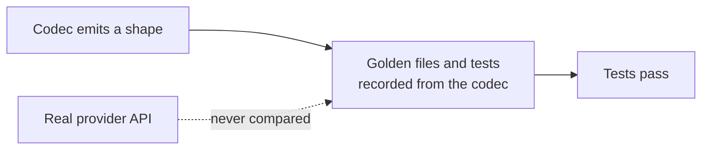

# LLM Provider Wire-Shape Fixes

## Outcome

Every `httpLlmResponse` provider should return what the real provider API returns, and accept
what real SDKs send, so client libraries, agent frameworks and gateways work against a mock
without special cases. GitHub discussion
[#2757](https://github.com/mock-server/mockserver-monorepo/discussions/2757) found that
`BEDROCK` returned Anthropic's Messages shape where the docs promised the AWS Converse API. An
audit of every provider on 2026-10-03 then found the same class of bug elsewhere. The items
below are worked in batches, most SDK-breaking first. The release is **not** gated on finishing
this plan: each item ships when it lands. When every item is closed this file is deleted in the
same commit. Updated 2026-10-12: every item listed below is still open; items closed on
2026-10-12 have been removed.

## Why this class of bug got through

The codec tests derive their expected values from the codec itself. Examples:
`shouldEncodeCanonicalTokenUsageCounts` checks only non-streaming bodies and excludes the
OpenAI-compatible aliases, and the Responses tests set `call_id` equal to `id`. Item 16 closes
this gap.

## What remains

| # | Item | Batch |
|---|---|---|
| 24a | Per-provider embedding batch limits do not match the real APIs | 5 |
| 33 | Chaos blocks and errors on a streaming request are plain JSON, not the provider's stream | 5 |
| 36 | OpenAI spec-required nullable fields are omitted | 5 |
| 37 | A streamed Ollama tool call ends the stream instead of preceding the final message | 3 |
| 38 | OpenRouter choices lack `native_finish_reason` | 5 |
| 39 | Whole non-completion responses from LLM hosts get a GenAI span | 5 |
| 40 | Bedrock Cohere v3 describes unsupported images as zeros instead of rejecting them | 5 |
| 41 | Ollama /api/generate returns the chat shape | 3 |

## Items

| # | Problem | Fix |
|---|---|---|
| 24a | From item 24's review: the per-request embedding batch limits are not each provider's own. Gemini `:batchEmbedContents` accepts up to `EmbeddingWire.MAX_INPUTS` (2,048) requests (`GeminiCodec.encodeEmbedding`), where the real API allows 100. Voyage's 1,000-document rerank limit (MockServer mocks Voyage only for rerank) and OpenAI's 300,000-token total per embedding request are not enforced. | Give each codec its provider's own input count (Gemini 100, Voyage rerank 1,000 documents), and reject an OpenAI request whose inputs total over 300,000 tokens by the codec's token estimate. |
| 33 | Chaos blocks and errors on a streaming request are plain JSON, not the provider's stream | A chaos content-filter block on a streaming request (Bedrock ConverseStream and InvokeModelWithResponseStream, Gemini streamGenerateContent, Anthropic stream) is returned as one HTTP 200 JSON body, not as the provider's event stream, so a streaming SDK may fail to parse it. Real providers end the stream with the filtered stop reason. Errors are fine as plain JSON because providers return them before streaming starts. | Check each provider's documented streamed refusal, then encode the block through the codec's streaming path when the completion streams. |
| 36 | Found by the item 16 contract tests: the OpenAI OpenAPI spec lists `logprobs` as required (nullable) on each Chat Completions `choices[]` entry, and `access_programs`, `temperature` and `top_p` as required on the Responses `Response` object (non-streaming, and in `response.created` / `.in_progress` / `.completed`). MockServer omits all four. openai-python and async-openai declare them optional, so those SDKs accept the omission; a client generated strictly from the spec may not. Tolerated in `provider-contracts/openai/*` and `openai-responses/*` with `"openItem": "36"`. | Emit them as `null` (or the request's value for `temperature` / `top_p`), regenerate the openai, azure-openai and openai-responses goldens, and delete the `openItem: 36` allowances (the contract test fails while they remain once the gap is closed). |
| 37 | Found by the item 16 contract tests: Ollama's `/api/chat` docs stream a tool call in a `done: false` message and then send an empty `done: true` message carrying `done_reason` and the counts. `OllamaCodec` puts the tool call in its single `done: true` message, so a client that reads tool calls only from non-final messages, or treats the final message as metadata, sees none. Tolerated in `provider-contracts/ollama/chat-stream-tool-call` with `"openItem": "37"`. | Emit the tool calls in a `done: false` message before the final one, and delete the allowance. |
| 38 | Found while closing item 14: OpenRouter's documented `NonStreamingChoice` and `StreamingChoice` types carry `native_finish_reason` (string or null, the upstream model's own value) beside `finish_reason` (openrouter.ai/docs/api-reference/overview). Item 8 added OpenRouter's `reasoning`, usage chunk, `cost` and `is_byok` but not this field, so a client that reads it gets nothing. | Write `native_finish_reason` on each OpenRouter choice, streamed and whole, and add an OpenRouter case under `provider-contracts/` from the API reference. |
| 39 | Found while fixing item 30: the completion-path gate added for item 30 applies only to streamed responses. A whole JSON response from an LLM host on a non-completion path, such as `GET /v1/models` on `api.openai.com`, is still parsed as a completion and gets a GenAI span named `chat unknown` with no tokens (no cost and no uncounted-call log line). Whole responses were left alone because embeddings and rerank responses carry usage and are counted today. | Extend `LlmProviderSniffer.isCompletionPath` into an "accountable endpoint" check that also admits embeddings and rerank paths, then apply it to whole responses too. |
| 40 | Found in the item 22a review: Bedrock Cohere Embed v3 describes an image it cannot read (a WebP or GIF data URI, which AWS rejects for v3, or line-wrapped base64) with zero width and height instead of returning the 400 the real API sends for an unsupported image. | Check the AWS v3 page's accepted formats and the real error body, then return that error for an unsupported format; accept line-wrapped base64 if the real API does. |
| 41 | `OllamaCodec` decodes an `/api/generate` request (`system` and `prompt`) but always encodes the `/api/chat` shape, a `message` object, while `/api/generate` returns its text in a top-level `response` field (streamed: one `response` piece per NDJSON line, then a final object with `done: true`; https://github.com/ollama/ollama/blob/main/docs/api.md). A client of `/api/generate` therefore reads no text from the mock. | Encode the `/api/generate` shape (non-streamed and NDJSON-streamed) when the request path is `/api/generate`, with a golden file and a test against the documented fields. |
