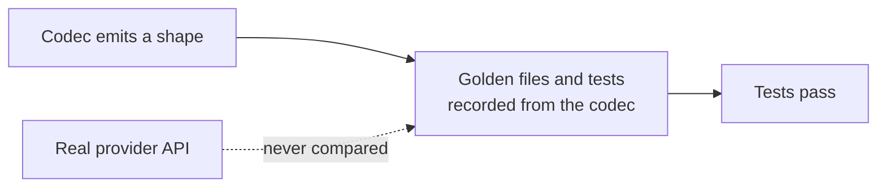

# LLM Provider Wire-Shape Fixes

## Outcome

Every `httpLlmResponse` provider should return what the real provider API returns, and accept
what real SDKs send, so client libraries, agent frameworks and gateways work against a mock
without special cases. GitHub discussion
[#2757](https://github.com/mock-server/mockserver-monorepo/discussions/2757) found that
`BEDROCK` returned Anthropic's Messages shape where the docs promised the AWS Converse API. An
audit of every provider on 2026-10-03 then found the same class of bug elsewhere. The items
below are worked in batches, most SDK-breaking first. The release is **not** gated on finishing
this plan: each item ships when it lands. When every item is closed this file is deleted in the
same commit. Updated 2026-10-13: every item listed below is still open; closed items have been removed.

## Why this class of bug got through

The codec tests derive their expected values from the codec itself. Examples:
`shouldEncodeCanonicalTokenUsageCounts` checks only non-streaming bodies and excludes the
OpenAI-compatible aliases, and the Responses tests set `call_id` equal to `id`. Item 16 closes
this gap.

## What remains

| # | Item | Batch |
|---|---|---|
| 33f | The chaos content-filter Anthropic refusal body sends a short usage object | 5 |
| 39o | Captured native Vertex AI Gemini calls are priced at the Gemini API rate offline and in the dashboard | 5 |

## Items

| # | Problem | Fix |
|---|---|---|
| 33f | Found while closing item 33e. The Anthropic and Bedrock InvokeModel codecs now send the full Usage object the real APIs send (both cache counts, 0 when unset, `cache_creation`, `service_tier`, and `inference_geo` for the Claude API only). The fixed refusal body a chaos content-filter block returns (`LlmRefusalPresets.ANTHROPIC_REFUSAL_BODY` / `BEDROCK_INVOKE_REFUSAL_BODY`) still sends only `{"input_tokens":0,"output_tokens":0}`. It was left alone because 33e was scoped to the codec. | Build the refusal body's usage the way `AnthropicCodec` does (Claude API with `inference_geo`, Bedrock without) and assert it in the content-filter wire-shape tests. |
| 39o | Found while closing item 39n (low priority). A forwarded native Vertex AI Gemini call (`:generateContent`, `:streamGenerateContent` on an `aiplatform` host) is now costed from Vertex AI's Gemini rates, but the offline pricers still see only the provider and model: the optimisation report (`LlmOptimisationReportBuilder`, `OptimisationSignals`), the MCP `verify_cost_budget` tool (`McpToolRegistry`) and the dashboard (`mockserver-ui/src/lib/llmPricing.ts`, used by `LlmUsageDetail` and `SessionInspector`, which classifies Vertex AI Gemini paths as `gemini`). They price a captured Gemini 2.0 Flash call on Vertex AI at the Gemini API's 0.10 / 0.40 USD per million input / output tokens instead of Vertex AI's 0.15 / 0.60. | Each pricer has the captured request: when `LlmProviderSniffer.isVertexAiHost` matches its host, price it with `LlmPricing.estimateVertexAiCostUsd`. Give the dashboard a Vertex AI Gemini table chosen by the captured host and update `llmPricing.test.ts`'s snapshot. |
