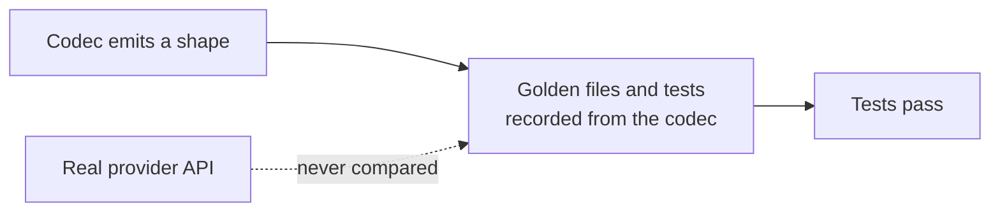

# LLM Provider Wire-Shape Fixes

## Outcome

Every `httpLlmResponse` provider should return what the real provider API returns, and accept
what real SDKs send, so client libraries, agent frameworks and gateways work against a mock
without special cases. GitHub discussion
[#2757](https://github.com/mock-server/mockserver-monorepo/discussions/2757) found that
`BEDROCK` returned Anthropic's Messages shape where the docs promised the AWS Converse API. An
audit of every provider on 2026-10-03 then found the same class of bug elsewhere. The items
below are worked in batches, most SDK-breaking first. The release is **not** gated on finishing
this plan: each item ships when it lands. When every item is closed this file is deleted in the
same commit. Updated 2026-10-13: every item listed below is still open; closed items have been removed.

## Why this class of bug got through

The codec tests derive their expected values from the codec itself. Examples:
`shouldEncodeCanonicalTokenUsageCounts` checks only non-streaming bodies and excludes the
OpenAI-compatible aliases, and the Responses tests set `call_id` equal to `id`. Item 16 closes
this gap.

## What remains

| # | Item | Batch |
|---|---|---|
| 33f | The chaos content-filter Anthropic refusal body sends a short usage object | 5 |
| 39p | The dashboard reads Vertex AI OpenAI-compatible and Mistral calls as Gemini calls with no usage | 5 |

## Items

| # | Problem | Fix |
|---|---|---|
| 33f | Found while closing item 33e. The Anthropic and Bedrock InvokeModel codecs now send the full Usage object the real APIs send (both cache counts, 0 when unset, `cache_creation`, `service_tier`, and `inference_geo` for the Claude API only). The fixed refusal body a chaos content-filter block returns (`LlmRefusalPresets.ANTHROPIC_REFUSAL_BODY` / `BEDROCK_INVOKE_REFUSAL_BODY`) still sends only `{"input_tokens":0,"output_tokens":0}`. It was left alone because 33e was scoped to the codec. | Build the refusal body's usage the way `AnthropicCodec` does (Claude API with `inference_geo`, Bedrock without) and assert it in the content-filter wire-shape tests. |
| 39p | Found while closing item 39o (low priority). `detectByHost` in `mockserver-ui/src/lib/llmTraffic.ts` sends every request to an `aiplatform` host that is not a Claude path to the Gemini parser, so a Vertex AI `/endpoints/openapi/chat/completions` (or `/responses`) call and a `/publishers/mistralai/` call, which the server sniffs as `OPENAI` / `OPENAI_RESPONSES` / `MISTRAL`, show in the dashboard as Gemini with no usage and no cost. It also does not recognise the `aiplatform.<region>.rep.googleapis.com` hosts, though a Gemini path there is still caught by the path fallback. Docs advisory from the 39o review: an `httpForward` expectation is also logged with MockServer's own host, so the offline pricers price it at the Gemini API rates too, but `docs/code/llm-mocking.md` and `llm_response_mocking.html` name only `proxyPassMappings`. | Make `detectByHost` mirror `LlmProviderSniffer` for Vertex AI hosts: the full host pattern including `.rep` hosts, the OpenAI-compatible endpoint paths to the OpenAI parsers, and `/publishers/mistralai/` to the OpenAI-shaped parser, with wire-shape tests from the Vertex AI docs. Verify the `httpForward` logging first, then name it beside `proxyPassMappings` in both docs. |
