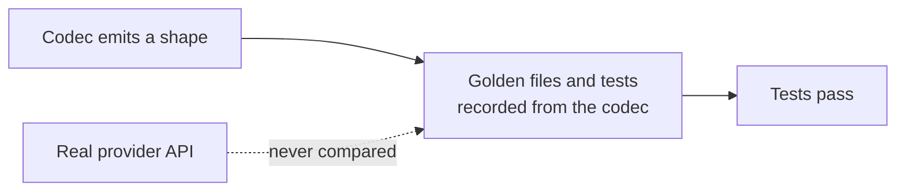

# LLM Provider Wire-Shape Fixes

## Outcome

Every `httpLlmResponse` provider should return what the real provider API returns, and accept
what real SDKs send, so client libraries, agent frameworks and gateways work against a mock
without special cases. GitHub discussion
[#2757](https://github.com/mock-server/mockserver-monorepo/discussions/2757) found that
`BEDROCK` returned Anthropic's Messages shape where the docs promised the AWS Converse API. An
audit of every provider on 2026-10-03 then found the same class of bug elsewhere. The items
below are worked in batches, most SDK-breaking first. The release is **not** gated on finishing
this plan: each item ships when it lands. When every item is closed this file is deleted in the
same commit. Updated 2026-10-12: every item listed below is still open; items closed on
2026-10-12 have been removed.

## Why this class of bug got through

The codec tests derive their expected values from the codec itself. Examples:
`shouldEncodeCanonicalTokenUsageCounts` checks only non-streaming bodies and excludes the
OpenAI-compatible aliases, and the Responses tests set `call_id` equal to `id`. Item 16 closes
this gap.

## What remains

| # | Item | Batch |
|---|---|---|
| 24a | Per-provider embedding batch limits do not match the real APIs | 5 |
| 39c | Gemini and legacy text-completion spans use the `chat` operation name (decided: rename, changelog BREAKING) | 5 |
| 42b | DeepSeek streams usage only with `stream_options.include_usage` | 5 |
| 41b | Ollama load and unload requests are still accounted as completions | 5 |
| 33d | Check whether Anthropic messages should send `container` and `diagnostics` | 5 |
| 39e | Mocked Bedrock InvokeModel responses send no token-count headers | 5 |
| 39f | Mistral `codestral-embed` is priced at the `codestral` chat rate | 5 |
| 39d | Forwarded Vertex AI calls to the OpenAI-compatible endpoint and to partner models other than Claude and Mistral get no token counts | 5 |
| 39g | Forwarded Bedrock calls with OpenAI-shaped usage are counted only through headers | 5 |

## Items

| # | Problem | Fix |
|---|---|---|
| 24a | From item 24's review: the per-request embedding batch limits are not each provider's own. Gemini `:batchEmbedContents` accepts up to `EmbeddingWire.MAX_INPUTS` (2,048) requests (`GeminiCodec.encodeEmbedding`), where the real API allows 100. Voyage's 1,000-document rerank limit (MockServer mocks Voyage only for rerank) and OpenAI's 300,000-token total per embedding request are not enforced. | Give each codec its provider's own input count (Gemini 100, Voyage rerank 1,000 documents), and reject an OpenAI request whose inputs total over 300,000 tokens by the codec's token estimate. |
| 39c | Found while fixing item 39: the OpenTelemetry GenAI semantic conventions say a well-known `gen_ai.operation.name` MUST be used when it applies: `generate_content` for Gemini `generateContent`/`streamGenerateContent`, `text_completion` for legacy `/v1/completions` (and Ollama `/api/generate` and Mistral FIM). MockServer names all of these `chat`, on both the mock and the forward path. Decided (owner, 2026-10-12): rename, as a separate BREAKING unit. | Extend `LlmProviderSniffer.Operation` with `GENERATE_CONTENT` and `TEXT_COMPLETION`, apply it on the forward path and in `HttpLlmResponseActionHandler`, and add a `BREAKING:` changelog entry naming the renamed spans. |
| 42b | Found while closing item 42a: DeepSeek's API reference (https://api-docs.deepseek.com/api/create-chat-completion, `stream_options.include_usage`) says "If omitted or set to false, the usage field is absent from all chunks except the last one. Either way, the last chunk before the data: [DONE] message carries the token usage statistics", and its streaming example puts `usage` on the chunk that carries `finish_reason`. A mocked `DEEPSEEK` stream follows OpenAI's rule instead: without the opt-in no chunk has `usage`, so a client or gateway that counts DeepSeek tokens from a stream reads none. `docs/code/llm-mocking.md` (the `stream_options.include_usage` paragraph) also says DeepSeek follows the opt-in rule. | Without the opt-in, put `usage` on the `finish_reason` chunk (as `MistralCodec` does); with it, keep `"usage": null` on every other chunk and the usage on the last chunk. `finishChunkFields` cannot see the opt-in today, so the hook needs it. Add DeepSeek to `usageStreamedWithoutAnOptInIsReadByTheProxyUsageScanner`, add a DeepSeek stream contract from the reference's streaming example, and correct the docs paragraph. |
| 41b | Found in the item 41a review: the Ollama codec now answers a load-only or unload request (no messages or prompt, optionally `keep_alive: 0`) with Ollama's empty reply, but `HttpLlmResponseActionHandler` still records a GenAI span carrying the expectation's token usage, counts the call in `recordLlmUsageMetrics`, and runs inferred-usage and structured-output checks against a reply with no text. A real Ollama server generates nothing for these requests, and clients preload and keep models alive often, so usage and cost metrics are inflated. | Skip span recording, usage metrics and output checks when the codec answered a model-management request, with a test that a load and an unload request record no tokens. |
| 33d | Found while closing item 33c: anthropic-sdk-typescript declares `Message.container`, `Message.diagnostics` and `RawMessageDeltaEvent.Delta.container` as required and nullable (src/resources/messages/messages.ts at 2979ed5cef4b), and anthropic-sdk-python makes them Optional with a None default; MockServer sends neither. Real captures so far omit both: the vercel/ai Anthropic stream fixture and two Bedrock InvokeModel captures have neither field, and the Python docstring says `diagnostics` is null only when requested. So the API likely sends `container` only when a container tool runs. | Verify against recorded real responses before changing anything; if a field turns out to be sent on every message, emit it in `AnthropicCodec`. `BedrockCodec` reuses `AnthropicCodec`, so strip anything Bedrock does not send rather than regenerating its golden files. |
| 39e | Found while fixing item 39b: real Bedrock `InvokeModel` responses carry the input and output token counts in the `X-Amzn-Bedrock-Input-Token-Count` and `X-Amzn-Bedrock-Output-Token-Count` headers (not listed in the InvokeModel API reference, but present in observed responses and read by boto3-based clients such as langchain-aws and litellm; item 39a reads them on the forward path), but `BedrockCodec` sends neither on any InvokeModel mock. A mocked Bedrock Cohere embedding has no token count in its body either, so its span and token metrics carry no tokens, while the same call forwarded is counted. | Confirm the header names against recorded real responses, have `BedrockCodec` send them on InvokeModel mocks (completions, Titan and Cohere embeddings), and have the mock path usage reader (`EncodedLlmCallUsage`) read them as a fallback. |
| 39f | Found in the item 39b review: the cost lookup prefix-matches model names, so Mistral `codestral-embed` picks up the chat price for `codestral`, on both the mock and the forward path. Embeddings for most other models have no price and get a null cost. | Make the price lookup match on whole model names (or treat `-embed` models separately) so an embedding model never inherits a chat rate, with a test for `codestral-embed`. |
| 39d | Found while fixing item 39a: on a Vertex AI host every path that is not `/publishers/anthropic/` or `/publishers/mistralai/` is sniffed as `GEMINI`, so `GeminiLlmClient` reads the response. That gives no token counts for the OpenAI-compatible endpoint (`/v1/projects/{p}/locations/{l}/endpoints/openapi/chat/completions`, used for Gemini and for Llama and other Model Garden MaaS models), whose usage is OpenAI's `usage.prompt_tokens`/`completion_tokens`, nor for `:rawPredict` on any other partner publisher. | Sniff the Vertex `endpoints/openapi` path as an OpenAI-shaped provider (or read OpenAI usage in `GeminiLlmClient` when `usageMetadata` is absent), decide per partner publisher, and test each against the real response shape. |
| 39g | Found in the item 39a review: `BedrockLlmClient.parseUsage` reads only Anthropic-shaped usage, so a Bedrock response whose body carries OpenAI-shaped `usage.prompt_tokens`/`completion_tokens` (the `/openai/v1/chat/completions` endpoint, and gpt-oss or AI21 Jamba on InvokeModel) is counted only when the `X-Amzn-Bedrock-*-Token-Count` headers are present, and a relayed stream from that endpoint is never counted. | Check against AWS docs or a recorded response whether that endpoint sends the token-count headers and a stream usage chunk, then map `prompt_tokens`/`completion_tokens` in `BedrockLlmClient.parseUsage` and its stream reading, with tests for whole and streamed responses without headers. |
