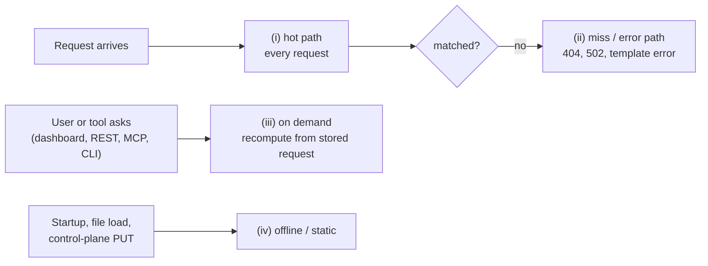

# Usability and Diagnostics Plan

## Outcome

A user should be able to ask "why did this request, forward, verification, template or spec
fail, and what do I change?" and get the answer in one step from the dashboard, REST, an MCP
tool or the CLI, without restarting at DEBUG. The per-request hot path must not get more
expensive; the first item makes it cheaper. Explanations are **recomputed on demand** from the
stored request plus the current expectations, not recorded on every request. Nothing is sent to
an external LLM unless the user configures one, and MockServer stays self-hosted.

## Where each idea's cost lands

| Category | When it runs | Rule for this plan |
|---|---|---|
| (i) hot path | every request | nothing new here; changes must be allocation-neutral or better |
| (ii) miss / error | only on a 404, forward failure, template error | bounded work, no blocking I/O, never an LLM call |
| (iii) on demand | only when a user or tool asks | preferred; hard evaluation budgets, report truncation |
| (iv) offline / static | startup, spec load, expectation PUT, CLI | preferred; advisory, never rejecting |

## What already exists (do not rebuild)

- **Match diagnostics:** `detailedMatchFailures` (default true) builds a `MatchDifference` per
  non-matching candidate; `PUT /mockserver/debugMismatch` (per-expectation diffs for one
  request); `PUT /mockserver/explainUnmatched` re-runs recent unmatched requests against the
  current matchers, ranks the closest expectations and adds remediation hints, within a budget
  (50 expectations, 500 evaluations) — already category (iii).
- **Suggested fixes (B3):** `PUT /mockserver/explainUnmatched` with `"suggestFixes": true` adds,
  to each of the five closest non-matching expectations, a guarded RFC 6902 patch of its
  `httpRequest`, the fields it could not patch and `matchesAfterPatch`; the dashboard's Explain
  Unmatched view previews it (Preview Fix) and applies it only on Apply Fix, through
  `PUT /mockserver/expectation`.
- **Explain one request (A3):** `PUT /mockserver/explain?correlationId=` re-checks a recorded
  request against the current expectations in serving order; names the winner, a reason for each
  expectation ahead of it, the ones it shadows, the outcome at arrival and `expectationsChangedSince`.
  Also reachable from a dashboard log group's **Explain** button and a typed `explain` in every
  client (Java in A3a; Node, Python, Ruby, Go, Rust, .NET and PHP in A3b, which also gave them typed
  `debugMismatch` and `explainUnmatched`); the 200 schema is complete, and a guard test ties the
  explainer's gate order to the serving loop.
- **MCP diagnosis tools (B1):** `explain_request` (A3's explainer by correlation id, redacted as the
  event log is) and `diagnose_config` (the effective configuration with each value's source, credentials
  masked; the non-default properties, or any property by name with a default shown by its value; plus each
  unrecognised key by name with its suggestions, using core's normaliser and "did you mean").
  Then (B1c) `explain_forward_failure` (A4's 502 reasons, read back from the event log's failed-forward
  entries, by correlation id or the most recent; redacted, reason capped at 2,048 characters),
  `suggest_expectation_fix` (B3's guarded patches, only the expectations that carry one),
  `lint_expectations` (A8, at most `maxIssues`, errors first) and `test_template` (A5's dry run; a
  MUTATE tool, because it runs the template it is sent, as its REST route does).
- **404 hints:** `findClosestMatchHint` feeds the `x-mockserver-closest-match(-hint)` headers
  (`closestMatchHintEnabled`, default true), the optional mismatch diagnostic body, and a DEBUG
  log. It checks at most 1,000 expectations and memoises per (method, path) until the store
  changes (A2). The INFO closest-match walk on the serving path shares the 1,000 cap but not the
  memo, and its line says when expectations were left unchecked (A2b). A used-up or expired expectation still in the store is never named closest, here,
  in the INFO closest-match line, in `explainUnmatched` or in `debugMismatch` (A2c).
- **Active expectations listing:** with no filter (empty body or `{}`) it lists every active
  expectation, including `not(...)` ones (A3c).
- **Clear with no filter:** an empty body, `{}` or a client's `clear(request())` clears every
  expectation, including `not(...)`, DNS and binary ones, and with `type=log` or `all` every log
  entry that carries a request, DNS and binary ones included (A3d).
- **Verification:** failures include the closest-request diff (`detailedVerificationFailures`,
  default true), and a failed request-count verification ends with a `verification summary:`
  block: expected vs matched count, the three closest non-matching requests with every differing
  field, and how many requests arrived after the verification started (A9). Response and sequence
  failures get the same block: response counts and near misses, the sequence step that failed with
  its near misses and out-of-order matches, and requests matching with the other disposition (A9b).
- **Other failures:** forward failures return a 502 with the raw error; OpenAPI load returns the
  parser messages grouped by kind with JSON-pointer locations; the problems of a spec that still
  loads are logged, counted in the `PUT /mockserver/openapi` 201 header, returned with
  `?includeLoadProblems=true` and by the `create_expectation_from_openapi` MCP tool, and listed by
  the dashboard's OpenAPI import (A6b); unknown `mockserver.*` / `MOCKSERVER_*` keys log a WARN at startup.
- **Dashboard:** Explain Unmatched, Debug Mismatch, Matcher Playground, create-expectation-from-
  unmatched, Verification, Drift, Diff Requests and Baseline Compare views, plus log-pressure and
  dropped-event banners.
- **MCP:** a large tool set, including `explain_unmatched_requests`, `debug_request_mismatch`,
  `retrieve_logs`, `verify_*` and `create_expectation(s_from_recorded_traffic)`; prompts
  `debug_unmatched_request`, `why_did_verify_fail`, `fix_my_expectation` and `why_forward_failed`
  (each chains existing tools and asks for "Facts from MockServer" apart from "Interpretation"),
  and `create_mock_from_description` (natural-language → expectation, with the user's own assistant
  doing the reasoning). `create_expectation` rejects unknown parameters with `unknownParameters` and
  `suggestions`; `raw_expectation` returns schema `validationErrors` by JSON path.
- **Bring-your-own LLM:** `PUT /generateExpectation` (`llmProvider` / `llmBaseUrl` / `llmModel`)
  with a template fallback when no backend is configured; `SemanticDriftExtension` optionally uses
  an LLM for drift.
- **Consumer docs:** `debugging_issues.html`, `troubleshooting_matching.html`, `DEBUGGING.md`.

- **Template dry run (A5):** `PUT /mockserver/template/test` renders a template against a sample
  request with the serving engines and limits, and reports the result, the failure with its template
  line and column and a hint, and warnings for unresolved Velocity references and `scenario.set`. A
  failing JavaScript template's log message now gives the template line and column too. The
  dashboard's Mocks view runs it from a Test Template button in the response and forward template
  steps (A5b).
- **Template time limits and failure answer (A5c, A5d):** JavaScript templates stop after
  `javascriptTemplateExecutionTimeout`, and Velocity templates after `velocityTemplateExecutionTimeout`
  at the next loop iteration, macro call, `#parse`, `#evaluate` or `#define` block render (both default
  5000 ms; a single long Java call is not interrupted); a failed template answers 404, or with
  `templateFailureAsServerError` a 500 with an `x-mockserver-template-error` header and the engine's
  error as the body.
- **Expectation lint (A8):** `PUT /mockserver/lint` lints the active expectations, or a body of
  expectations without storing them, and `mockserver lint <file>...` lints files offline: shadowed
  expectations, `times` / time to live / percentage of 0, unreachable sequential responses, five path
  mistakes, method and header-name typos, and STRICT JSON arrays (info). `PUT /mockserver/expectation`
  runs the per-expectation rules and reports them in `x-mockserver-lint-warnings` and a WARN log; the
  O(n²) shadowing check runs on demand and once per initialisation-file load, capped at 100,000 pairs and a regex step budget (a regex that overflows the stack counts as not covering). Each JSON initialisation file load (start-up and `--watch` reloads) runs the per-expectation rules and the shadowing check over that file and logs one capped WARN naming it, not repeated while the problems are unchanged (A8c).
  The dashboard's Active Expectations panel has a Lint button (`LintDialog`: severity, rule,
  message, a Shadowed by link, ids that open in the composer), and the composer and the
  Expectation JSON import show a Lint Warnings badge from `x-mockserver-lint-warnings` (A8b).
- **Forward-failure causes:** a failed forward's 502 names a TLS failure, an HTTP/2 error, a
  client-side set-up failure or an undecodable upstream response (`upstreamFailureReason`,
  `7a8b8c424`, extended to binary and wss in `d089350d4`), and a connection that could not be made
  or was lost (unresolvable host, refused, connect timeout, no route, local ports or files running
  out, unreachable upstream proxy, a pooled connection closed under a non-idempotent request), each
  with what to change, plus a loop hint for a failed forward back to MockServer itself
  (`UpstreamConnectFailure`).
- **Forward loop detection (A12, A12b):** every forward action (a WebSocket upgrade a forward relays
  included) and `proxyPassMappings` entry adds this instance's id to `x-mockserver-forwarded-by`; a request
  already carrying it `forwardLoopMaxHops` times (default 10, 0 turns it off) is answered `508 Loop Detected`
  naming the cause and the fix (`ForwardLoopGuard`).
- **Dashboard → `/generateExpectation`:** yes, the Generate Stub dialog calls it
  (`mockserver-ui/src/lib/generateStub.ts`).
- **Configuration (was A7):** the startup WARN for an unknown `mockserver.*` / `MOCKSERVER_*` key
  names the key it was most likely meant to be ("did you mean"); the effective configuration
  (`--print-config`, `GET /mockserver/config` with `?nonDefault=true`, dashboard Server Info tab)
  shows each value and its source, a property at its default with the default's value (A11, read
  from the property's getter), credentials redacted, and lists the unrecognised keys by name with
  their suggestions.

**Gaps:** a Velocity time limit that cannot stop a single long Java call or cap memory (A5h).

## Items

| # | Problem → proposal | Cost | Performance reasoning | Effort | Risks | Priority |
|---|---|---|---|---|---|---|
| A8e | The `x-mockserver-lint-warnings` badge (A8b) shows only after a composer register or an Expectation JSON import; Generate Stub (`lib/generateStub.ts`), Capture as Mock (`CaptureAsMockDialog`) and Apply Fix (`lib/expectationFix.ts`) also PUT `/mockserver/expectation` but ignore the header → read `lintWarningCount(res)` in each path and render `LintWarningsBadge` where it reports success | (iii) | UI only; reads a header the PUT already returns | S | None | P3 |
| A8g | The on-load lint (`ExpectationLinter.adviseOnLoad`, A8c) receives every valid entry of the file, including later entries whose id repeats, which `RequestMatchers.update` drops, so the WARN can report an ignored entry as shadowed or as shadowing another → in `adviseOnLoad`, run `removeReplacedDuplicates(report, subjects, Collections.nCopies(loaded.length, 0))` before sorting, so it reports DUPLICATE_ID and lints only what is loaded; add a loader test with a repeated id | (iv) | Once per file load; one pass over the ids | S | Create the `Report` before the dedup; generated ids are already null in `Subject.reportedId`, so they are never treated as duplicates | P3 |
| A8h | A file load keeps the FIRST entry for a repeated id (`RequestMatchers.update`) while `PUT /mockserver/expectation` keeps the LAST, and the initialisation page claimed "last" until A8f → owner decision: keep the difference (lint and docs now describe it) or make a file load keep the last entry like an upsert | (iv) | Load path only | S | BREAKING for users whose files repeat an id: the response served changes; needs a changelog `BREAKING:` entry and a major version | P3 |
| B5 | Optional plain-language summary of explain results from a configured LLM (`?narrate=true`) | (iii) | On demand, asynchronous, timeout-bounded, never inline in a 404 | S | Off by default; label as AI-generated; always return the deterministic facts too | P3 |
| A5e | Two template failures are outside `templateFailureAsServerError`: output that is not a valid response is not a thrown failure, so it still answers 404 (a response template) or 502 (a forward template); and a forward-with-override `responseTemplate` renders in the upstream response callback, not in the action handler → under that flag, answer both as template failures, with the validation errors in the body for the first | (ii) | Failure path only | S | Same opt-in; keep the TEMPLATE_GENERATION_FAILED log entry | P2 |
| A5f | Owner decided 2026-10-14: keep `templateFailureAsServerError` opt-in now (a 404 to 500 change is BREAKING for clients and tests that expect the 404) and make the 500 the default in the next major release, 9.0.0 → in 9.0.0 flip the default to true and add a `BREAKING:` changelog bullet (optionally announced first by a start-up warning, as `UpcomingDefaultChanges` does for other defaults) | (ii) | Failure path only | S | Clients asserting the 404 | P2, next major (9.0.0) |
| A5g | With A5 and A5c/A5d both landed, the dry run still says Velocity "cannot be cancelled" and waits timeout plus a 5 s grace, and A5's `TemplateEvaluationException` (line, column, hint) is not used in the 500 body → let the dry run rely on `velocityTemplateExecutionTimeout` for Velocity (and drop the now-stale "Velocity and Mustache cannot be cancelled" wording in `TemplateDryRun` javadoc, both OpenAPI spec copies and the regenerated Postman/Bruno descriptions), and build the 500 body from the line, column and hint when the engine supplies them | (iii) / (ii) | On demand and failure path only | S | Keep the dry-run grace for Mustache, which still cannot be stopped | P2 |
| A5h | A single long Java call made by a Velocity template is not interrupted by `velocityTemplateExecutionTimeout`: a backtracking regex such as `$s.matches('(.*a){25}')` on a 48-character string ran past 15 s with a 500 ms limit, and `$r.contains(-1)` on `[1..2147483647]` took about 3 s against a 500 ms limit, because the deadline is only checked between loop iterations, macro calls, `#parse`, `#evaluate` and `#define` block renders; the limit also does not cap memory (`$l.addAll([1..2147483647])` ran out of heap in a 1 GB JVM) → wrap the String regex methods (`matches`, `replaceAll`, `replaceFirst`, `split`) through the uberspector so the pattern runs over a CharSequence whose `charAt` checks the render deadline, which stops the matcher part-way | (ii) | One counter check per `charAt` on the regex path only | M | Must keep `SecureUberspector` in the chain; other slow calls (huge `repeat`, deep JSON) stay unbounded | P2 |
| A5i | A `#define` block reached through a method call (`$a20.toString()`) does stop at the Velocity time limit, but Velocity wraps the timeout in a `MethodInvocationException`. So the engine reports it as a generic "Exception: ... transforming template" failure, not the timeout WARN, though the message still names the timeout → in `VelocityTemplateEngine`, find a `VelocityTemplateTimeoutException` in the cause chain and log and rethrow it as the timeout | (ii) | Failure path only | S | None | P3 |
| A5j | A Mustache variable that does not resolve renders as empty text with no warning (`MustacheTemplateEngine` compiles with `defaultValue("")`), so a typo such as `{{request.pth}}` passes the dry run silently, while Velocity references already warn → in the dry run only, a second JMustache pass compiled without `defaultValue("")`, whose missing-name failure becomes a warning with its line (it stops at the first missing name); the dashboard's Test Template dialog already shows warnings | (iii) | Dry run only, one extra render; serving keeps the lenient compiler | S | A template that relies on missing values rendering empty must only warn, never fail the dry run | P3 |
| B1d | MCP prompts still chain the older tools: `why_forward_failed` walks `retrieve_request_responses`, `retrieve_logs` and `list_expectations`, and `fix_my_expectation` has the assistant derive the change itself from `debug_request_mismatch` → start `why_forward_failed` with `explain_forward_failure` (keeping `list_expectations` for the target), have `fix_my_expectation` try `suggest_expectation_fix` before a hand-made change, and update `McpDiagnosisPromptChainTest` and the prompt docs | (iii) | On demand; prompt text only | S | Keep the "Facts from MockServer" split; a prompt must still work when no fix is suggested or no failure is recorded | P2 |
| A2d | At INFO an unmatched request writes one `EXPECTATION_NOT_MATCHED` entry (a rendered message and an expectation clone) per compared expectation, so a 404 flood still costs about 3.3 ms per miss with 1,000 expectations (4.4 ms with `detailedMatchFailures`; 0.08 us at WARN, `MatchingBenchmark` `EXACT`); A2b's cap applies only above 1,000 → decide between a lower cap for the logged entries only (closest match kept exact) and one summary entry per miss (counts plus the closest few) above some size, behind a flag | (ii) | Removes per-expectation rendering and cloning from the INFO miss path | S | Changes what the dashboard log and `troubleshooting_matching.html` show; both rely on one entry per compared expectation | P3 |
| A3e | The `debugMismatch` and `explainUnmatched` 200 responses are `type: object` in the OpenAPI spec, so all seven clients that wrap them model their envelopes (results, closest match, unmatched requests, `suggestedFix`) by hand from `HttpState`'s output, and the schema-drift tests in the Node, Python and Ruby clients cannot cover them → add response schemas (both spec copies) that reuse `ExplainedExpectation`, then extend those drift tests | (iv) | Spec only; no runtime change | S | The schemas must match `HttpState`'s output exactly; check against a live response | P3 |
| B3c | `MockServerEventLog.retrieveUnmatchedRequests` returns every `NO_MATCH_RESPONSE` entry, and a failed forward's 502 is logged as one, so `explainUnmatched` (and `suggest_expectation_fix` and the dashboard's Explain Unmatched through it) can treat a request that matched a forward expectation whose upstream failed as unmatched and suggest patching another expectation to catch it → exclude entries with `FORWARD_FAILURE_MESSAGE_FORMAT` (as `retrieveForwardFailures` selects them), or mark them and point at `explain_forward_failure` instead | (iii) | On demand; one more predicate on the existing scan | S | The `limit` then counts only true misses; check `ExplainUnmatchedIntegrationTest` and the dashboard view still show what users expect | P2 |
| A3g | The Java client's `clear(dnsRequest(...))` and `clear(binaryRequest(...))` send an EMPTY body, because `RequestDefinitionSerializer.serialize` returns "" for a DNS or binary definition; the server reads an empty clear body as "clear everything", so clearing one DNS mock wipes every expectation and the whole log → serialise DNS and binary definitions (the server already parses `{"dnsName":...}`), or have the client refuse a definition it cannot serialise; add a client-to-server test that clears one DNS expectation and keeps the rest; check `retrieve...(dnsRequest(...))` and the other clients, which were not checked | (iv) | Control plane only | S | Users who got "clear all" from it would now keep data: changelog Fixed entry | P2 |
| A3f | An unfiltered log read builds an empty HTTP request matcher (`MockServerEventLog.retrieveLogEntries` with a null filter), and a DNS or binary request fails it, so `retrieveMessageLogEntries(null)` leaves out an `EXPECTATION_MATCHED` entry for a DNS query (seen while writing `HttpStateClearUnfilteredTest`) → confirm which endpoints and dashboard views lose DNS and binary log entries with no filter, then treat a null or empty filter as "all" there as A3c and A3d did, keeping the request-less-entry rule | (iv) | Read path only; skips a matcher when unfiltered | S | Retrieval output grows by entries that were hidden | P3 |

## Approach to LLM features

1. **MCP first.** MockServer exposes deterministic tools; the user's own assistant reasons over
   them. No runtime cost, no new dependency, the model stays the user's choice.
2. **Deterministic explanations are the base** (A3, A8, B3): reproducible, testable, offline,
   and consumed by both MCP and a bring-your-own LLM.
3. **Bring-your-own LLM stays optional and off by default** (B5), reusing the existing `llm*`
   configuration and no bundled SDK; redaction fails closed.
4. **No hosted LLM, no bundled model, no SaaS.**

## Sequence

1. **Wave 0 — hygiene and performance:** A2d. (A2, A2b, A2c, C1 and C1b landed.)
2. **Wave 1 — explain engine:** done (A3, A10 and B1 landed).
3. **Wave 2 — failure classes:** A5e, A5g, A5h and A5i, each with an MCP tool and a dashboard entry where it applies. (A4, A6 and A6b landed; B1c added the MCP tools for A4, A5, A8 and B3; A5 landed, with its dashboard entry in A5b; A5c and A5d landed; A5f waits for the 9.0.0 major release.)
4. **Wave 3 — fixes:** A8e, A8g; A8h waits for an owner decision. (B2, B3, A9b, A8, including the CLI, A8b, initialisation-file lint (A8c), the authorisation page (A8d) and per-source `DUPLICATE_ID` (A8f) landed.)
5. **Wave 4 — optional:** B5. (B6, B7, A11, A11b and B1b landed.)

## Performance rules for every item

- Nothing new in category (i). Any change touching the hot path is checked with
  `MatchingBenchmark` on both `detailedMatchFailures` arms.
- Prefer recomputing on demand to recording per request; the answer states it was recomputed and
  whether expectations changed since the request arrived.
- Miss-path work is bounded (capped candidates, memoised where safe), never blocks, and never
  calls an LLM.
- Diagnostics never run on the event-log consumer thread, and on-demand re-evaluation must not
  emit match events of its own (the lesson from the dashboard not-matched flood).
- Explain APIs have hard evaluation budgets and report truncation.
- LLM calls happen only on explicit request, asynchronously, timeout-bounded and redacted.
