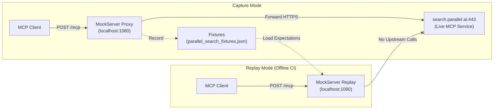

# Parallel Search MCP Capture and Replay Example

This example demonstrates how to integrate an MCP (Model Context Protocol) client with the **Parallel Search MCP** service (`https://search.parallel.ai/mcp`) over Streamable HTTP, capture real upstream interactions through MockServer's forward proxy, and replay the recorded interactions locally for fast, deterministic, offline testing.

## Overview

[Parallel Search MCP](https://docs.parallel.ai/integrations/mcp/search-mcp) enables AI agents and applications to perform real-time web searches and extract full-page or excerpted markdown content via two primary tools:
- `web_search`: General-purpose web search optimized for agent reasoning loops.
- `web_fetch`: Extracts token-efficient markdown and excerpts from target URLs.

When testing agent workflows that rely on web search, issuing live requests to external services in continuous integration (CI) causes test flakiness, rate limiting, and external credential dependencies. MockServer solves this by providing:
1. **Live Capture**: MockServer acts as a forward proxy in front of `https://search.parallel.ai/mcp`, capturing the exact JSON-RPC requests and responses.
2. **Deterministic Replay**: MockServer loads recorded fixtures and simulates the MCP server locally with dynamic JSON-RPC ID echoing (`$!{request.jsonRpcRawId}`), running entirely offline without requiring network access or API credentials.



---

## Prerequisites

- **Python 3.9+**
- **MockServer** running on `localhost:1080` (for live capture and replay). Start one quickly using Docker:
  ```bash
  docker run -d --rm -p 1080:1080 mockserver/mockserver
  ```
- *(Optional)* A Parallel API key if you wish to run authenticated live capture with higher rate limits. (The free tier does not require an API key).

---

## Installation

1. Create and activate a Python virtual environment:
   ```bash
   python3 -m venv .venv
   source .venv/bin/activate
   ```

2. Install the MockServer client and example dependencies:
   ```bash
   pip install -r requirements.txt
   pip install -e ../../../mockserver-client-python
   ```

---

## Usage

The runnable script `parallel_search_mcp.py` supports three modes: `replay` (default), `capture`, and `live`.

### 1. Offline Replay (Recommended for Tests & CI)

Runs completely offline against MockServer, serving recorded fixtures. Does not contact `search.parallel.ai` and requires no credentials:

```bash
python parallel_search_mcp.py --mode=replay
```

**Expected output:**
```
[Replay] Connecting to MockServer on localhost:1080...
[Replay] Loading fixture from .../fixtures/parallel_search_fixtures.json...
[Replay] Registered 6 MockServer expectations.
[Replay] Connecting to MCP endpoint via Streamable HTTP...
[Replay] Handshake successful: Server 'Parallel Web Search MCP Server' v1.27.0
[Replay] Discovering available tools...
[Replay] Found 2 tools: ['web_search', 'web_fetch']

[Replay] Executing web_search...
[Replay] Search returned 4 results:
  1. MockServer - HTTP, HTTPS, and SOCKS mock server and proxy
     URL: https://www.mock-server.com
     Snippet: MockServer enables easy mocking of any system you integrate with via HTTP or HTTPS...

[Replay] Executing web_fetch for 'https://www.mock-server.com'...
[Replay] Page fetch returned 1 results:
  URL: https://www.mock-server.com
  Title: MockServer - HTTP, HTTPS, and SOCKS mock server and proxy
  Excerpts count: 6

[Replay] Offline replay completed successfully! No upstream calls made.
```

### 2. Live Capture (Record Upstream Traffic)

Proxies requests through MockServer to `https://search.parallel.ai/mcp`, recording the live traffic into a sanitized JSON fixture:

```bash
# Optional: export PARALLEL_API_KEY for higher rate limits
export PARALLEL_API_KEY="your-api-key"

python parallel_search_mcp.py --mode=capture --fixture=fixtures/parallel_search_fixtures.json
```

**Expected output:**
```
[Capture] Setting up MockServer proxy on localhost:1080 -> search.parallel.ai:443...
[Capture] Forward proxy rule registered.
[Capture] Executing live interactions through MockServer proxy...
[Capture] Saving captured session to .../fixtures/parallel_search_fixtures.json...
[Capture] Fixture successfully recorded with 2 tools.
```

### 3. Direct Live Mode (No Proxy)

Connects directly to the live Parallel Search MCP service for exploratory or ad-hoc usage:

```bash
python parallel_search_mcp.py --mode=live
```

---

## Configuration & Environment Variables

| Variable | Default | Description |
|---|---|---|
| `MOCKSERVER_HOST` | `localhost` | Host where MockServer is running |
| `MOCKSERVER_PORT` | `1080` | Port where MockServer is running |
| `PARALLEL_MCP_URL` | `https://search.parallel.ai/mcp` | Upstream Parallel Search MCP endpoint URL |
| `PARALLEL_API_KEY` | *(None)* | Optional Bearer token for authenticated upstream calls |
| `PARALLEL_SESSION_ID` | Auto-generated UUID | Session identifier for free-tier rate-limit tracking |
| `PARALLEL_MODEL_NAME` | `mockserver-mcp-client/1.0` | Client identifier sent for telemetry |
| `PARALLEL_TIMEOUT_SECONDS` | `30.0` | Network request timeout in seconds |

---

## Dynamic ID Echoing Mechanism

In the MCP specification, every JSON-RPC request carries a dynamic `id` (e.g. `{"id": 1}`). If a mock server matched on exact static request payloads, replaying with a different ID would fail.

MockServer handles dynamic JSON-RPC IDs cleanly using built-in mechanisms:
1. **JsonPathBody & JsonRpcBody matchers**: Expectations match on `method` (e.g. `initialize`, `tools/list`) and `params.name` (e.g. `web_search`), ignoring the dynamic `id` and `session_id`.
2. **Velocity Template Action**: Responses use an `HttpTemplate` with `$!{request.jsonRpcRawId}`:
   ```json
   {
     "statusCode": 200,
     "headers": [{"name": "Content-Type", "values": ["application/json"]}],
     "body": {
       "jsonrpc": "2.0",
       "result": { ... },
       "id": $!{request.jsonRpcRawId}
     }
   }
   ```
   This echoes back whatever ID the client submitted, ensuring RFC-compliant JSON-RPC 2.0 communication.

---

## Running Automated Tests

Run the full automated test suite verifying search replay, fetch replay, credentials isolation, network isolation, and error handling:

```bash
pytest tests/ -v
```

All tests run fully offline without contacting external networks.

---

## Troubleshooting

### Connection Refused (`[Error] ConnectionRefusedError`)
Ensure MockServer is running on `localhost:1080`:
```bash
docker run -d --rm -p 1080:1080 mockserver/mockserver
```

### Missing or Corrupt Fixture (`FixtureNotFoundError` / `FixtureValidationError`)
Ensure `fixtures/parallel_search_fixtures.json` exists and contains valid JSON with `initialize`, `tools`, `web_search`, and `web_fetch` interactions. Regenerate the fixture using `--mode=capture`.

### Live Service Rate Limiting (HTTP 429)
The anonymous free tier on `https://search.parallel.ai/mcp` enforces rate limits per IP and session ID. When capturing live traffic, generate a fresh `session_id` or set `PARALLEL_API_KEY` to unlock higher rate limits. Replay mode is completely unaffected by rate limits.
